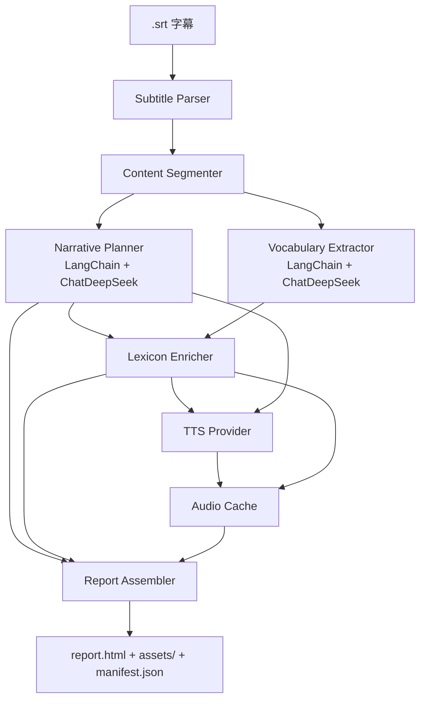
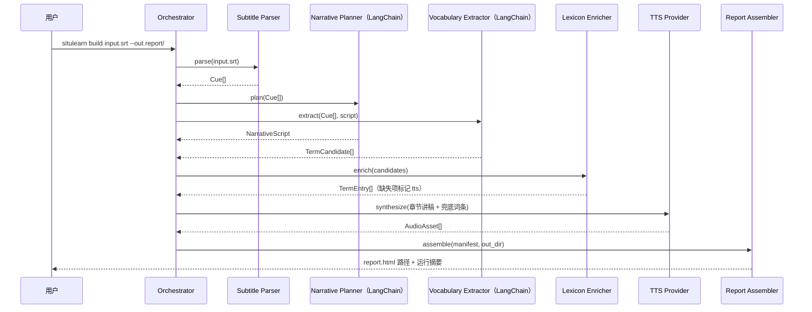

# 情景学习 字幕脉络与生词语音化 技术方案

| 字段 | 内容 |
| --- | --- |
| 标题 | 情景学习 字幕脉络与生词语音化 技术方案 |
| 主笔 | alang |
| 评审人 | 独立评审（doc-writer quality reviewer） |
| 创建日期 | 2026-11-02 |
| 目标版本 | v0.1 |
| 关联资源 | [总体架构](../../architecture/system.md)；本地字幕样本《文艺复兴的解放》 |

## 1. 背景与上下文

### 1.1 系统现状

当前没有已实现的代码模块，也没有运行中的服务。看纪录片学英语的流程完全人工，按下面的路径走：

1. 用户自行准备单语英文 `.srt` 字幕文件，播放器加载字幕后开始观看。
2. 观影时遇到不认识的专业词，暂停查词会打断节奏，于是多数情况下直接靠上下文猜。
3. 一部片子看完，除零星印象外不留下词表；想回看某个术语，只能重新拖动进度条或在字幕里搜索。
4. 想了解片中艺术家、流派、作品的背景，需要另开浏览器逐个搜索，搜索结果与片中的论证顺序脱节。

技术栈现状为零：没有字幕解析、没有词典查询、没有语音生成、没有学习材料渲染。本方案是新建能力，不改造任何现有模块。

### 1.2 核心技术痛点

失败链有四个断点，按发生顺序排列：

1. **当场放弃，理解断裂**：听到生词 → 想查 → 暂停打断观影节奏 → 决定不查 → 靠上下文猜 → 术语所在的那段论证接不上 → 整部片子只理解到「大概」。
2. **事后整理成本太高**：看完想整理 → 记不住哪些词出现过 → 回看字幕逐句找 → 成本高于收益 → 放弃 → 没有任何沉淀。
3. **查了也不等于学会**：查词 → 只拿到孤立释义 → 不知道它在这个领域里为什么这么用 → 下次遇到同一个词仍然不认识。
4. **字幕依赖加深**：长期依赖中文字幕 → 英文声音与文字对不上 → 听力与词汇都不积累 → 越看越需要字幕。

证据（引述）：用户描述触发场景时说：「我最近在看一部纪录片叫做文艺复兴的解放，这中间有很多专业的词汇我都不认识，包括很多的艺术家，他的背景我也想要了解」。用户进一步给出的具体词例是 `Renaissance`（文艺复兴，领域术语）、`cherub`（小天使，艺术史专名）与 `wheedled`（哄骗，低频普通动词）。三个词分别落在领域术语、专名与低频普通词三类，说明选词不能只收专业术语，还需要覆盖「字面认识、放在片子里却不理解」的普通词。这条证据直接对应前三个断点：术语不认识导致当场理解断裂；艺术家背景需要额外搜索，对应事后整理成本；只查孤立释义无法建立领域脉络。证据的可核实形式是纪录片片名、用户自述与上述三个具体词例。实际字幕样本已验证：1,186 条 cue、59.7 分钟、UTF-8 不带 BOM、62 条多行 cue、没有 HTML 标签与说话人标记；大量 cue 在句子中间切断（首条以 `in` 结尾，下一条以 `Florence` 开头），因此解析后必须先做句子级合并。

### 1.3 重构/设计动机

三个触发点在同一时间成立，所以现在做：

1. **使用触发**：最近观看《文艺复兴的解放》时被一串艺术家名与艺术史术语卡住，痛点从「可能存在」变成「刚刚发生」。
2. **素材触发**：`.srt` 字幕文件容易获得，输入不再是门槛。本次已明确输入源为 srt，不靠视频本身。
3. **能力触发**：长上下文模型可以一次读完 45–60 分钟纪录片的完整字幕并保持叙事结构；结构化输出让「脉络 + 词表」可以稳定落成数据；云端 TTS 让口语化讲稿可以直接变成音频。

目标是把「看片时的模糊理解」转成一份可反复翻看、可边走边听的学习报告：先听脉络怎么走，再对着生词本看。听和看两条通道都用上。

### 1.4 非目标

不做这件事的后果已经在 1.2 写明：理解停在「大概」、反复查反复忘、能力无法积累。本次明确不做：

- 视频下载、转码与字幕提取（本次不做；输入只接受现成 `.srt`）。
- `.vtt` 等其他字幕格式与多集合并（Deferred to Phase 2）。
- 逐句双语对照阅读器（本次不做）。
- 跨报告累积生词库、间隔重复与学习进度（Deferred to Phase 2）。
- 多用户账号、云端同步与分享链接（本次不做）。
- 报告公开分发与对外分享（本次不做；当前边界为个人学习使用，页脚署名仍保留）。
- 移动端 App（Deferred to Phase 2）。
- LangGraph、LangServe 与自建 agent 循环（本次不做；只使用 LangChain 核心 Chain/Runnable 与 `langchain-deepseek`）；LangSmith 只作为本地调试的可选开关，不作为运行依赖。

## 2. 目标与非目标

### 2.1 目标

- **G1 - 端到端可运行（工程）**：输入一份 45–60 分钟英文纪录片 `.srt`（约 500–900 条 cue），一条命令生成离线可打开的 HTML 报告。验收：用《文艺复兴的解放》真实字幕跑通，`report.html` 双击可打开；断网后脉络文字、词表与已下载音频仍可使用。
- **G2 - 脉络可播报（质量）**：报告包含「是什么 / 背景 / 按什么顺序展开」的叙事线，拆成 4–8 个章节，每章有全中文口语播报稿（英文术语用通行中文译名或简短解释，不夹带英文原词）与音频；全文朗读时长落在 6–15 分钟。验收：独立评审按 5 项检查打分（开场定位、背景交代、推进顺序、口语化程度、章节收束），至少 4 项通过；音频总时长实测落在区间内。
- **G3 - 术语覆盖（质量）**：从字幕抽取 30–80 个词条，按理解价值排序；专业术语与专名优先，但不排除像 `wheedled` 这样「字面认识、语境里不理解」的低频普通词。词条必填字段完整率 100%（词、音标或明确的缺失原因、中英释义、上下文原句、分类）。验收：随机抽 20 条由人工判定，≥ 80% 属于「不理解就会断论证」的关键词；必填字段完整率 100%。
- **G4 - 语音可用（可靠性）**：每个脉络章节都有音频；≥ 95% 的词条有真人音频（Oxford Learner's Dictionaries / Youdao Dictionary），其余词条明确标注 TTS；全部音频在断网状态可播放。验收：统计 `manifest.json` 中 `audio_source=dictionary` 的词条占比 ≥95%；每个 TTS 词条有可见的发音说明；音频清单与 HTML 引用一一对应；断网手测播放。
- **G5 - 可重复与成本（可靠性）**：同一份输入与配置重跑，付费 LLM 与 TTS 调用次数为 0，报告重建时间小于 5 秒。验收：二次运行日志中 `llm_calls=0`、`tts_calls=0`，并对重建阶段计时。

目标与后续章节的对应关系：

| Goal | 主要落点 |
| --- | --- |
| G1 | 3.1 总体架构；4.4 CLI 契约；6.3 冒烟清单 |
| G2 | 3.2 Narrative Planner；4.3 NarrativeScript；4.5 时序 |
| G3 | 3.2 Vocabulary Extractor；4.3 TermEntry；4.4 抽词契约 |
| G4 | 3.2 TTS Provider；4.4 语音接口；5.2 降级策略 |
| G5 | 4.1 阶段缓存；5.2 幂等性；6.3 重跑冒烟 |

### 2.2 非目标

- **NG1 - 视频处理**：不做视频下载、转码、硬字幕识别（本次不做）。对应 1.2 的「事后整理成本太高」：先用现成字幕切断素材成本，不在视频侧扩范围。
- **NG2 - 其他字幕格式**：不支持 `.vtt`、`.ass` 与多集合并（Deferred to Phase 2）。对应 1.3 的「素材触发」：首版只锁定已被验证的 srt 输入。
- **NG3 - 逐句双语阅读器**：不做逐句对照、划词翻译与播放器联动（本次不做）。对应 G1 的端到端目标：先保证整份报告可生成，不把范围扩成阅读器。
- **NG4 - 跨报告生词库**：不做累积词库、间隔重复与掌握度追踪（Deferred to Phase 2）。对应 1.2 的「反复查、反复忘」：单份报告先解决「当场学一遍」，跨片累积留到下一阶段。
- **NG5 - 多用户与云同步**：不做账号体系、云端存储与分享链接（本次不做）。对应用户定位「我和同类学习者」：v0.1 以本地文件交付，避免引入服务端。
- **NG6 - 移动端 App**：不做原生移动端（Deferred to Phase 2）。对应「边走边听」：首版用离线 HTML 加系统播放器满足，不额外开发客户端。

## 3. 架构设计与核心方案

### 3.1 总体架构

> 核心原则：字幕只解析一次；LLM 只负责「理解与挑选」；词典与 TTS 只负责「补齐可听可读的材料」；渲染阶段不发起网络请求。

### 3.2 核心模块职责

- **Subtitle Parser**：把 `.srt` 转成结构化 cue，负责编码、时间码与文本清洗，是唯一接触原始字幕格式的模块。
- **Content Segmenter**：按时间间隔和标点把 cue 合并为完整句子，再按段落边界切成语义段。真实 srt 存在大量半句 cue（如 `in` 与 `Florence` 分属相邻两条），不能把单条 cue 当作一个句子。
- **LangChain 编排层**：整条构建管线以 LCEL `Runnable` 为骨架；两个 LLM 阶段由 `ChatDeepSeek` 驱动，字幕解析、词典、TTS 与渲染封装为自定义 `Runnable`。编排层负责并行、重试与 callback，不替代各阶段的领域实现。
- **Narrative Planner**：一次读完整份字幕，产出主题定位、背景、4–8 个推进章节与口语化播报稿，不写书面摘要体；以 LangChain Chain 实现，模型经 `ChatDeepSeek` 调用。
- **Vocabulary Extractor**：从字幕中挑选专业术语与专名，保留出现位置、原句与「为什么它是理解卡点」，并给出分类与置信度；同样以 LangChain Chain 实现。
- **Lexicon Enricher**：查询词典补齐音标、英英释义与真人发音；中文释义结合领域语境生成；词典缺失时标记 TTS 兜底。
- **TTS Provider**：可替换的语音合成接口，按章节和词条生成音频；实现层不进入报告渲染。
- **Audio Cache**：以文本、音色、语速与供应商的哈希为键缓存音频，保证重跑不重复付费。
- **Report Assembler**：把 manifest 渲染成离线 HTML，绑定章节播放、词条发音、上下文原句、章节筛选与全局播放器；播放器显示进度条、当前/总时长与剩余时间。
- **CLI Orchestrator**：解析参数、编排阶段、汇总错误与运行日志，是唯一对用户暴露的入口；LLM 阶段通过 LangChain 编排层执行。

### 3.3 核心数据流转

1. 用户执行 `situlearn build <input.srt> --out <dir>`，Orchestrator 计算输入文件与配置的摘要，检查阶段缓存，然后调用 LangChain 管线。
2. Subtitle Parser 解析 cue；Content Segmenter 生成语义段。
3. LangChain 编排层用 `RunnableParallel` 让 Narrative Planner 与 Vocabulary Extractor 读取同一份完整字幕，分别产出结构化脉络与候选词条；两者可并行。
4. Lexicon Enricher 合并候选词条，查询词典、生成中英释义、下载真人发音；缺失项进入 TTS 队列。
5. TTS Provider 按章节合成脉络音频，并为缺发音的词条合成兜底音频；结果写入 Audio Cache。
6. Report Assembler 读取 manifest 与音频清单，渲染 `report.html`；所有引用使用相对路径。
7. Orchestrator 输出运行摘要：阶段耗时、LLM/TTS 调用次数、缓存命中、缺音频数量与错误码。

### 3.4 关键选型与约束

- **实现语言选 Python 3.11+，包管理固定为 uv**：字幕解析、文本处理、CLI 与 HTML 模板生态成熟，单人维护成本低；LangChain 的 Python 生态也最完整。依赖声明在 `pyproject.toml`，锁定在 `uv.lock`，安装统一使用 `uv sync --frozen`。
- **LLM 固定为 DeepSeek**：通过 `langchain-deepseek` 的 `ChatDeepSeek` 调用；默认模型 `deepseek-flash`（已用最小请求验证可用），叙事梳理可切换 `deepseek-reasoner`。45–60 分钟纪录片的完整字幕约 1.5 万–2.5 万 tokens [estimated]，处于 DeepSeek 的长上下文范围内；结构化输出由 Pydantic 校验兜底。选择理由与替代方案见 7.2、7.6。
- **编排框架固定为 LangChain**：用户指定 LangChain；用 `langchain-deepseek` 的 `ChatDeepSeek` 调用 DeepSeek，用 `ChatPromptTemplate` 管理提示，用 `with_structured_output` 约束 Pydantic 模型，用 LCEL `Runnable` 组合阶段。LangChain 承担整条管线的编排与结构化输出；缓存、音频与渲染作为自定义 `Runnable` 接入，不改变其领域实现。与直接调用 DeepSeek SDK 的对比见 7.6。
- **报告采用「目录 + 相对路径」而非单文件内嵌音频**：脉络音频与几十条词条发音合起来通常达到数十 MB，base64 内嵌会显著放大文件并拖慢首屏。目录整体拷贝即可离线使用，满足「自包含」的实质要求。替代方案见 7.5。
- **真人发音优先 Oxford/Youdao**：整词、词元、别名、多词关键词四级回退；命中后不再调用 TTS，`audio_source=dictionary`。Oxford 覆盖普通词，Youdao 覆盖单字专名；多词词条播放关键词真人音并在 `pronunciation_note` 标注。
- **TTS 默认接小米 `mimo-v2.5-tts`（当前限时免费），走可替换接口**：接口是 Chat Completions 兼容形态，待合成文本放在 `assistant` 消息，`user` 消息只放风格指令；默认 `冰糖` 音色、MP3 输出。模型上下文与输出各 8K，限流 100 RPM / 10M TPM；没有原生语速参数，v0.1 固定 1.0。分块音频按章节播放，不依赖 ffmpeg。限时免费意味着定价可能变化，接口隔离让供应商可替换，缓存键包含供应商与音色。替代方案见 7.4。
- **词条发音优先词典真人音频，TTS 兜底**：艺术家名、作品名在通用词典里经常查不到，必须允许「没有音标、但有 TTS 发音」的降级路径。

### 3.5 新增、改造与保持不变

- **新增**：Subtitle Parser、Content Segmenter、LangChain 编排层（`langchain`、`langchain-deepseek`）、Narrative Planner、Vocabulary Extractor、Lexicon Enricher、TTS Provider、Audio Cache、Report Assembler、CLI Orchestrator。
- **工程基线**：Python 3.11+、`uv`、`pyproject.toml`、`uv.lock`；依赖安装与命令执行分别使用 `uv sync --frozen` 与 `uv run`。
- **改造**：没有既有模块需要改造；本方案从空仓库起步。
- **保持不变**：用户现有的观影方式与播放器；原始 `.srt` 文件不被修改；报告在断网环境下可读可听；API Key 只存在于环境变量。

## 4. 详细设计

### 4.1 阶段与产物

| 阶段 | 输入 | 输出 | 是否可缓存 |
| --- | --- | --- | --- |
| parse | `.srt` 文件 | `Cue[]` | 是，按文件摘要 |
| segment | `Cue[]` | `Segment[]` | 是，按 cue 摘要 |
| plan | `Cue[]` / `Segment[]` | `NarrativeScript` | 是，按字幕摘要 + 模型 + 提示版本 |
| extract | `Cue[]` / `NarrativeScript` | `TermCandidate[]` | 是，同上 |
| enrich | `TermCandidate[]` | `TermEntry[]` + 音频文件 | 是，按词条与词典版本 |
| synthesize | 讲稿章节 + 待兜底词条 | `AudioAsset[]` | 是，按文本 + 音色 + 语速 |
| assemble | `ReportManifest` + 音频 | `report.html` | 否，纯本地渲染 |

### 4.2 配置项

| 配置 | 默认值 | 说明 |
| --- | --- | --- |
| `llm_framework` | `langchain` | 编排框架，固定值 |
| `llm_provider` | `deepseek` | 模型供应商，固定值 |
| `llm_model` | `deepseek-flash` | 默认模型；叙事梳理可切 `deepseek-reasoner` |
| `llm_base_url` | `https://api.deepseek.com/v1`（可被 `DEEPSEEK_BASE_URL` 覆盖） | 允许指向兼容网关；不写入产物 |
| `llm_api_key_env` | `DEEPSEEK_API_KEY` | 密钥环境变量名；密钥本身不落盘 |
| `langchain_version` | 锁定的 minor 版本 | `langchain` 与 `langchain-deepseek` 的版本，记录到 manifest |
| `prompt_version` | `v2` | 提示模板版本；变更触发 LLM 阶段缓存失效 |
| `terms_min` / `terms_max` | 30 / 80 | 词条数量目标区间 |
| `narrative_sections` | 4–8 | 脉络章节数量区间 |
| `narrative_language` | `zh` | 全中文播报（v0.1 固定）；`zh_en_mixed` 延后到 Phase 2 |
| `tts_provider` | `xiaomi-mimo-v2.5-tts`（限时免费，可替换） | 语音供应商 |
| `tts_model` | `mimo-v2.5-tts` | 语音模型 |
| `tts_base_url` | `https://api.xiaomimimo.com/v1`（可被 `MIMO_BASE_URL` 覆盖） | 兼容网关 |
| `tts_api_key_env` | `MIMO_API_KEY` | 密钥环境变量名；密钥本身不落盘 |
| `tts_voice` | `冰糖` | 中文女声；备选 `白桦` |
| `tts_format` | `mp3` | 输出格式 |
| `tts_chunk_chars` | 3,000 | 单次合成最大字符数，低于 8K 上下文上限 |
| `tts_rpm_limit` | 90 | 低于官方 100 RPM 的安全值 |
| `human_audio_rps` | 8 | Oxford/Youdao 每个源的请求上限（req/s） |
| `human_audio_negative_ttl_s` | 3,600 | 未命中词条的负缓存有效期（秒） |
| `dictionary_rps` | 5 | 词典接口请求上限（req/s） |
| `llm_max_retries` | 3 | DeepSeek 客户端最大重试次数 |
| `tts_speed` | 1.0 | v0.1 固定 1.0；小米 TTS 无原生 speed 参数 |
| `dictionary_timeout_s` | 5 | 单次词典请求超时 |
| `audio_max_bytes` | 5,242,880 | 单个音频文件上限 |
| `cache_dir` | `~/.cache/situlearn/` | 阶段与音频缓存目录 |

### 4.3 数据模型与契约

| 实体 | 字段 | 类型 | 必填 | 校验与说明 |
| --- | --- | --- | --- | --- |
| `Cue` | `cue_id` | int | 是 | 从 1 连续递增，唯一 |
| `Cue` | `start_ms` / `end_ms` | int | 是 | `0 ≤ start_ms < end_ms`；允许相邻 cue 时间重叠 |
| `Cue` | `text` | string | 是 | 去 HTML 标签后的纯文本，长度 1–2,000 字符 |
| `Segment` | `segment_id` | string | 是 | 稳定 ID，由首尾 cue 与摘要生成 |
| `Segment` | `cue_ids` | int[] | 是 | 非空且均存在于 `Cue[]` |
| `Segment` | `start_ms` / `end_ms` | int | 是 | 覆盖所含 cue 的时间范围 |
| `NarrativeSection` | `section_id` | string | 是 | 同一报告内唯一 |
| `NarrativeSection` | `heading` | string | 是 | 4–20 字，口语化小标题 |
| `NarrativeSection` | `start_ms` / `end_ms` | int | 是 | 必须落在字幕总时长内 |
| `NarrativeSection` | `summary` | string | 是 | 80–300 字，说明本节讲了什么 |
| `NarrativeSection` | `key_terms` | string[] | 是 | 0–12 个，必须能在词表中找到 |
| `NarrativeSection` | `spoken_text` | string | 是 | 全中文口语播报稿；英文人名、作品名、术语用通行中文译名或简短解释，不夹带英文原词；不含书面摘要套话 |
| `NarrativeSection` | `audio_refs` | string[] | 是 | 指向 `assets/audio/` 下的一个或多个文件，按播放顺序排列 |
| `NarrativeSection` | `audio_status` | enum | 是 | `ready` / `partial` / `unavailable`；`ready` 时 `audio_refs` 非空 |
| `NarrativeScript` | `title` / `logline` | string | 是 | 标题 2–30 字；一句话定位 20–120 字 |
| `NarrativeScript` | `background` | string | 是 | 150–600 字，交代主题背景与人物/作品关系 |
| `NarrativeScript` | `sections` | `NarrativeSection[]` | 是 | 数量 4–8 |
| `TermCandidate` | `term` / `lemma` | string | 是 | 展示形与词元；专名允许两者相同 |
| `TermCandidate` | `surface_forms` | string[] | 是 | 至少 1 项，均为字幕中真实出现的形态 |
| `TermCandidate` | `category` | enum | 是 | `domain_term`（如 `Renaissance`）/ `proper_noun`（如 `cherub`）/ `work_title` / `school_genre` / `common_advanced`（如 `wheedled`） |
| `TermCandidate` | `cue_ids` | int[] | 是 | 非空，均存在于 `Cue[]` |
| `TermCandidate` | `context_sentence` | string | 是 | 逐字取自字幕，长度 10–300 字符 |
| `TermCandidate` | `section_id` | string | 是 | 必须引用存在的 `NarrativeSection` |
| `TermCandidate` | `why_it_matters` | string | 是 | 15–120 字，说明漏掉它会断哪条论证 |
| `TermCandidate` | `confidence` | float | 是 | `0.0 ≤ confidence ≤ 1.0` |
| `TermEntry` | `term` | string | 是 | 与候选词条一致 |
| `TermEntry` | `ipa` | string? | 否 | 词典缺失时为 `null`，同时 `pronunciation_note` 说明原因 |
| `TermEntry` | `pronunciation_note` | string? | 否 | 音标缺失、多词关键词发音或 TTS 兜底时说明原因 |
| `TermEntry` | `part_of_speech` | string | 是 | 词典词性或 `proper_noun` |
| `TermEntry` | `definition_zh` / `definition_en` | string | 是 | 各 10–300 字；中文释义必须结合片中出现语境 |
| `TermEntry` | `audio_ref` | string | 是 | 音频相对路径，或 `unavailable` 加原因 |
| `TermEntry` | `audio_source` | enum | 是 | `dictionary`（Oxford/Youdao 真人音频）/ `tts` / `unavailable` |
| `TermEntry` | `why_it_matters` | string | 是 | 15–120 字，从候选词条带入，说明漏掉它会断哪条论证 |
| `TermEntry` | `sources` | object[] | 是 | 每项含 `name` 与 `url`；至少 1 项；真人音频来源追加到列表 |
| `ReportManifest` | `schema_version` | string | 是 | 语义化版本，当前 `1.0.0` |
| `ReportManifest` | `source` | object | 是 | 含 `filename`、`sha256`、`duration_ms`、`cue_count` |
| `ReportManifest` | `config` | object | 是 | 记录影响产物的配置，含 `llm_framework`、`llm_provider`、`langchain_version`、`prompt_version`、模型、`narrative_language`、`tts_model` 与 `tts_voice`；不含任何密钥 |
| `ReportManifest` | `narrative` | `NarrativeScript` | 是 | 完整脉络 |
| `ReportManifest` | `terms` | `TermEntry[]` | 是 | 数量 30–80；越界时写 `warnings` |
| `ReportManifest` | `assets` | `AudioAsset[]` | 是 | 含 `path`、`duration_ms`、`text_sha256`、`source` |
| `ReportManifest` | `warnings` | string[] | 是 | 记录降级与缺失原因；没有降级时为空数组 |

### 4.4 接口与协议

内部抽象接口（只定义契约，不规定实现）：

- `SubtitleParser.parse(path: Path) -> list[Cue]`：只接受 `.srt`；遇到无法识别的编码或空字幕时抛出 `SubtitleParseError`。
- `ContentSegmenter.segment(cues: list[Cue]) -> list[Segment]`：输入 cue 非空；输出段的 `cue_ids` 必须覆盖全部 cue 且不重复。
- `NarrativePlanner.plan(cues: list[Cue], config: PlanConfig) -> NarrativeScript`：一次调用完成；返回值必须通过 `NarrativeScript` 的 JSON Schema 校验。
- `VocabularyExtractor.extract(cues: list[Cue], script: NarrativeScript, config: ExtractConfig) -> list[TermCandidate]`：候选数量 30–80；低于 30 或高于 80 时在 manifest 的 `warnings` 中记录。
- `LexiconEnricher.enrich(candidates: list[TermCandidate], cues: list[Cue], config: EnrichConfig) -> list[TermEntry]`：词典失败必须降级而不是终止；每个词条都要给出 `audio_source`。
- `TTSProvider.synthesize(request: AudioRequest) -> AudioAsset`：`AudioRequest` 含 `text`、`voice`、`speed`、`format`；同一请求重复调用应命中缓存。
- `ReportAssembler.assemble(manifest: ReportManifest, out_dir: Path) -> Path`：只读本地文件，不发起网络请求；按 `audio_refs` 生成章节播放列表，全局播放器显示进度条与剩余时间；返回 `report.html` 路径。

阶段实现契约：整条构建管线由 LangChain `Runnable` 组合；两个 LLM Chain 的输入为 Pydantic 模型或 dict，输出经 `with_structured_output` 校验；字幕解析、词典、TTS 与渲染是非 LLM 的自定义 `Runnable`。LLM Chain 不直接读写缓存或文件，缓存与落盘由 Orchestrator 统一管理。

CLI 契约：

- `situlearn build <input.srt> --out <dir> [--no-audio] [--terms-min 30] [--terms-max 80] [--voice <id>] [--force]`
- 成功退出码 `0`；输入或解析错误 `2`；LLM 输出不可用 `3`；写盘失败 `4`；部分音频缺失但报告已生成仍返回 `0`，并在摘要中列出缺失数。

外部协议：

- **LangChain → DeepSeek**：通过 `langchain-deepseek` 的 `ChatDeepSeek` 调用 DeepSeek API；默认模型 `deepseek-flash`，可通过配置切换 `deepseek-reasoner`。提示用 `ChatPromptTemplate` 管理；脉络与抽词两个 Chain 用 `with_structured_output(PydanticModel)` 约束返回值；用 LCEL `Runnable` / `RunnableParallel` 组合与并行。DeepSeek 的 JSON 输出与函数调用能力因模型而异，结构化输出以 Pydantic 校验为准，校验失败按 4.6 重试。长输出使用流式调用并在结束时取完整消息；请求超时 10 分钟，客户端默认重试 2 次。不引入 LangGraph/LangServe，不把 API Key 写入 Chain 配置或序列化产物。
- **词典接口**：`GET https://api.dictionaryapi.dev/api/v2/entries/en/{term}`。`200` 解析音标、词性、英英释义与音频 URL；`404` 视为「词典无此词」，转 TTS 兜底；`429` 与 `5xx` 退避重试 2 次后转兜底。单次超时 5 秒。
- **真人发音源**：优先 Oxford Learner's Dictionaries（`/media/english/us_pron/...`，MP3），其次 Youdao Dictionary（`/dictvoice?audio=...&type=1|2`，MP3）。整词查不到时，按词元、别名（如 `Melencolia`→`melancholia`）和多词关键词依次回退；多词词条播放关键词的真人音频并在 `pronunciation_note` 标注。两条链路都失败时才进入 TTS。
- **TTS 接口（小米 MiMo）**：`POST {MIMO_BASE_URL}/chat/completions`，默认 `https://api.xiaomimimo.com/v1`；鉴权头 `api-key: $MIMO_API_KEY`。请求体 `model=mimo-v2.5-tts`，`messages` 为 `[{role:user, content:风格指令}, {role:assistant, content:待合成文本}]`，`audio={voice, format:"mp3"}`，`stream=false`。响应为 JSON，音频在 `choices[0].message.audio.data`（base64），解码后写入 `assets/audio/`。单次文本不超过 3,000 字符；超过时按句子分块并生成多个 `audio_refs`。限流按 90 RPM 控制；模型上下文与输出各 8K。若 `finish_reason` 为 `content_filter` 或 `length`，该段按 `ERR_TTS_FAILED` 处理。TTS 只用于无真人音源的残留词条与脉络章节；若供应商转为收费或不可用，按 7.4 的接口切换到备选实现。

### 4.5 核心流程与时序

异常路径：

1. **LLM 输出不合法**：结构化输出校验失败时，带校验错误重试 1 次；仍失败则保留已解析的 cue 与缓存，退出码 `3`，不生成半成品报告。
2. **词典不可用**：单条词条降级为「中文释义 + TTS 发音」，`ipa` 置 `null`，`pronunciation_note` 写明词典未命中；继续处理其余词条。
3. **TTS 部分失败**：失败章节的 `audio_refs` 或词条的 `audio_ref` 标记为 `unavailable` 并附原因，报告照常生成，退出码 `0`，摘要中列出缺失数量。
4. **写盘失败**：立即停止，保留缓存与临时产物，退出码 `4`，提示目标目录不可写。

### 4.6 异常处理与错误码

| 错误码 | 触发场景 | 处理策略 |
| --- | --- | --- |
| `ERR_SUBTITLE_PARSE` | 文件不是合法 srt、编码无法识别、时间码格式错误 | 终止；输出首个错误位置与修复建议；退出码 `2` |
| `ERR_SUBTITLE_EMPTY` | 解析后 cue 数为 0，或全文字符数少于 200 | 终止；提示检查文件；退出码 `2` |
| `ERR_INPUT_TOO_LARGE` | 字幕字符数超过 300,000（约 2 小时以上内容） | 终止；提示拆分或等待分块能力；退出码 `2` |
| `ERR_LLM_INVALID_OUTPUT` | 结构化输出连续 2 次未通过 Schema 校验 | 终止；保留此前阶段缓存；记录请求 ID；退出码 `3` |
| `ERR_LLM_REFUSAL` | 模型返回安全拒答、空响应或供应商侧内容拦截 | 终止；记录供应商错误码与原始说明；退出码 `3` |
| `ERR_LLM_RATE_LIMIT` | 429 且 SDK 重试耗尽 | 终止；输出建议等待时间；退出码 `3` |
| `ERR_DICTIONARY_UNAVAILABLE` | 词典超时、429 或 5xx，重试耗尽 | 降级为 TTS 发音；`ipa` 置 `null`；写入 `warnings` |
| `ERR_DICTIONARY_NOT_FOUND` | 词典返回 404 | 降级为 TTS 发音；专名不视为错误；写入 `warnings` |
| `ERR_AUDIO_INVALID` | 下载音频的 MIME 不是 `audio/*` 或超过 5 MB | 丢弃该文件，转 TTS 兜底；写入 `warnings` |
| `ERR_TTS_FAILED` | TTS 超时、鉴权失败或返回空音频，重试耗尽 | 该条目标记 `unavailable`；报告继续生成；退出码保持 `0` |
| `ERR_TTS_INVALID_RESPONSE` | 响应缺少 `choices[0].message.audio.data`，或 base64 解码失败 | 该段标记 `unavailable`；继续其他段；退出码保持 `0` |
| `ERR_ASSET_WRITE` | 目标目录不可写、磁盘空间不足 | 终止；保留缓存；退出码 `4` |

### 4.7 开发环境与依赖管理

- **包管理固定为 uv**：使用 `uv` 创建虚拟环境、安装依赖与运行命令；不使用 pip、poetry 或 conda。
- **依赖声明**：运行时依赖写入 `pyproject.toml`，解析结果锁定在 `uv.lock`；`uv.lock` 随代码提交，是 LangChain、`langchain-deepseek` 与 DeepSeek 客户端版本的唯一依据。
- **可复现安装**：本地与 CI 统一执行 `uv sync --frozen`；发布冒烟前先在干净环境执行一次，禁止依赖未锁定的 `uv sync`。
- **命令入口**：开发期用 `uv run situlearn build <input.srt> --out <dir>` 执行 CLI；v0.1 以 `uv run` 为准，不额外维护全局安装脚本。
- **开发依赖**：测试、静态检查与格式化通过 `uv add --dev` 管理，与运行时依赖隔离。
- **Python 版本**：`pyproject.toml` 声明 `requires-python >= 3.11`；`uv` 按 `.python-version` 选择解释器。

## 5. 非功能性需求

### 5.1 性能与资源

- **解析延迟**：1,000 条 cue 的 srt 解析在 2 秒内完成 [estimated]。验收：基准脚本对同一文件计时 5 次取中位数。
- **端到端构建**：45–60 分钟纪录片、30–80 个词条，在普通笔记本与稳定网络下 15 分钟内完成 [estimated]；该指标不含用户手动补充素材的时间。验收：构建摘要中的各阶段 `duration_ms` 求和。
- **缓存重建**：输入与配置不变时，从缓存重建 `report.html` 小于 5 秒 [estimated]。验收：二次构建对 assemble 阶段计时。
- **内存峰值**：单次构建进程内存峰值小于 1 GB [estimated]；字幕全文与 manifest 均为纯文本，不做视频解码。验收：构建结束由进程自身上报峰值 RSS。
- **并发**：词典查询与音频下载并发度 4，避免触发第三方限流 [estimated]。验收：并发调度器的最大在途请求计数不超过 4。
- **磁盘占用**：单个报告目录（含音频）小于 100 MB [estimated]；缓存目录可在构建后手动清理。验收：构建结束对输出目录执行 `du -sh` 并写入摘要。

### 5.2 可靠性与容灾

- **幂等性**：构建键为 `sha256(字幕文件) + sha256(规范化配置)`；相同键重复执行不产生重复词条、重复音频或重复计费。验收：连续两次构建的 `manifest.json` 中词条数与 `assets` 条目数完全一致。
- **阶段级恢复**：parse、segment、plan、extract、enrich、synthesize 各自落缓存；进程中断后重跑从最近完成阶段继续。验收：在 synthesize 阶段终止进程后重跑，日志显示前五个阶段 `cache_hit=true`。
- **降级策略**：词典失败降级 TTS；TTS 失败标记 `unavailable` 并继续渲染；单条失败不影响整份报告。验收：注入词典 404 与 TTS 500 两种故障，报告仍生成且 `warnings` 有对应记录。
- **外部请求限速与重试**：Oxford/Youdao 每源不超过 8 req/s，词典不超过 5 req/s，TTS 不超过 90 RPM；真人音频解析并发度 2，词典 4，TTS 串行。429/5xx 按 `Retry-After` 或指数退避重试最多 3 次；DeepSeek 客户端最多重试 3 次。验收：用 mock 返回 429，请求间隔不低于配置值，重试次数不超过 3。
- **失败结果 TTL 缓存**：真人音频解析未命中的词条写入 1 小时 TTL 的负缓存，避免每次重跑都重新请求；TTL 过期后自动重试。已成功命中的词条不再请求。验收：首次未命中后重跑，请求数为 0；把 `checked_at` 调到 1 小时前再跑，会重新查询。
- **TTS 分块**：单次合成文本不超过 3,000 字符；超长章节按句号、问号、感叹号切块，块间保留顺序；任一块失败时该章节标 `partial`。验收：用一段超过 3,000 字符的讲稿跑通，生成多个 `audio_refs`。
- **完整性校验**：渲染前校验 manifest 中每个 `audio_ref` 与 `audio_refs` 条目对应的文件存在且大小大于 0；不满足时改写为 `unavailable` 或 `partial` 并记录，不阻断渲染。验收：删除一个章节音频与一个词条音频后重跑，对应项变为 `partial` 或 `unavailable`，其余正常播放。

### 5.3 可观测性

- **运行日志**：每次构建生成 `run.log`（JSON Lines），每个阶段至少 1 条记录，字段包含 `run_id`、`stage`、`duration_ms`、`llm_calls`、`tts_calls`、`input_tokens`、`output_tokens`、`cache_hit`、`error_code`。验收：字段存在性检查脚本对每个阶段记录逐项断言。
- **终端摘要**：构建结束向 stderr 输出阶段耗时、词条数量、音频缺失数量、缓存命中数与产物路径。验收：摘要文本包含全部 5 类信息。
- **可核对指标**：`build_success_rate`、`audio_missing_rate`、`term_field_completeness`、`narrative_duration_s` 四项在每次构建的摘要中给出。验收：摘要中逐项出现，缺失任一项视为失败。
- **Chain 级追踪**：通过 LangChain callback 记录每个 `Runnable` 的输入长度、输出长度、耗时与 token 用量，默认写入本地 `run.log`，不依赖 LangSmith。验收：每次构建至少 2 条 chain 事件，字段齐全。
- **隐私**：日志不记录字幕原文与 API Key；只记录长度、哈希与错误位置。验收：对 `run.log`、`manifest.json` 与 `report.html` 搜索密钥前缀与字幕首句，均无命中。

### 5.4 安全、隐私与合规

- **密钥管理**：LLM 与 TTS 的密钥只从环境变量读取，不写入 manifest、HTML、日志或缓存键。验收：构建后对全部产物搜索密钥值，命中数为 0。
- **数据流向**：字幕内容只发送给用户显式配置的 LLM 与 TTS 端点；词典查询只发送单词本身，不发送整句上下文。验收：用本地代理记录出站请求，目标域名与请求体字段符合上述约束。
- **离线渲染**：`report.html` 设置 `Content-Security-Policy: default-src 'self'; media-src 'self'; style-src 'unsafe-inline'`，禁止运行时访问外部域名。验收：断网打开报告，浏览器控制台无外部请求失败。
- **下载校验**：词典音频只接受 `audio/*` 且不超过 5 MB；文件名由内部 ID 生成，不直接使用远程文件名，避免路径穿越。验收：注入 `text/html` 响应与 6 MB 文件，两者均被拒绝并转 TTS 兜底。
- **署名**：报告页脚列出 Oxford Learner's Dictionaries、Youdao Dictionary、Wiktionary（可用时）与小米 MiMo TTS；`manifest.json` 的每个词条 `sources` 保留具体词条 URL；真人音频仅用于个人学习。验收：页脚包含至少 1 条可点击的来源链接，且抽检 5 个词条的 `sources` 均能打开。

### 5.5 兼容性与可用性

- **运行环境**：Python 3.11 及以上，依赖与虚拟环境由 `uv` 管理；macOS 14+ 与 Ubuntu 22.04+ 为一级支持，Windows 11 尽力支持 [estimated]。验收：CI 在两个一级平台上各执行一次 `uv sync --frozen` 并跑完整冒烟。
- **浏览器**：报告在 Chrome、Safari、Firefox 最近两个大版本中可播放音频 [estimated]。验收：6 个浏览器版本的手测清单全部通过。
- **可访问性**：播放控件与进度条可通过键盘操作；音频按钮带 `aria-label`；词条正文与释义保持 4.5:1 以上对比度。验收：键盘走查覆盖全部播放控件与进度条，对比度检查工具无低于 4.5:1 的正文组合。
- **离线**：报告目录整体拷贝到无网络设备后，文字、音频与筛选功能仍可用。验收：断网设备上完成一次章节播放、一次词条发音与一次分类筛选。

## 6. 上线与迁移计划

### 6.1 发布与灰度

本工具是本地 CLI，没有生产流量，发布以版本化产物与使用范围逐步扩大代替流量灰度：

- **Phase 1 - 手工基线**：用《文艺复兴的解放》真实 srt 跑通完整流程；提交 `uv.lock`，在干净环境用 `uv sync --frozen` 安装后执行；人工检查 4–8 个章节的脉络与随机 20 个词条。通过标准：G1、G2、G3 的验收项全部满足。
- **Phase 2 - 自用观察**：连续处理 3 部不同题材纪录片（历史、自然科学、科技），观察两周；记录构建成功率、音频缺失率、词条命中率与脉络时长。
- **Phase 3 - 小范围分享**：整理安装说明与一份示例产物，交给 3–5 位同类学习者试用；收集无法跑通的环境与词条质量问题，再决定是否扩大范围。

每个阶段以 git tag 固化版本；不满足通过标准时不进入下一阶段。

### 6.2 数据迁移与兼容性

- **存量数据**：这是新建工具，没有需要迁移的历史数据或数据库。
- **产物兼容**：`manifest.schema_version` 采用语义化版本；渲染器读取时对新增字段保持向后兼容，缺失的可选字段使用默认值。
- **缓存兼容**：缓存键包含 `schema_version`、提示版本、模型标识、TTS 供应商与音色；任一变化自动失效旧缓存，不做原地迁移。
- **字幕文件**：只读输入，不修改、不移动、不重命名用户文件。

### 6.3 上线验证与冒烟

冒烟清单（每次发布前执行）：

1. 在干净环境执行 `uv sync --frozen`，然后用一份不少于 300 条 cue 的 srt 构建，确认退出码 `0`。
2. 打开 `report.html`，确认脉络章节数在 4–8、词条数在 30–80。
3. 逐个点击章节播放与至少 10 个词条发音，确认音频可播；用一段中英混读讲稿试听，确认 `冰糖` 的英文术语发音可接受。
4. 断网后重新打开报告，确认文字、音频与筛选仍可用。
5. 删除 `assets/audio/` 中一个文件后重跑，确认该条目标记为 `unavailable` 且报告仍生成。
6. 相同输入与配置重跑，确认 `llm_calls=0`、`tts_calls=0`，重建时间小于 5 秒。
7. 检查 `manifest.json` 的 `config` 记录 `llm_framework=langchain`、`llm_provider=deepseek`、`llm_model=deepseek-flash`、`langchain_version`、`prompt_version`、`narrative_language`、`tts_model` 与 `tts_voice`。

观察指标：`build_success_rate`、`audio_missing_rate`、`term_field_completeness`、`narrative_duration_s`、`cache_hit_rate`。

### 6.4 回滚与熔断

- **回滚触发条件**（任一满足即回滚）：
  - 连续 5 次构建中失败次数超过 1 次（失败率大于 20%）。
  - 单份报告音频缺失率超过 10%。
  - 人工抽检 20 个词条，关键卡点词少于 12 个（命中率低于 60%）。
  - 3 份样本中有 2 份的脉络朗读时长落在 6–15 分钟之外。
- **回滚步骤**：
  1. 停止使用当前版本，保留最近一份可用的报告目录与 `manifest.json`。
  2. 通过版本管理切回上一个通过 Phase 1 的 tag（例如 `git checkout v0.1.0`），或重装上一个已发布版本。
  3. 用同一份 srt 重跑，确认产物结构与上一版一致；必要时加 `--no-audio` 先隔离语音问题。
  4. 在 `changelog.md` 记录回滚原因、触发指标与恢复版本。
  5. 修复后在 Phase 2 样本集上重新验证，再恢复发布。

## 7. 替代方案与权衡

### 7.1 Status Quo：继续靠猜，不做工具

- **思路**：维持现有观影习惯，遇到生词靠上下文猜，不记录、不复习。
- **优点**：零开发、零成本、不打断观影。
- **成本与风险**：每部纪录片都重复同一条失败链；专业术语反复出现、反复遗忘；艺术家与流派背景无法与片中论证建立联系。
- **达到阈值的信号**：一部 45–60 分钟纪录片出现 10 个以上不认识的关键术语，且其中至少 3 个影响对整段论证的理解。当前《文艺复兴的解放》已经触发该阈值。

### 7.2 方案 A：把字幕贴进通用聊天窗口，让模型当场解释

- **思路**：每次看片后把字幕粘贴给聊天模型，要求它解释术语与背景，用户自行阅读。
- **优点**：不需要开发，模型能力现成；交互灵活。
- **淘汰原因**：产物是一次性对话，不能反复翻、不能离线听；每次都要重新粘贴与提示；没有稳定的词条结构与发音；与「边走边听」的目标不匹配。

### 7.3 方案 B：视频播放器插件或双语字幕工具

- **思路**：在播放器内叠加双语字幕、划词查询与生词标记。
- **优点**：与观看过程同步，查词路径最短；成熟工具已有词库与复习功能。
- **淘汰原因**：依赖视频文件与特定播放器，平台绑定强；产物不是可带走的报告；用户明确以 srt 为输入，不需要视频侧能力；插件无法生成口语化脉络与播客式音频。

### 7.4 方案 C：全本地 TTS，零成本生成所有语音

- **思路**：脉络与词条发音全部使用系统或浏览器自带 TTS，不接云端服务。
- **优点**：零 API 成本、零密钥、完全离线；实现简单。
- **淘汰原因**：音质与跨平台一致性不足，长段中文播报的韵律容易机械；「边走边听」对音质敏感。当前默认用 Oxford/Youdao 真人音频；小米 `mimo-v2.5-tts`（限时免费，已连通测试通过）只作为无真人音源时的兜底；本地 TTS 作为网络不可用时的降级路径。

### 7.5 方案 D：单文件 HTML 内嵌全部音频

- **思路**：把脉络与词条音频以 base64 内嵌进一个 HTML 文件，追求字面意义上的「单文件」。
- **优点**：只需传输一个文件；不会出现音频路径丢失。
- **淘汰原因**：数十 MB 音频经 base64 膨胀约三分之一，首屏解析与内存占用明显变差；浏览器对大体积内嵌媒体的支持不稳定；目录加相对路径已能满足离线与整体拷贝。

### 7.6 方案 E：直接调用 DeepSeek SDK，不引入 LangChain

- **思路**：跳过 LangChain，直接用 DeepSeek 官方 SDK 或 OpenAI 兼容客户端与自定义提示函数完成两个 LLM 阶段。
- **优点**：依赖更少，调用链更短，调试时更容易定位到具体请求；结构化输出与流式控制更直接。
- **淘汰原因**：用户已把 LangChain 指定为框架约束；本项目的两个 LLM 阶段需要提示模板、结构化输出、并行组合与 callback 追踪，LangChain 提供了统一抽象。直接 SDK 作为对照保留，不在 v0.1 采用。

### 7.7 最终选型与权衡矩阵

最终选择 **LangChain + DeepSeek（`deepseek-flash`）编排 + 本地 Python CLI + 目录式离线报告 + Oxford/Youdao 真人发音优先 + 小米 `mimo-v2.5-tts` 兜底并署名**。

| 维度 | Status Quo | 方案 A 聊天解释 | 方案 B 播放器插件 | 方案 C 全本地 TTS | 方案 D 单文件内嵌 | 方案 E 直接 DeepSeek SDK | 当前选型 |
| --- | --- | --- | --- | --- | --- | --- | --- |
| 产物可反复使用 | 否 | 弱 | 中 | 是 | 是 | 同当前 | **是** |
| 带上下文脉络 | 否 | 弱 | 弱 | 是 | 是 | 同当前 | **是** |
| 可离线边走边听 | 否 | 否 | 否 | 是 | 是 | 同当前 | **是** |
| 单次准备成本 | 低 | 中 | 低 | 低 | 中 | 中 | **中** |
| 音质 | 不适用 | 不适用 | 不适用 | 弱 | 强 | 同当前 | **强** |
| 依赖与隐私面 | 最小 | 中 | 中 | 最小 | 小 | 小 | **中** |
| LangChain 框架契合 | 不适用 | 不适用 | 不适用 | 不适用 | 不适用 | 否（直接 DeepSeek SDK） | **是** |
| 契合当前阶段 | 否 | 否 | 否 | 部分 | 部分 | 否 | **是** |

矩阵结论与第 2 章一致：G1 要求端到端生成可离线打开的产物，排除 Status Quo 与方案 A；G2 要求脉络与音频，排除方案 B；G4 对音质与可用率的要求排除方案 C 作为默认；方案 D 在体积与浏览器兼容性上不如目录式产物；方案 E 不满足 LangChain 框架约束。

## 附录 A：未决问题

> 原 A1（术语样本）、原 A2（TTS 供应商）、原 A3（词典音频署名）已在 2026-11-02 的修订中解决：词例见 1.2，供应商见 3.4 与 4.2，署名要求见 5.4。

- **A1 - TTS 定价风险**：小米 `mimo-v2.5-tts` 当前限时免费，官方未给额度、到期日或商业使用条款；用户已确认仅个人使用。责任人是 alang，计划在 Phase 2 前设定每月预算上限，并准备一个可切换的备选 TTS 实现。
- **A2 - 跨报告生词库**：当前按单份报告设计，是否在 Phase 2 做跨片累积与掌握度追踪，取决于 Phase 2 的自用频率。
- **A3 - 双语字幕输入**：当前只接受单语英文字幕；双语 srt 是否需要在解析阶段剥离中文字幕行，留待 Phase 2 评估。
- **A4 - 多集纪录片**：当前一次处理一份 srt；多集合并是否属于同一份报告，留待 Phase 2 评估。
- **A5 - LangChain 版本锁定**：`langchain` 与 `langchain-deepseek` 的版本由 `uv.lock` 锁定；具体版本尚未选定，minor 版本常有 API 变动。责任人是 alang，计划在 Phase 1 前选定一组通过冒烟的版本并提交 lockfile，之后升级需重跑冒烟清单。
- **A6 - DeepSeek 模型版本**：默认 `deepseek-flash`（已用最小请求验证可用），叙事梳理可切 `deepseek-reasoner`；具体版本号与上下文上限以官方文档为准，Phase 1 前锁定并记录到 manifest。
- **A7 - 残留 TTS 词条的发音质量**：全中文播报固定使用 `冰糖`；仅 `Renascita`、`Saint Donasian` 等无免费真人音源的词条使用 TTS，需人工试听确认可接受。
- **A8 - 真人音频许可**：Oxford Learner's Dictionaries 与 Youdao Dictionary 的音频用于本地个人学习；若未来分享报告，需重新评估再分发许可或改用 Wiktionary 真人音频。
