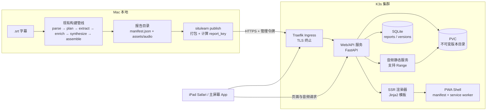
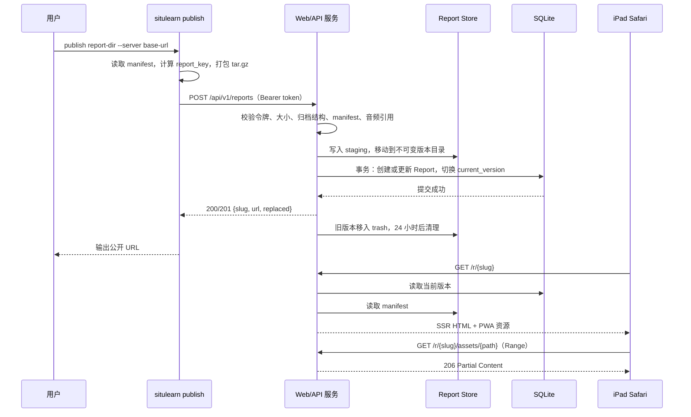

# 情景学习 学习报告公网发布与 iPad 播放 技术方案

| 字段 | 内容 |
| --- | --- |
| 标题 | 情景学习 学习报告公网发布与 iPad 播放 技术方案 |
| 主笔 | alang |
| 评审人 | 独立评审（doc-writer quality reviewer） |
| 创建日期 | 2026-11-02 |
| 目标版本 | v0.2 |
| 关联资源 | [总体架构](../../architecture/system.md)；[SPEC-001 字幕脉络与生词语音化](../SPEC-001-subtitle-learning-report/spec.md)；本地样本《文艺复兴的解放》 |

## 1. 背景与上下文

### 1.1 系统现状

情景学习目前是一个本地 CLI 工具，负责把一份英文纪录片 `.srt` 字幕变成可离线打开的学习报告。当前技术栈是 Python 3.11+、uv、LangChain + DeepSeek、Jinja2 模板与本地文件缓存；没有常驻服务、没有数据库、没有账号体系，也没有服务端渲染的 Web 前端；现有报告是本地静态 HTML。

核心流程如下：

1. 用户在 Mac 终端执行 `situlearn build <input.srt> --out <dir>`。
2. Subtitle Parser 解析字幕，Content Segmenter 合并半句 cue。
3. Narrative Planner 与 Vocabulary Extractor 调用 DeepSeek，分别生成章节讲稿与候选词条。
4. Lexicon Enricher 查询词典与 Oxford/Youdao 真人音频，TTS 补齐残留发音与章节音频。
5. Report Assembler 把 `manifest.json` 渲染成 `report.html`，音频写入 `assets/audio/`。
6. 用户在本机文件系统上双击 `report.html`，通过 `file://` 打开报告。

现有报告已经具备章节列表、章节播放、词条发音、按章节与分类筛选、底部全局播放器、进度条与剩余时间。README 记录的真实样本结果为：60 分钟纪录片、8 个中文叙事章节、74 个词条、73/74 真人发音、82 个离线音频文件；完整构建约 9 分钟，全缓存重建小于 1 秒。报告通过相对路径引用音频，不依赖本地服务或外部网络。

iPad 访问现状为零：用户从未尝试把报告带到 iPad 上，仓库中也没有任何发布、上传、公网托管或移动端页面代码。报告目录不是 URL，离开 Mac 之后没有入口。

### 1.2 核心技术痛点

失败链按发生顺序如下：

1. 在 Mac 上执行 `situlearn build`，得到一份包含 `report.html`、`manifest.json` 与 `assets/audio/` 的报告目录。
2. 用户在通勤、家务或睡前想继续学习，拿起 iPad。
3. 报告只存在于 Mac 本地文件系统，iPad 上没有入口；用户也没有尝试过拷贝整个目录。
4. 用户只能回到桌前用 Mac，或直接放弃这次学习。
5. 下一次学习仍然绑定桌面，碎片时间持续浪费；未来公开分享也始终没有起点。

用户确认失败链卡在第 3 步：不是“拷过去打不开”，而是“根本没有可访问的入口”。这条链路直接对应两个后果：iPad 作为日常主设备无法承接学习，公网分享无法启动。

证据（引述）：用户描述触发场景时说：「想离开 Mac 继续学」「我不太喜欢被绑定，在桌子前看着我的Mac iPad才是我平时的那个主要设备」「公开分享无法启动」。这三条引述分别对应失败链的第 2、3、5 步。用户明确表示这不是频次问题，而是设备习惯问题，因此本 Spec 不把“每周发生几次”作为验收依据，而把“iPad 上能否稳定完成一次看与听”作为核心验收。

补充证据（仓库事实）：现有 `report.html.j2` 没有 Media Session、Service Worker 或播放进度持久化代码。即使把目录拷贝到 iPad，也只能依赖 Safari 前台播放，锁屏与切后台行为没有保障，关闭页面后也无法回到上次位置。这解释了为什么“换一种传输方式”不足以解决需求，必须同时补齐 Web 访问层与 iPad 播放层。

### 1.3 重构/设计动机

三个触发点在同一时间成立，所以现在做：

1. **使用触发**：用户希望在通勤、家务、睡前离开 Mac 继续学习，当前报告没有离开桌面的路径。
2. **设备触发**：iPad 是用户日常的主设备，学习材料如果只能在 Mac 上打开，使用频率会被桌面场景限制。
3. **分发触发**：用户希望未来公开分享，而本地目录没有 URL、没有发布入口、没有下架能力，公开分享无法启动。
4. **技术触发**：内容管线已经端到端跑通，报告数据与音频资产完整；用户已有云服务器、域名与 K3s 集群，缺的是发布与播放层，不是重新做内容生成。

本次目标是把“本地文件报告”扩展成“可发布的公网学习报告”：本地构建保持不变，新增一条发布命令，把报告推到云服务器；服务器提供难猜的公开链接与重做后的 Web 前端；iPad 通过 Safari 或主屏幕 App 打开，支持锁屏与切后台继续播放，并在本机记住播放进度。公开链接不提供汇总首页，也不被搜索引擎收录。

本次同时明确一项已接受风险：现有词条的 Oxford/Youdao 真人音频原本只用于本地个人学习，公开分享构成再分发。用户已知悉并选择保留音频公开，风险由用户承担；Spec 在上线清单中保留许可复核点，但不把“替换音频来源”纳入本次范围。

### 1.4 非目标

不做的后果已经在 1.2 写明：学习继续绑定 Mac，iPad 主设备无法使用，公开分享没有起点。本次明确不做：

- 网页上传字幕与服务器端构建（本次不做；构建继续在 Mac 本地完成）。
- 报告汇总首页、全站搜索与分类浏览（本次不做；每条报告只有独立公开链接）。
- 多用户账号、RBAC 与团队协作（Deferred to Phase 2）。
- 跨设备播放进度同步（本次不做；进度只保存在当前设备的浏览器本地）。
- 句级同步高亮、语速控制、深色模式（本次不做；只做章节级高亮）。
- 原生 iOS/iPadOS App 与应用商店发布（Deferred to Phase 2）。
- 公开版音频许可替换与法务清理（本次不做；按 1.3 的已接受风险处理）。
- 搜索引擎收录、公开目录与站点地图（本次不做；明确 noindex）。
- 多副本高可用、多地域部署与读写分离（Deferred to Phase 2；单副本满足个人与小范围分享）。

## 2. 目标与非目标

### 2.1 目标

- **G1 - 公网发布与访问（架构/交付）**：Mac 上一条命令把现有报告发布到云服务器，返回一个难猜的公开 URL；iPad Safari 打开后能看到完整章节、词表与播放器。验收：用《文艺复兴的解放》报告执行发布，返回 `201` 与 `slug`；iPad Safari 17+ 打开该 URL，章节数、词条数与本地报告一致；`curl -I` 返回 `200` 且带 `X-Robots-Tag: noindex`。
- **G2 - iPad 看与听（体验/可靠性）**：iPad 锁屏或切到其它 App 后音频继续播放，锁屏界面可控制播放/暂停与章节切换；重新打开页面恢复到上次章节与时间点；可添加到主屏幕并以独立窗口打开。验收：真机连续播放 10 分钟并锁屏，音频不中断；锁屏控制可暂停与继续；切到其它 App 30 秒后返回，播放位置连续；关闭页面再打开，进度恢复误差不超过 5 秒；主屏幕图标可启动。
- **G3 - 发布原子性与生命周期（可靠性）**：同一份字幕重复发布覆盖同一链接；上传中断或校验失败时旧版本保持可用；支持手动下架；未授权发布被拒绝。验收：注入中断上传，旧 URL 仍返回 `200` 且音频完整；重复发布返回同一 `slug` 且 `replaced=true`；下架后返回 `410`；无令牌发布返回 `401`；100 MB 报告发布完成时间小于 5 分钟 [estimated]。
- **G4 - 前端重做与移动端可用（架构/质量）**：新的服务端渲染前端覆盖现有报告的全部内容能力（章节、讲稿、词表、筛选、章节播放、词条发音），在 320–1366 px 宽度下无横向滚动，主要触控目标不小于 44×44 px。验收：内容对照清单 100% 通过；宽度扫描 0 处横向滚动；键盘可完成播放、暂停、章节切换与词条筛选；正文对比度不低于 4.5:1。
- **G5 - 运维与可观测（运维）**：应用以单副本部署到现有 K3s，具备健康检查、结构化日志、基础指标与备份恢复步骤。验收：`/healthz` 与 `/readyz` 返回 `200`；滚动更新与回滚各在 10 分钟内完成；日志可按 `request_id` 串起一次发布；备份恢复演练能在 2 小时内恢复最近一份报告 [estimated]。

目标与后续章节的对应关系：

| Goal | 主要落点 |
| --- | --- |
| G1 | 3.1 总体架构；4.4 接口与协议；4.8 K3s 部署资源；6.3 冒烟 |
| G2 | 3.2 模块职责；4.7 前端页面与交互；5.5 兼容性与可访问性；6.3 冒烟 |
| G3 | 4.1 发布包与存储布局；4.3 数据模型与契约；4.5 核心流程与时序；4.6 错误码 |
| G4 | 4.7 前端页面与交互；5.5 兼容性与可访问性；6.3 内容对照 |
| G5 | 4.8 K3s 部署资源；5.3 可观测性；6.1 发布与灰度；6.4 回滚与熔断 |

### 2.2 非目标

- **NG1 - 网页构建**：不在网页上传 `.srt` 或触发服务器构建（本次不做）。对应 1.3 的“构建留在本地”，避免把 LLM/TTS 密钥与长任务搬进公网服务。
- **NG2 - 汇总首页**：不提供报告列表、全站搜索与分类浏览（本次不做）。对应 1.4 的“每条报告一个公开链接”，保持链接不可枚举。
- **NG3 - 多用户账号**：不做注册、登录、RBAC 与团队空间（Deferred to Phase 2）。当前只有单一管理令牌，公开侧只读。
- **NG4 - 跨设备进度**：不同步 iPad 与 Mac 的播放位置（本次不做）。进度保存在当前设备的 `localStorage`，避免引入账号与服务端会话。
- **NG5 - 高级播放能力**：不做句级同步高亮、语速控制与深色模式（本次不做）。章节级高亮已覆盖“边听边看”的最小需求。
- **NG6 - 原生 App**：不开发 iOS/iPadOS 原生客户端（Deferred to Phase 2）。PWA 主屏幕入口满足“像 App 一样打开”。
- **NG7 - 音频许可清理**：不替换或重新授权公开版词条音频（本次不做）。对应 1.3 的已接受风险；上线前保留一次人工复核。
- **NG8 - 搜索引擎收录**：不提交站点地图、不开放抓取、不提供公开目录（本次不做）。所有公开页返回 `noindex`。
- **NG9 - 高可用多副本**：不做多副本、多地域与数据库主从（Deferred to Phase 2）。SQLite 与单副本 PVC 是当前规模的合理边界。

## 3. 架构设计与核心方案

### 3.1 总体架构



> 核心原则：内容生成继续在本地完成；公网服务只负责接收、校验、存储、渲染与播放；公开侧只读，写操作只有一个带令牌的发布接口。

### 3.2 核心模块职责

- **Existing Build Pipeline**：保留 SPEC-001 的解析、规划、抽取、富化、合成与组装职责，本方案不改内容生成逻辑。
- **Publish Client**：新增在 CLI 内，负责把报告目录打包为受控归档、读取 `manifest.json` 计算 `report_key`、上传并展示进度；不参与内容生成。
- **Web/API Server**：FastAPI 应用，负责认证、发布接收、报告元数据读写、公开页面路由、健康检查与静态音频服务。
- **SSR Renderer**：用 Jinja2 把 `manifest.json` 映射为公开页面视图模型，输出章节页、词表页与播放器；不修改源报告数据。
- **Report Store**：PVC 上的不可变版本目录；每次发布写入新版本目录，公开请求只读当前版本。
- **Metadata Store**：SQLite，记录报告、版本、公开 slug 与发布审计；是“当前版本指针”的唯一来源。
- **Media Delivery**：按相对路径提供音频，支持 HTTP Range，保证 Safari 可拖动进度与分段加载。
- **PWA Shell**：`manifest.webmanifest`、Service Worker、图标与离线回退页；缓存已访问报告的外壳与音频。
- **Ops Layer**：K3s 原生 YAML/Kustomize 管理的 Deployment、Service、Ingress、PVC、ConfigMap 与 Secret。

### 3.3 核心数据流转

1. 用户在 Mac 执行现有构建命令，得到报告目录；内容生成链路不变。
2. 用户执行 `situlearn publish <report-dir> --server <url>`；Publish Client 读取 `manifest.json`，用 `source.sha256` 作为 `report_key`，把目录打包为 `tar.gz`。
3. 客户端携带管理令牌上传；服务端校验大小、归档结构、`manifest.json`、schema 主版本与所有 `audio_ref`/`audio_refs` 指向的文件是否存在。
4. 服务端把归档解压到 staging 目录，写入新的不可变版本目录；随后在一个数据库事务里把 `current_version` 指向新版本。事务提交前，公开请求仍读旧版本。
5. 公开请求按 `slug` 解析到 `report_id` 与 `current_version`，SSR 读取该版本的 `manifest.json` 渲染页面；音频请求由 Media Delivery 以 Range 响应。
6. iPad 首次播放后，Service Worker 缓存页面外壳与已播放音频；本机 `localStorage` 记录章节与时间点。
7. 发布成功后，旧版本保留 24 小时作为操作回退窗口，之后异步清理；不向用户暴露版本历史。

### 3.4 关键选型与约束

- **服务端采用 Python + FastAPI + Jinja2 服务端渲染，不引入 Node 前端构建链**：现有仓库已是 Python/uv，服务端渲染首屏快、部署面小，PWA 与 Media Session 用原生 JS 即可实现。与 SPA 的对比见 7.5。
- **构建留在本地，公网只接收成品**：LLM 与 TTS 密钥、长时间构建与缓存继续留在 Mac；公网服务不持有内容生成密钥，降低泄露面与运营成本。与网页构建的对比见 7.4。
- **部署到现有 K3s，使用原生 YAML/Kustomize，单副本 + PVC + SQLite**：用户已有集群与域名；报告访问是低并发只读，单副本足以支撑个人与小范围分享。多副本会引入 SQLite 写冲突与共享存储复杂度，留到 Phase 2。
- **公开链接采用“可读前缀 + 12 位 base32 随机后缀”，全站 noindex**：用户明确要求难猜链接且不提供首页。slug 形如 `renaissance-liberation-a1b2c3d4e5f6`；后缀约 60 bit，避免被枚举；标题无法转写为 ASCII 时前缀退化为 `report`。链接形态见 4.4。
- **发布使用单一管理令牌**：用户选择单一令牌而非账号体系；令牌只存在 K8s Secret 与本地环境变量，比较使用常量时间算法。认证边界见 5.4。
- **同一 `report_key` 覆盖同一链接**：`report_key` 取自字幕文件 sha256，同一份字幕重建后仍映射到同一报告与 slug；用户选择“同链接覆盖，可下架”，不做对外版本历史。
- **公开版保留现有真人音频**：用户已接受再分发风险；页脚继续保留来源署名，上线前做一次人工复核。风险记录见附录 A。
- **iPad 后台播放依赖 `<audio>` + Media Session API + PWA**：这是 iOS Safari 下可控的组合；必须真机验证锁屏与切后台行为，验证失败时的降级见附录 A。与原生 App 的对比见 7.6。

### 3.5 新增、改造与保持不变

- **新增**：`situlearn publish` 子命令、FastAPI Web/API 服务、SSR 页面模板、PWA Shell、SQLite 元数据、K3s/Kustomize 部署资源、发布与公开访问的监控指标。
- **改造**：CLI 增加发布入口；报告数据读取从“仅本地渲染”扩展为“本地渲染 + 服务端渲染”；总体架构文档第 2 节当前只描述本地 CLI，实施阶段同步改为“本地构建 + 公网只读 Web App”。
- **保持不变**：现有构建管线、`manifest.json` schema、音频生成与缓存、离线 `report.html` 产物、API Key 只存在本地环境变量的约束。现有本地报告仍可继续双击打开，不因本方案失效。

## 4. 详细设计

### 4.1 发布包与存储布局

发布包是报告目录的 `tar.gz` 归档，根目录必须直接包含 `manifest.json` 与 `assets/audio/`；`report.html` 可以存在但服务端不依赖它。归档必须满足：

- 解压后总大小不超过 100 MB，文件数不超过 2,000。
- 所有路径为相对路径，不含 `..`、符号链接、设备文件或绝对路径。
- `manifest.json` 可解析，`schema_version` 主版本为 `1`；表单 `report_key` 必须等于 `manifest.source.sha256`，不一致时拒绝。
- `manifest.assets[].path`、`narrative.sections[].audio_refs[]` 与 `terms[].audio_ref` 指向的文件存在且大小大于 0；`unavailable` 除外。

服务端存储布局：

```text
/data/
  situlearn.sqlite3
  reports/<report_id>/versions/<version>/   # 不可变版本目录
  staging/<upload_id>/                       # 上传与校验临时目录
  trash/<report_id>/<version>/               # 待清理旧版本
```

`report_id` 是服务端生成的 UUID；`version` 是发布时生成的单调递增标识。公开路径使用 `slug`，不暴露 `report_id` 或版本号。上传先写 `staging/`，校验通过后移动到 `versions/`；数据库事务提交后旧版本进入 `trash/`，24 小时后清理。

### 4.2 配置项

| 配置 | 默认值 | 说明 |
| --- | --- | --- |
| `SITE_BASE_URL` | 由 Kustomize overlay 注入 | 公开站点根 URL，用于生成分享链接、PWA 清单的绝对资源与审计记录 |
| `PUBLISH_TOKEN` | 由 K8s Secret 注入 | 发布接口管理令牌；不写入镜像、日志或仓库 |
| `PUBLISH_ENABLED` | `true` | 熔断开关；设为 `false` 时发布接口返回 `503`，公开读取不受影响 |
| `MAX_REPORT_BYTES` | `104857600`（100 MB） | 单个发布包上限 |
| `MAX_REPORT_FILES` | `2000` | 归档文件数上限 |
| `MAX_REPORTS` | `50` | 报告总数上限 [estimated] |
| `PUBLISH_RATE_LIMIT` | `5/min` | 单令牌发布频率上限 |
| `PUBLIC_RATE_LIMIT` | `120/min/IP` | 公开页面与音频请求频率上限 [estimated] |
| `PREVIOUS_VERSION_TTL_H` | `24` | 旧版本保留小时数，用于回退 |
| `AUDIO_CACHE_MAX_MB` | `200` | PWA 音频运行时缓存上限 [estimated] |
| `DB_BUSY_TIMEOUT_MS` | `5000` | SQLite 写锁等待上限 |
| `LOG_LEVEL` | `info` | 结构化日志级别 |
| `SENTRY_DSN` | 空 | 可选错误上报；为空时只写本地日志 |

### 4.3 数据模型与契约

| 实体 | 字段 | 类型 | 必填 | 校验与说明 |
| --- | --- | --- | --- | --- |
| `Report` | `report_id` | string(UUID) | 是 | 主键；服务端生成 |
| `Report` | `report_key` | string(64) | 是 | 字幕 sha256 十六进制；唯一；来自 `manifest.source.sha256` |
| `Report` | `slug` | string(64) | 是 | 唯一；小写字母、数字与连字符；创建后不变 |
| `Report` | `title` | string | 是 | 来自 `manifest.narrative.title`；1–80 字符；用于页面标题与 slug 前缀 |
| `Report` | `status` | enum | 是 | `published` / `unpublished`；下架后公开路由返回 `410` |
| `Report` | `current_version` | string | 是 | 指向 `ReportVersion.version`；下架后保留最后版本供回退 |
| `Report` | `created_at` / `updated_at` | datetime | 是 | UTC；发布与下架更新 `updated_at` |
| `Report` | `size_bytes` | int | 是 | 当前版本解压后总大小；用于容量统计 |
| `Report` | `manifest_schema_version` | string | 是 | 当前支持主版本 `1` |
| `ReportVersion` | `report_id` + `version` | string | 是 | 联合主键 |
| `ReportVersion` | `dir_path` | string | 是 | 相对 `/data/reports/` 的版本目录；禁止 `..` |
| `ReportVersion` | `manifest_sha256` | string(64) | 是 | 归档内 `manifest.json` 的 sha256 |
| `ReportVersion` | `status` | enum | 是 | `active` / `superseded` / `deleted`；清理任务只处理 `superseded` |
| `ReportVersion` | `created_at` | datetime | 是 | UTC |
| `PublishEvent` | `event_id` | string(UUID) | 是 | 主键 |
| `PublishEvent` | `report_id` | string(UUID) | 否 | 首次发布失败时为空 |
| `PublishEvent` | `request_id` | string | 是 | 与日志关联 |
| `PublishEvent` | `action` | enum | 是 | `publish` / `unpublish` |
| `PublishEvent` | `result` | enum | 是 | `success` / `rejected` / `failed` |
| `PublishEvent` | `client_ip_hash` | string(64) | 是 | 客户端 IP 的加盐哈希；不存原始 IP |
| `PublishEvent` | `error_code` | string? | 否 | 失败时填写 4.6 的错误码 |
| `PublishEvent` | `created_at` | datetime | 是 | UTC |
| `PublicReportView` | `slug` / `title` / `logline` | string | 是 | 公开视图；由 `manifest.narrative` 投影 |
| `PublicReportView` | `background` | string | 是 | 公开视图；源报告背景段落 |
| `PublicReportView` | `sections` | object[] | 是 | 每项含 `section_id`、`heading`、`summary`、`spoken_text`、`start_ms`、`end_ms`、`key_terms`、`audio_refs`、`audio_status` |
| `PublicReportView` | `terms` | object[] | 是 | 每项含 `term`、`ipa`、`part_of_speech`、`definition_zh`、`definition_en`、`context_sentence`、`why_it_matters`、`category`、`section_id`、`audio_ref`、`audio_source`、`pronunciation_note` |
| `PublicReportView` | `attribution` | string[] | 是 | Oxford、Youdao、TTS 等来源署名 |

公开视图不包含 `manifest.config`、`source.filename`、`source.sha256`、`report_key`、`report_id`、版本号与任何本地路径。`audio_ref` 在公开视图中统一改写为 `/r/<slug>/assets/{path}` 形式的相对 URL，避免暴露存储布局。

### 4.4 接口与协议

**发布接口（需要令牌）**

- `POST /api/v1/reports`：`multipart/form-data`，字段 `archive`（`tar.gz`，≤100 MB）、`report_key`（64 位十六进制）、`schema_version`（主版本）。请求头 `Authorization: Bearer $PUBLISH_TOKEN`。成功 `201` 首次创建，`200` 覆盖更新，响应 `{slug, url, report_id, version, replaced}`。未授权 `401`；包过大 `413`；归档非法 `400`；manifest 缺失或引用资产缺失 `422`；并发发布同一 `report_key` 返回 `409`。
- `DELETE /api/v1/reports/{slug}`：需要令牌；`204` 下架；`404` 报告不存在。
- `GET /api/v1/reports/{slug}`：需要令牌；返回报告元数据与当前版本，供发布后核对；公开侧不可访问。
- `GET /healthz`：进程存活；返回 `200 {"status":"ok"}`。
- `GET /readyz`：数据库与 PVC 可读写；返回 `200` 或 `503`。

**公开接口（只读、无需登录）**

- `GET /r/{slug}`：报告首页，SSR 返回章节列表、背景与播放器；不存在 `404`，已下架 `410`。
- `GET /r/{slug}/chapters/{section_id}`：章节详情；`section_id` 不属于该报告时 `404`。
- `GET /r/{slug}/vocabulary`：词表页，支持 `?section=` 与 `?category=` 查询参数；非法参数返回空结果而非错误。
- `GET /r/{slug}/assets/{path}`：音频与图标静态资源；支持 `Range`，命中返回 `206` 与 `Content-Range`；路径越界 `400`，文件不存在 `404`。
- `GET /r/{slug}/manifest.webmanifest`：该报告的 PWA 清单，`start_url` 为 `/r/{slug}`，`scope` 为 `/r/{slug}/`；`display: standalone`。
- `GET /sw.js`：Service Worker 脚本，作用域为站点根，便于缓存跨报告公共外壳。
- `GET /offline`：离线回退页。

**响应头约束**

- 所有公开页面：`X-Robots-Tag: noindex, nofollow`，HTML 内同时输出 `<meta name="robots" content="noindex, nofollow">`。
- 所有响应：`Strict-Transport-Security: max-age=31536000; includeSubDomains`。
- HTML：`Content-Security-Policy: default-src 'self'; media-src 'self'; img-src 'self' data:; style-src 'self' 'unsafe-inline'; script-src 'self'; connect-src 'self'`。
- 音频：`Accept-Ranges: bytes`，正确的 `Content-Type: audio/mpeg`。
- 页面与音频：`Cache-Control` 使用内容哈希或版本号，避免覆盖更新后缓存串版本。

**CLI 契约**

- `situlearn publish <report-dir> --server <base-url> [--token-env SITULEARN_PUBLISH_TOKEN] [--dry-run]`
- 成功输出 `slug`、公开 URL 与是否覆盖旧版本，退出码 `0`。
- 认证失败退出码 `5`；网络或超时退出码 `6`；服务端拒绝（校验失败、容量不足、发布关闭）退出码 `7`；本地报告缺失或 manifest 不可读退出码 `2`。
- `--dry-run` 只做本地打包与校验，不发起网络请求。

**内部接口**

- `ReportPublisher.publish(report_dir: Path, server: URL, token: str) -> PublishResult`：负责打包、上传与错误映射。
- `ReportStore.install(upload: StagedArchive) -> VersionRef`：校验并写入不可变版本目录。
- `ReportRepository.switch_version(report_key: str, version: VersionRef) -> Report`：在单个事务内完成创建或覆盖。
- `PublicRenderer.render(report: PublicReportView, page: PageKind) -> HTML`：只读视图模型，不访问网络。

### 4.5 核心流程与时序



异常路径：

1. **令牌无效**：在读取请求体前返回 `401`，不写 staging，不记录请求体。
2. **上传中断或归档非法**：删除 staging，不切换版本；旧版本继续服务。
3. **manifest 或音频引用缺失**：返回 `422`，staging 清理；不创建报告。
4. **数据库事务失败**：新版本目录保留在 `staging` 或标记为 `superseded`，`current_version` 不变；返回 `500` 并记录 `request_id`。
5. **并发发布同一 `report_key`**：数据库唯一约束或行锁拦截，返回 `409`；客户端提示稍后重试。
6. **旧版本清理失败**：只记录告警，不影响公开访问；下次清理任务重试。
7. **公开请求遇到下架**：返回 `410`，不暴露历史版本。
8. **音频 Range 非法**：返回 `416` 与 `Content-Range: bytes */<size>`，前端回退到整段请求。

### 4.6 异常处理与错误码

| 错误码 | 触发场景 | 处理策略 |
| --- | --- | --- |
| `ERR_PUBLISH_UNAUTHORIZED` | 缺失、错误或过期令牌 | 返回 `401`；记录 `request_id` 与哈希 IP；不读取请求体 |
| `ERR_PUBLISH_DISABLED` | `PUBLISH_ENABLED=false` | 返回 `503`；公开读取继续服务 |
| `ERR_PUBLISH_PAYLOAD_TOO_LARGE` | 归档超过 100 MB 或文件数超过 2,000 | 返回 `413`；客户端提示压缩或拆分 |
| `ERR_PUBLISH_INVALID_ARCHIVE` | 非 gzip、路径越界、符号链接、绝对路径 | 返回 `400`；清理 staging；客户端提示重新打包 |
| `ERR_PUBLISH_MANIFEST_INVALID` | `manifest.json` 缺失、无法解析或字段不全 | 返回 `422`；不创建报告；返回首个字段错误 |
| `ERR_PUBLISH_SCHEMA_UNSUPPORTED` | `schema_version` 主版本不是 `1` | 返回 `422`；提示升级/降级客户端 |
| `ERR_PUBLISH_ASSET_MISSING` | 引用的音频文件不存在或大小为 0 | 返回 `422`；列出前 10 个缺失路径 |
| `ERR_PUBLISH_CONFLICT` | 同一 `report_key` 并发发布 | 返回 `409`；客户端指数退避重试最多 3 次 |
| `ERR_PUBLISH_STORAGE_FULL` | PVC 剩余空间低于 10% | 返回 `507`；触发容量告警；公开读取继续 |
| `ERR_PUBLISH_DB_BUSY` | SQLite 写锁超过 5 秒 | 返回 `503`；客户端重试；记录 `request_id` |
| `ERR_REPORT_NOT_FOUND` | slug 不存在 | 返回 `404`；不区分从未存在与已删除（下架使用 `410`） |
| `ERR_REPORT_GONE` | 报告已下架 | 返回 `410`；页面提示报告已下架 |
| `ERR_RATE_LIMITED` | 超过发布或公开请求频率 | 返回 `429`；带 `Retry-After` |
| `ERR_AUDIO_RANGE_INVALID` | `Range` 格式错误或越界 | 返回 `416`；带 `Content-Range: bytes */<size>` |
| `ERR_ASSET_PATH_INVALID` | 公开资源路径含 `..` 或非法字符 | 返回 `400`；不读取文件系统 |

CLI 错误映射：`ERR_PUBLISH_UNAUTHORIZED` → 退出码 `5`；网络错误、TLS 错误、超时 → `6`；其余服务端拒绝 → `7`；本地报告问题 → `2`。

### 4.7 前端页面与交互

新前端是服务端渲染的多页应用，共享同一套模板与播放器脚本；不使用前端框架，交互由原生 JavaScript 完成。

**页面结构**

- **报告首页 `/r/{slug}`**：标题、一句话定位、背景、章节卡片列表、词表入口、底部全局播放器。章节卡片显示标题、摘要、时长与“播放本节”。
- **章节页 `/r/{slug}/chapters/{section_id}`**：章节标题、摘要、完整讲稿、关键词与“播放本节”。播放时当前章节卡片与讲稿区块同时高亮，实现章节级同步。
- **词表页 `/r/{slug}/vocabulary`**：按章节与分类筛选，支持报告内搜索；每条显示词、音标、词性、中英释义、上下文原句、为什么是卡点与发音按钮。
- **离线页 `/offline`**：网络不可用且未缓存时提示已缓存内容与重试。

**播放器行为**

- 单例 `<audio>` 元素，播放列表由章节 `audio_refs` 顺序拼接；切章时更新 `src`，不重建元素。
- 播放/暂停、上一章/下一章、进度条、当前/总时长与剩余时间；章节级高亮由播放列表索引驱动。
- 通过 Media Session API 设置 `metadata`（报告标题、章节标题、封面）与 `positionState`；注册 `play`、`pause`、`previoustrack`、`nexttrack`、`seekto` 动作，映射到锁屏控制。
- iOS 要求首次播放由用户手势触发；页面加载后不自动播放，恢复进度时显示“继续上次播放”按钮。
- 页面进入后台或锁屏时保持 `<audio>` 播放；PWA 以 `standalone` 模式打开时同样生效。

**进度记忆**

- 键名 `situlearn:progress:<slug>`，值为 `{version: 1, section_id, asset_index, current_time_s, updated_at}`。
- 每 5 秒与暂停/切章时写入；恢复时校验 `section_id` 仍存在且 `asset_index` 未越界，否则回到该章开头。
- 进度只存在当前设备；清理浏览器数据后丢失，不做跨设备同步。

**PWA 与离线**

- 每份报告生成独立的 `manifest.webmanifest`，声明报告名称、短名称、`start_url: "/r/{slug}"`、`scope: "/r/{slug}/"`、`display: "standalone"`、主题色与至少 192/512 px 图标；报告页通过 `<link rel="manifest">` 指向该清单。
- Service Worker 预缓存应用外壳（模板、样式、脚本、图标、离线页），运行时缓存已访问报告的页面与音频。
- 音频缓存采用 LRU，上限 200 MB [estimated]；超出时先清理最久未访问的报告资源。
- 缓存版本随应用镜像版本更新；新版本激活时保留旧缓存直到新页面加载成功，避免更新中断播放。
- 离线访问未缓存报告时返回离线页，不显示浏览器默认错误。

**移动端与可访问性**

- 320–1366 px 响应式布局；底部播放器使用 `env(safe-area-inset-bottom)`；主要触控目标不小于 44×44 px。
- 播放控件、筛选器与进度条支持键盘；按钮有 `aria-label`；章节高亮不只依赖颜色。
- 正文与背景对比度不低于 4.5:1；尊重 `prefers-reduced-motion`。

### 4.8 K3s 部署资源

使用原生 YAML 与 Kustomize，仓库内提供 `deploy/k8s/base/` 与 `deploy/k8s/overlays/prod/`：

| 资源 | 关键配置 |
| --- | --- |
| Namespace | `situlearn` |
| Deployment | 单副本；镜像使用不可变 tag；容器端口 8000；`/healthz` 存活探针、`/readyz` 就绪探针；`requests: 100m/256Mi`、`limits: 500m/512Mi` [estimated] |
| Service | ClusterIP，暴露 80 → 8000 |
| Ingress | Traefik Ingress；TLS 终止；host 由 overlay 的 `SITE_HOST` 注入；启用 HSTS 与请求体上限 110 MB |
| PVC | 主存储 `ReadWriteOnce`，20 GiB [estimated]；挂载 `/data` |
| PVC | 备份存储 `ReadWriteOnce`，20 GiB [estimated]；挂载 `/backup` |
| ConfigMap | 4.2 中非敏感配置 |
| Secret | `PUBLISH_TOKEN`、可选 `SENTRY_DSN`；不提交到仓库 |
| CronJob | 每日把 SQLite 与报告目录打包到 `/backup`，保留 7 天 [estimated] |
| NetworkPolicy | 仅允许 Ingress 访问 8000；允许应用访问 DNS 与时间服务 |

部署命令约定：`kubectl apply -k deploy/k8s/overlays/prod`；发布前先 `kubectl diff -k`，发布后 `kubectl rollout status deployment/situlearn -n situlearn --timeout=10m`。

## 5. 非功能性需求

### 5.1 性能与资源

- **页面首字节**：已发布报告首页在 2C2G 节点上的 TTFB 小于 300 ms [estimated]；验收：用 100 次请求取 P95。
- **音频起播**：iPad 在稳定 Wi-Fi 下点击播放后 2 秒内开始出声 [estimated]；验收：真机录屏计时，连续 10 次取中位数。
- **并发**：单副本支持 50 个并发音频流与 200 个每分钟页面请求而不出现 5xx [estimated]；验收：用 `hey` 或 `wrk` 压测 5 分钟，5xx 为 0。
- **资源占用**：容器常驻内存小于 512 MB，CPU 峰值小于 500m [estimated]；验收：K3s metrics 观察 24 小时。
- **发布耗时**：100 MB 报告在同城网络下 5 分钟内完成 [estimated]；验收：发布真实报告并记录客户端耗时。
- **页面体积**：首页 HTML 小于 150 KB，首屏 CSS/JS 合计小于 100 KB [estimated]；验收：构建产物统计。

### 5.2 可靠性与容灾

- **发布原子性**：任何发布失败都不能改变 `current_version`；验收：注入上传中断、校验失败、数据库失败三种故障，旧 URL 均返回 `200` 且音频完整。
- **进程恢复**：Pod 重启后 60 秒内恢复公开访问；验收：`kubectl delete pod` 后连续请求，记录恢复时间。
- **数据持久性**：报告与 SQLite 位于 PVC；每日备份，RPO 24 小时、RTO 2 小时 [estimated]；验收：从备份恢复一份报告并在临时命名空间打开。
- **幂等性**：同一 `report_key` 重复发布不产生重复报告或重复 slug；验收：连续发布两次，`reports` 计数不变，第二次 `replaced=true`。
- **容量保护**：PVC 使用率超过 80% 告警，超过 90% 拒绝新发布；验收：注入大文件使使用率超过阈值，发布返回 `507`。
- **下架一致性**：下架后公开路由返回 `410`，音频资源返回 `404`，不残留可枚举入口；验收：下架后逐项请求首页、章节、词表与音频。

### 5.3 可观测性

- **结构化日志**：JSON Lines，至少包含 `timestamp`、`level`、`request_id`、`route`、`method`、`status`、`duration_ms`、`slug`、`error_code`；不记录令牌、请求体与字幕原文。验收：抽一次发布与一次播放，日志字段齐全。
- **健康检查**：`/healthz` 只检查进程；`/readyz` 检查 SQLite 可写与 PVC 可读；验收：删除 PVC 权限后 `/readyz` 返回 `503`。
- **指标**：`/metrics` 暴露 `http_requests_total`、`http_request_duration_seconds`、`publish_total{result}`、`storage_bytes`、`report_count`；验收：Prometheus 或 `curl` 可读取，数值随请求变化。
- **告警阈值**：5xx 比例连续 5 分钟大于 1%、发布失败连续 3 次、PVC 使用率大于 80%、Pod 重启次数 1 小时内大于 2 次；验收：用测试流量触发阈值并在告警通道看到记录。
- **审计**：每次发布与下架写 `PublishEvent`；保留 180 天 [estimated]；验收：查询最近 10 次操作，`request_id` 与日志可对应。

### 5.4 安全、隐私与合规

- **传输安全**：Ingress 强制 HTTPS，TLS 1.2+，HSTS 一年；HTTP 自动跳转 HTTPS；验收：`curl` 检查协议与响应头。
- **发布认证**：`Authorization: Bearer` 令牌，常量时间比较；令牌只存在 K8s Secret 与本地环境变量；验收：错误令牌返回 `401`，日志中搜索令牌值命中 0 次。
- **输入校验**：归档大小、文件数、路径、符号链接、manifest schema 与资产引用全部校验；公开资源路径禁止 `..`；验收：构造路径穿越与超大归档，均被拒绝。
- **限流**：发布 5 次/分钟/令牌，公开 120 次/分钟/IP；客户端 IP 只信任 Ingress 注入的 `X-Forwarded-For`，取最右侧由可信代理追加的地址；超限返回 `429` 与 `Retry-After`；验收：压测触发 429，等待后恢复。
- **公开面收敛**：公开页不显示 `config`、源文件名、sha256、`report_id`、版本号与本地路径；全站 noindex；不提供目录列表；验收：抓取公开 HTML 搜索敏感字段，命中 0 次。
- **内容安全策略**：公开页 CSP 如 4.4；禁止外部脚本、字体与图片；验收：浏览器控制台无外部请求。
- **密钥管理**：发布令牌与可选错误上报 DSN 只从环境变量读取；不写入镜像、ConfigMap、日志或报告产物；验收：对镜像与日志搜索令牌前缀，命中 0 次。
- **音频再分发风险**：公开版保留 Oxford/Youdao 真人音频是用户明确接受的风险；页脚保留署名；上线前人工复核一次来源与许可说明；验收：页脚包含来源链接，复核记录写入发布检查单。

### 5.5 兼容性与可访问性

- **浏览器**：iPadOS/iOS Safari 17+ 为一级支持；桌面 Chrome、Safari、Firefox 最近两个大版本为二级支持 [estimated]；验收：真机与桌面各完成一次完整播放。
- **PWA**：iPad 可“添加到主屏幕”，独立窗口打开，离线页可用；验收：主屏幕启动后断网，已缓存报告可打开。
- **后台播放**：锁屏与切后台连续播放 10 分钟不中断，锁屏界面可控制播放/暂停与章节切换；验收：真机手测并录屏。
- **响应式**：320–1366 px 无横向滚动；底部播放器不遮挡正文；验收：Chrome DevTools 设备模拟逐档检查。
- **可访问性**：主要触控目标 ≥44×44 px；正文对比度 ≥4.5:1；播放与筛选可用键盘完成；验收：键盘走查与对比度工具检查。
- **本地离线报告**：现有 `report.html` 继续可用，不因新增 Web 前端而改变；验收：断网双击本地报告，章节与音频仍可播放。

## 6. 上线与迁移计划

### 6.1 发布与灰度

本方案是新增公网服务，没有历史生产流量；发布以“访问范围逐步扩大”代替流量灰度：

- **Phase 1 - 本地联调**：在 Mac 上以本地进程运行 Web/API，使用局域网地址让 iPad 打开；验证 SSR、音频 Range、Media Session 与进度记忆。通过标准：G2、G4 的验收项在真机通过。
- **Phase 2 - K3s 单用户**：构建镜像并部署到 K3s，配置域名与 TLS；只由 alang 使用公开链接访问 48 小时。通过标准：G1、G3、G5 的验收项通过，5xx 为 0。
- **Phase 3 - 小范围分享**：把链接发给 3–5 位同类学习者，观察 7 天；收集播放失败、加载慢与排版问题。通过标准：无 P0/P1 问题，音频起播与后台播放无回归。
- **Phase 4 - 公开分享**：确认 Phase 3 指标后，按需公开链接；仍不提供首页与搜索引擎收录。

每个阶段使用不可变镜像 tag；K3s 部署使用 `kubectl apply -k`，发布前执行 `kubectl diff -k`，发布后等待 `rollout status`。

### 6.2 数据迁移与兼容性

- **存量数据**：服务端是新建，没有历史数据库需要迁移；现有本地报告目录不需要转换，首次 `situlearn publish` 即完成导入。
- **manifest 兼容**：服务端接受 `schema_version` 主版本 `1`，对新增可选字段保持忽略；主版本变化时拒绝发布并提示升级客户端。现有 `manifest.json` 不新增必填字段。
- **slug 兼容**：`report_key` 取自字幕 sha256，同一份字幕重建后仍覆盖同一 slug；更换字幕文件视为新报告，生成新 slug。
- **数据库演进**：SQLite 使用 `schema_version` 表记录版本，迁移只做加列与加表；回滚时旧版本代码忽略新列，避免破坏性迁移。
- **缓存兼容**：Service Worker 缓存名包含应用版本；应用更新后旧缓存延迟清理，避免正在播放的音频被中断。
- **本地报告兼容**：`report.html` 与 `manifest.json` 的本地读取路径不变；新增发布命令不修改报告目录内容。

### 6.3 上线验证与冒烟

每次发布前执行：

1. `GET /healthz` 与 `GET /readyz` 均返回 `200`。
2. 用《文艺复兴的解放》报告执行 `situlearn publish`，返回 `201` 与公开 URL；重复发布返回同一 `slug` 且 `replaced=true`。
3. iPad Safari 打开公开 URL，章节数、词条数与本地报告一致；播放三个章节，词条发音抽检 10 条。
4. iPad 锁屏播放 10 分钟，切到其它 App 30 秒后返回，播放不中断；锁屏控制可暂停、继续与切章。
5. 关闭页面后重新打开，进度恢复到上次位置，误差不超过 5 秒。
6. 添加到主屏幕，断网后打开已缓存报告，页面与已播放音频可用；未缓存报告显示离线页。
7. `curl -I` 检查 `X-Robots-Tag: noindex`、HSTS 与 CSP；未知 slug 返回 `404`，下架报告返回 `410`。
8. 无令牌发布返回 `401`；超大归档返回 `413`；非法归档返回 `400`；缺失音频引用返回 `422`。
9. 音频请求带 `Range: bytes=0-1023`，返回 `206` 与 `Content-Range`。
10. 记录一次发布与一次播放的 `request_id`，确认日志可串联。

观察指标：`publish_success_rate`、`http_5xx_rate`、`http_request_duration_seconds{p95}`、`audio_206_rate`、`storage_bytes`、`report_count`、Pod 重启次数。

### 6.4 回滚与熔断

**回滚触发条件**（任一满足即回滚）：

- iPad 核心场景回归：当前镜像下锁屏或切后台播放连续中断 2 次，或音频无法起播，真机冒烟失败。
- 发布损坏旧报告：任一成功发布后，旧公开 URL 在 5 分钟内出现 5xx，或音频资源 404 比例大于 0。
- 公开服务 5xx 比例连续 5 分钟大于 1%。
- P95 页面响应连续 5 分钟大于 2 秒。
- PVC 使用率超过 90%，或存储写入失败。
- 未授权发布成功 1 次，或公开页出现令牌、本地路径等敏感字段。

**回滚步骤**：

1. 将 `PUBLISH_ENABLED` 置为 `false` 并滚动更新，停止新的发布；公开读取继续服务。
2. 执行 `kubectl rollout undo deployment/situlearn -n situlearn`，回到上一个通过冒烟的镜像 tag。
3. 如果问题来自错误发布，查 `PublishEvent` 与 `ReportVersion`，把 `current_version` 指回上一版本；旧版本在 24 小时内仍保留，超过窗口则从备份恢复。
4. 如果 PVC 或 SQLite 损坏，按 5.2 的备份步骤在临时命名空间恢复，确认报告可访问后再切回。
5. 重新执行 6.3 的冒烟清单，重点验证 iPad 锁屏播放与旧报告完整性。
6. 在 `changelog.md` 记录回滚原因、触发指标、恢复版本与后续修复项。
7. 修复并重新通过 Phase 2 验收后，再把 `PUBLISH_ENABLED` 置回 `true`。

## 7. 替代方案与权衡

### 7.1 Status Quo：继续只在 Mac 上打开离线报告

- **思路**：不新增 Web 服务，继续在 Mac 上 `situlearn build` 后双击 `report.html`。
- **优点**：零新增服务、零部署、零公网暴露；现有离线能力完全保留。
- **成本与风险**：学习继续绑定桌面；iPad 主设备无法使用；公开分享没有入口；锁屏与切后台播放没有保障。达到阈值的信号已经出现：用户明确表示 iPad 是日常主设备，且公开分享无法启动。
- **结论**：不满足 G1 与 G2，淘汰。

### 7.2 方案 A：静态托管 + 手动上传报告目录

- **思路**：把报告目录上传到 Cloudflare Pages、Vercel 或对象存储，公开链接直接指向静态 HTML。
- **优点**：没有常驻服务，运维最轻；静态文件天然支持 CDN 与 Range。
- **淘汰原因**：用户已有 K3s 与域名；静态托管缺少发布令牌、原子覆盖、下架与审计能力；报告更新与回滚需要额外脚本；与“Mac 构建后一条命令发布”的目标不一致。

### 7.3 方案 B：Tailscale/私有网络 + 家用服务器

- **思路**：在 Mac 或家用服务器上起 Web 服务，通过 Tailscale 或内网穿透让 iPad 访问。
- **优点**：不暴露公网；部署简单；复用现有设备。
- **淘汰原因**：用户明确要求公网公开分享；私有网络无法让外部学习者访问；家庭网络与 Mac 休眠会直接影响可用性。

### 7.4 方案 C：网页上传字幕，服务器端构建

- **思路**：Web App 接收 `.srt`，在服务器上运行现有构建管线并直接发布。
- **优点**：iPad 上即可发起构建，不依赖 Mac；发布链路更短。
- **淘汰原因**：需要把 DeepSeek/MIMO 密钥放到公网服务；构建耗时约 9 分钟且会触发付费调用，公网滥用风险高；现有本地缓存与构建流程需要重做。与用户选择的“Mac 构建后发布”不一致。

### 7.5 方案 D：React/Vue SPA + 独立 API

- **思路**：前端用 SPA 框架，报告数据通过 JSON API 获取。
- **优点**：交互丰富，组件生态成熟；前后端职责清晰。
- **淘汰原因**：为一个以阅读与播放为主的页面引入 Node 构建链与额外部署面；首屏与 PWA 缓存更复杂；现有 Python 团队栈下，SSR 已能满足章节、词表与播放器需求。

### 7.6 方案 E：原生 iPad App 或 WebView 壳

- **思路**：开发原生客户端，或在 WebView 中包一层壳。
- **优点**：后台播放与锁屏控制最可控；可获得系统级媒体体验。
- **淘汰原因**：需要 Apple 开发者账号、签名、审核与独立发布流程；内容更新还要兼容客户端版本；PWA + Media Session 已覆盖本次的看与听需求，原生 App 留到 Phase 2。

### 7.7 最终选型与权衡矩阵

最终选择 **本地构建 + 一条命令发布 + K3s 上的 FastAPI SSR Web App + SQLite/PVC + 难猜公开链接 + PWA/Media Session**。

| 维度 | Status Quo | 方案 A 静态托管 | 方案 B 私有网络 | 方案 C 网页构建 | 方案 D SPA | 方案 E 原生 App | 当前选型 |
| --- | --- | --- | --- | --- | --- | --- | --- |
| 离开 Mac 可访问 | 否 | 是 | 是（仅私有网络） | 是 | 是 | 是 | **是** |
| 公网公开分享 | 否 | 是 | 否 | 是 | 是 | 是 | **是** |
| 发布令牌与下架 | 否 | 弱 | 中 | 中 | 中 | 弱 | **强** |
| iPad 后台播放 | 否 | 弱 | 弱 | 弱 | 弱 | 强 | **中（PWA + Media Session，待真机验证）** |
| 运维与部署成本 | 最低 | 低 | 中 | 高 | 高 | 最高 | **中** |
| 密钥暴露面 | 最小 | 小 | 小 | 大 | 中 | 中 | **小** |
| 与现有 Python 栈契合 | 是 | 是 | 是 | 是 | 否 | 否 | **是** |
| 契合当前阶段 | 否 | 部分 | 否 | 否 | 否 | 否 | **是** |

矩阵结论与第 2 章一致：G1 要求公网发布与访问，排除 Status Quo 与方案 B；G3 要求令牌、原子覆盖与下架，排除方案 A；G2 要求 iPad 后台播放，方案 E 最强但成本过高，PWA 组合在本次范围内足够；方案 C 把密钥与付费构建搬到公网，风险与成本不匹配；方案 D 引入不必要的前端构建链。当前选型与 Goals、3.4 的关键选型一致。

## 附录 A：未决问题

- **A1 - 域名与 TLS 细节**：用户已有域名与 K3s 集群，但具体 host、DNS 解析方式、Traefik 与 cert-manager 的现状未在本 Spec 固定；由 Kustomize overlay 的 `SITE_HOST` 注入，部署前确认证书签发路径。责任人是 alang。
- **A2 - 公网带宽与月成本上限**：公开分享后音频流量是主要成本；当前只设置 120 次/分钟/IP 的默认限流，未设定月度带宽预算。Phase 3 前根据实际流量设定阈值与告警。责任人是 alang。
- **A3 - 备份介质与保留期**：4.8 已指定独立备份 PVC 与 7 天保留 [estimated]，但未确定是否进一步复制到对象存储或异地；Phase 2 前确定并做一次恢复演练。
- **A4 - iOS 后台播放真机行为**：Media Session + PWA 是当前可控方案，但 iOS Safari 在锁屏、低电量模式与切换音频输出设备时的行为需要在目标 iPad 上做一次技术验证；若前台可控但锁屏仍中断，降级为“主屏幕 PWA + 锁屏控制”，并在发布说明中标注。
- **A5 - PWA 离线缓存上限**：200 MB 是初始估计；需根据单份报告实际音频体积与 iPad 存储压力调整。Phase 1 后记录真实报告体积。
- **A6 - TTS 供应商公开分发条款**：章节音频由小米 `mimo-v2.5-tts` 生成，公开分享是否受供应商条款限制尚未确认；上线前复核一次服务条款。责任人是 alang。
- **A7 - 公开页是否显示来源信息**：当前设计隐藏源字幕文件名、sha256 与本地路径，仅保留报告标题与署名；如果用户希望显示片名或字幕来源，需要在发布视图模型中增加可选字段。
- **A8 - 访问统计**：当前只记录服务端请求指标，不做页面级访问统计与分享次数；是否需要匿名统计留到 Phase 2 评估。
- **A9 - 报告数量与容量默认值**：`MAX_REPORTS=50`、20 GiB 主存储 + 20 GiB 备份存储与单报告 100 MB 是初始估计；Phase 2 观察真实占用后调整，避免过早扩容。
