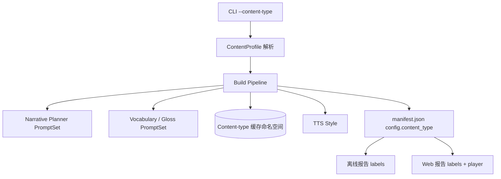

# 情景学习 字幕学习报告内容类型分型 技术方案

| 字段 | 内容 |
| --- | --- |
| 标题 | 情景学习 字幕学习报告内容类型分型 技术方案 |
| 主笔 | alang |
| 评审人 | 用户（方案批准） |
| 创建日期 | 2026-11-03 |
| 目标版本 | v0.3 |
| 关联资源 | [总体架构](../../architecture/system.md)；[SPEC-001 字幕脉络与生词语音化](../SPEC-001-subtitle-learning-report/spec.md)；本地样本《文艺复兴的解放》 |

## 1. 背景与上下文

### 1.1 系统现状

情景学习目前是一个本地 CLI 工具，负责把一份英文纪录片的 `.srt` 字幕变成可离线打开的学习报告。核心链路是：Subtitle Parser 解析字幕，Content Segmenter 合并半句 cue，Narrative Planner 生成中文脉络，Vocabulary Extractor 选出“理解卡点”词条，Lexicon Enricher 补词典与真人发音，TTS 生成章节音频与残留词条音频，Report Assembler 写出 `manifest.json` 与 `report.html`。Web 发布层把同一份 manifest 渲染成公网页面（SPEC-002），不重新生成内容。

当前所有生成与展示逻辑都默认输入是纪录片：

- 提示词把模型设定为“纪录片内容分析师”，叙事按“论证推进”组织，选词 rationale 是“漏掉这个词会断掉哪条论证”（`src/situlearn/prompts.py`）。
- 章节数在 schema 中固定为 4–8 节（`src/situlearn/knowledge.py`、`src/situlearn/planning.py`、`src/situlearn/chains.py`）。
- 报告与 Web 文案使用“内容脉络”“章节”“播放本节”“专业术语和专名优先”等纪录片措辞。
- 章节 TTS 使用固定的“适合纪录片解说的语气”（`src/situlearn/tts.py`）。
- 构建缓存目录只按字幕文件哈希分桶（`src/situlearn/pipeline.py`），同一份字幕的两次不同构建会共享 LLM 阶段产物。

### 1.2 核心技术痛点

用户现在同时看纪录片和剧情电影，失败链如下：

1. 用户拿到一部剧情电影的英文字幕，执行 `situlearn build`。
2. Narrative Planner 仍以“纪录片内容分析师”的身份工作，把剧情片讲成“每一段在论证什么”，而不是“谁想要什么、关系如何变化、剧情如何推进”。
3. Vocabulary Extractor 仍按“论证断点”选词，容易漏掉台词里的俚语、口语、人物关系词和潜台词关键词。
4. 报告标题、章节结构和播报稿可以生成，但读起来像一部谈论文献的纪录片，而不是一部剧情片；用户无法把报告当作“看完电影后的剧情复盘”使用。
5. 三个下游后果同时出现：剧情理解未被有效复盘；词表与观影体验脱节；用户只能继续人工整理，工具的电影场景实际不可用。

证据（引述）：用户在本轮需求中明确说「至少要支持纪录片跟电影」。这不是“将来也许”的愿望，而是当前使用范围已经覆盖电影，而工具只在纪录片场景成立。

补充证据（仓库事实）：`src/situlearn/prompts.py` 的全部叙事、中文修复、选词与释义提示词都写有“纪录片/片子/片中”；`src/situlearn/tts.py` 的默认语气写死为纪录片解说；报告模板的“内容脉络”“播放本节”“章节”等文案没有任何题材分支。这些不是措辞问题，而是生成目标与验收标准的问题。

### 1.3 重构/设计动机

本次做分型的触发点有三个：

1. **使用触发**：用户当前已经在看剧情电影，电影字幕无法得到与纪录片同等质量的学习报告。
2. **能力触发**：现有管线已经能解析任意单语英文 SRT，分题材只需要替换提示词策略、章节约束与展示文案，不需要重做解析、词典、音频或发布链路。
3. **兼容触发**：现有纪录片产物、缓存与已发布报告必须继续可用；分型不能以破坏旧行为为代价。

本次目标是把“纪录片专用报告”扩展为“按题材生成的报告”：至少支持 `documentary` 与 `movie` 两种内容类型，由用户在构建时显式选择；纪录片行为保持现状，电影使用剧情复盘导向的提示词、6–12 个场景段落、台词/剧情/人物关系导向的选词和电影文案。

产品边界已经确认：

- 电影报告是**看完再学**：允许完整剧情复盘和剧透，不提供防剧透或逐段解锁。
- 本次不新增人物、剧情摘要等结构化字段，沿用现有 `background` 与 `sections`。
- 内容类型由 CLI 显式指定，不由模型自动识别。

### 1.4 非目标

不做的后果是电影场景继续产出纪录片式报告，用户仍要人工整理。本次明确不做：

- 防剧透模式、按观看进度解锁、`spoiler_level` 字段（本次不做）。
- `characters`、`synopsis`、人物关系图与人物专属词条分类（Deferred to Phase 2）。
- LLM 自动识别内容类型（本次不做；避免多一次调用和不可复现的分类结果）。
- 针对电影的 Segmenter 参数调优（本次不做；复用现有切分策略）。
- 同一字幕的纪录片版与电影版在服务端并存（本次不做；发布仍是“最后发布生效”）。
- 新增语言、双语字幕、多集合并与视频处理（本次不做）。

## 2. 目标与非目标

### 2.1 目标

以下 5 个 Goal 按架构、生成能力、展示、可靠性与可运维性分类：

- **G1 - 架构：内容类型可选**：`situlearn build` 新增 `--content-type documentary|movie`，默认 `documentary`；非法值由 CLI 拒绝。验收：CLI 帮助与参数校验测试通过；不传参数时 manifest 与报告行为与改动前一致。
- **G2 - 生成能力：电影生成策略**：电影构建使用独立的叙事、中文修复、选词与释义提示词；叙事按剧情时间顺序输出 6–12 个场景段落，允许完整剧透，选词 rationale 指向台词、剧情与人物关系。验收：提示词单元测试冻结关键要求；mock LLM 的端到端构建产出 6 段电影报告。
- **G3 - 展示：电影展示文案**：电影报告使用“剧情脉络 / 场景 / 播放本场 / 全部场景 / 回到本场 / 上一场 / 下一场”等文案；纪录片报告文案逐字不变。验收：离线 HTML、Web 报告、章节页、词表页与播放器契约测试。
- **G4 - 可靠性：向后兼容与缓存隔离**：旧 manifest 无内容类型时按纪录片渲染；纪录片缓存、提示词和 TTS 缓存键保持逐字节兼容；同一字幕的纪录片与电影构建使用不同缓存目录，不串内容。验收：旧 fixture 渲染测试、缓存目录隔离测试、`AudioCache.key(style=None)` 对照测试。
- **G5 - 可运维性：发布与文档**：README、架构文档与发布 runbook 说明内容类型用法和“同一字幕最后发布生效”的限制。验收：文档评审；`publish --dry-run` 行为不变。

### 2.2 非目标

- **NG1 - 防剧透**：不做剧透安全模式、观看进度边界或分段解锁（本次不做）。
- **NG2 - 结构化剧情模型**：不新增人物、关系、剧情摘要字段或人物词条分类（Deferred to Phase 2）。
- **NG3 - 自动识别**：不做 `--content-type auto` 或 LLM 分类（本次不做）。内容类型由 CLI 显式指定，不由模型自动识别。
- **NG4 - 发布复合键**：不改 `report_key` 与服务端校验；同一字幕的两种题材不能同时在线（Deferred to Phase 2）。
- **NG5 - 电影专用切分**：不调整 Segmenter 的 gap、字数与时长参数（本次不做）。

## 3. 架构设计与核心方案

本章给出新增/改造/不变的组件拓扑与数据流：CLI 把题材交给 ContentProfile，Build Pipeline 按 profile 选择 PromptSet、缓存、章节校验与 TTS，Renderer 按 manifest 注入文案；新增 content.py 与电影提示词，改造 pipeline/chains/audio 与模板，SRT 解析、词典、真人音频与发布 API 保持不变。

### 3.1 总体架构

核心原则：**题材是策略，不是分支散落在各处的 if**。内容类型解析成一个不可变的 `ContentProfile`，提示词、章节边界、词条范围、TTS 语气、缓存后缀与展示文案都由 profile 提供；生成链路只依赖 profile，不直接感知具体题材。

图中每个模块的职责：

- **CLI**：解析 `--content-type`，默认纪录片，把值交给构建管线。
- **ContentProfile**：把题材解析成提示词、边界、缓存、TTS 与文案策略。
- **Build Pipeline**：按 profile 编排生成、校验、缓存与 manifest 写入。
- **PromptSet**：为叙事、选词与释义提供题材对应的提示词模板。
- **Renderer**：从 manifest 读取题材，把 `ReportLabels` 注入离线与 Web 模板。

### 3.2 核心模块职责

- **ContentProfile（新增）**：题材注册表与解析函数。持有 `ContentType`、`prompt_version`、`cache_suffix`、`section_min/max`、`terms_min/max`、`tts_style` 与 `ReportLabels`。构建路径严格校验，渲染路径对旧 manifest 宽松回退。
- **PromptSet（新增）**：每类内容的一组 8 个提示词模板（叙事 system/user、中文修复 system/user、选词 system/user、释义 system/user）。纪录片模板保持原文；电影模板独立定义。
- **Build Pipeline（改造）**：解析 profile，按 profile 选择缓存目录、提示词、章节校验、TTS 风格与 manifest 元数据。
- **Report Renderer / Web Renderer（改造）**：从 manifest 读取内容类型，把 `ReportLabels` 注入模板；不重新判断题材。
- **Publish（不变）**：继续使用字幕 SHA-256 作为 `report_key`，本次不改服务端契约。

### 3.3 核心数据流转

1. CLI 解析 `--content-type`，默认 `documentary`，传给 `build_report`。
2. `build_report` 解析出 `ContentProfile`，据此确定词条范围与缓存目录。
3. Narrative Planner、Vocabulary Extractor、Gloss 从 `PromptSet` 取对应模板；电影叙事额外接收字幕文件名作为片名线索。
4. 章节生成后按 profile 校验数量：纪录片 4–8，电影 6–12；不合法则重新生成或报错。
5. TTS 按 profile 的语气合成；纪录片传 `None` 以保持 provider 默认和旧缓存键。
6. manifest 的 `config` 仅在非纪录片时写入 `content_type`；纪录片 manifest 字节保持兼容。
7. 离线与 Web 渲染从 `config.content_type` 取 profile；缺失或未知值回退纪录片。

### 3.4 关键选型与约束

采用“不可变 `ContentProfile` + 独立 `PromptSet`”的原因：题材差异集中在一处；提示词可以逐字冻结与测试；缓存、TTS 与文案共享同一策略来源；纪录片路径可以保持空后缀与 `null` 样式，兼容成本最低。与自动识别、动态模型等方案的完整对比见第 7 章。

### 3.5 变与不变

- **新增**：`ContentType`、`ContentProfile`、`ReportLabels`、`PromptSet`、电影提示词、`--content-type`、缓存后缀 `-movie`。
- **改造**：`build_report` 签名与缓存路径、`plan_narrative` / `repair_narrative_chinese` / `extract_terms` / `gloss_terms` 的 profile 参数、音频 style 透传、报告模板与 Web 模板的文案注入、播放器上一场/下一场。
- **不变**：SRT 解析、切分算法、词典查询、真人音频解析、manifest schema major、发布 API、`report_key` 语义、纪录片提示词文本、纪录片缓存文件名与 TTS 缓存键。

## 4. 详细设计

本章给出 ContentType、ContentProfile 与 ReportLabels 的数据契约，CLI 与构建入口的接口，正常/异常流程，以及每个错误场景的处理策略。

### 4.1 内容类型与 profile

`ContentType` 取值：

| 值 | 含义 |
| --- | --- |
| `documentary` | 纪录片；默认值，保持现有 4–8 节与论证导向 |
| `movie` | 剧情电影；观影后完整复盘，6–12 个场景段落 |

`ContentProfile` 的字段与校验见 4.3。

### 4.2 展示文案契约

`ReportLabels` 至少包含以下键；纪录片取值必须与现有模板逐字一致：

| 键 | 纪录片 | 电影 |
| --- | --- | --- |
| `report_eyebrow` | 情景学习 · 字幕学习报告 | 情景学习 · 电影学习报告 |
| `web_eyebrow` | 情景学习报告 | 情景学习 · 电影报告 |
| `narrative_heading` | 内容脉络 | 剧情脉络 |
| `narrative_lead` | 先听一遍片子怎么走，再回头对着下面的生词本看。 | 先听一遍剧情和人物怎么走，再回头对着下面的生词本看。 |
| `play_all` | 播放全部脉络 | 播放全部剧情 |
| `play_section` | 播放本节 | 播放本场 |
| `no_audio` | 暂无音频 | 暂无音频 |
| `expand_script` | 展开播报稿 | 展开播报稿 |
| `section_unit` | 章节 | 场景 |
| `section_counter_unit` | 章 | 场 |
| `this_section` | 本节 | 本场 |
| `key_terms_heading` | 本节关键词 | 本场关键词 |
| `vocab_lead` | 专业术语和专名优先，也可以按章节筛选，回到它出现的语境。 | 台词里的关键词和专名优先，也可以按场景筛选，回到它出现的语境。 |
| `all_sections` | 全部章节 | 全部场景 |
| `back_to_section` | 回到本节 | 回到本场 |
| `previous_section` | 上一章 | 上一场 |
| `next_section` | 下一章 | 下一场 |
| `progress_narrative` | 叙事脉络 | 剧情脉络 |
| `progress_section_audio` | 章节音频 | 场景音频 |

### 4.3 数据模型与契约

`ContentProfile` 字段：

| 字段 | 类型 | 必填 | 说明 |
| --- | --- | --- | --- |
| `content_type` | `ContentType` | 是 | 题材标识，只允许 `documentary` / `movie` |
| `prompt_version` | string | 是 | 写入缓存文件名与 manifest；本次两者均为 `v2` |
| `cache_suffix` | string | 是 | 纪录片为空串，电影为 `-movie` |
| `section_min` / `section_max` | int | 是 | 纪录片 4/8，电影 6/12 |
| `terms_min` / `terms_max` | int | 是 | 两者均为 30/80；本次不改变词条目标 |
| `tts_style` | string 或 null | 是 | 纪录片 `null` 表示使用 provider 默认；电影为剧情解说语气 |
| `labels` | `ReportLabels` | 是 | 模板文案集合；纪录片取值与现有模板逐字一致 |

manifest 契约：`ReportManifest.config.content_type` 是可选字符串，只允许 `documentary` / `movie`；纪录片构建不写入该键。渲染路径遇到缺失、未知或非法值时回退 `documentary`；构建路径遇到非法值时抛 `ValueError`。

### 4.4 接口与协议

- CLI：`situlearn build <input.srt> --out <dir> [--content-type documentary|movie]`；默认 `documentary`；未知取值由 argparse `choices` 拒绝，退出码 2。
- 构建入口：`build_report(input_path, out_dir, *, content_type=documentary, terms_min=None, terms_max=None, no_audio=False, force=False, cache_root=None, progress=None)`；`terms_min/max` 为 `None` 时从 profile 取默认值。
- 渲染入口：`profile_for_manifest(manifest) -> ContentProfile`；只读取 `manifest.config`，不重新判断题材。
- 错误返回：`build_report` 的未知类型抛 `ValueError`，由 CLI 边界打印错误并返回 1；渲染路径不因未知题材抛错。

### 4.5 核心流程与时序

正常路径：

1. CLI 解析 `--content-type`，默认 `documentary`，传给 `build_report`。
2. `build_report` 解析出 `ContentProfile`，据此确定词条范围与缓存目录。
3. Narrative Planner、Vocabulary Extractor、Gloss 从 `PromptSet` 取对应模板；电影叙事额外接收字幕文件名作为片名线索。
4. 章节生成后按 profile 校验数量：纪录片 4–8，电影 6–12。
5. TTS 按 profile 的语气合成；纪录片传 `None` 以保持 provider 默认和旧缓存键。
6. manifest 的 `config` 仅在非纪录片时写入 `content_type`；纪录片 manifest 字节保持兼容。
7. 离线与 Web 渲染从 `config.content_type` 取 profile；缺失或未知值回退纪录片。

异常路径：

8. 缓存中的章节数不符合当前 profile：丢弃缓存并重新生成。
9. 新生成或中文修复后的章节数仍不符合 profile：构建失败，提示实际数量与允许范围。
10. 旧 manifest 缺少或带有未知 `content_type`：按纪录片渲染，不报错、不 404。

### 4.6 异常处理与错误码

| 场景 | 处理策略 |
| --- | --- |
| CLI 传入未知 `--content-type` | argparse `choices` 拒绝，退出码 2 |
| `build_report` 收到未知类型 | `ValueError`，由 CLI 边界打印错误并返回 1 |
| 缓存中的章节数不符合当前 profile | 丢弃缓存并重新生成 |
| 新生成的章节数不符合 profile | 构建失败并提示实际数量与允许范围 |
| 旧 manifest 缺少 `content_type` | 按纪录片渲染，不报错 |
| manifest 的 `content_type` 未知 | 按纪录片渲染，不 404 |
| 电影少于 6 段（短片） | 构建失败；调整 profile 下限即可，不改 schema |

### 4.7 电影生成契约

- **叙事**：按幕和场景的剧情推进顺序组织；每段说明发生了什么、人物关系/目标/处境如何变化；`spoken_text` 讲人物、动机、冲突、转折、结果与台词潜台词；允许完整剧透；禁止影评/观后感腔；只使用字幕信息。
- **章节**：6–12 个场景段落，`segment_ids` 覆盖整份字幕，不重叠、不遗漏。
- **选词**：优先人物、地点、组织、作品等专名；关注台词俚语、口语、文化典故与“字面认识但在这场戏里不理解”的低频词；`why_it_matters` 指向漏掉后台词、剧情信息或人物关系的损失。
- **释义**：结合台词语境解释该词在这场戏里的具体含义、语气或潜台词；专名交代身份与剧情作用。
- **片名线索**：字幕文件名只作为片名线索传入电影叙事提示词，明确禁止据此编造影片信息。

### 4.8 缓存与兼容

- 缓存目录：`<cache_root>/<字幕 sha256 前 16 位><cache_suffix>`。纪录片后缀为空，路径与现状一致；电影为 `<sha16>-movie`。
- LLM 阶段文件仍为 `narrative-<prompt_version>.json`、`terms-<prompt_version>.json`、`gloss-<prompt_version>.json`；目录级隔离同时保护未版本化的 `dictionary.json` 与 `human_audio.json`。
- TTS 缓存键在样式为 `null` 时保持 `model:voice:fmt:text`；非空样式加入样式段，避免电影音频复用纪录片音频。
- manifest `config.content_type` 仅在电影时写入；旧 manifest 缺失、未知或非法值在渲染时回退 `documentary`，构建路径非法值直接报错。

## 5. 非功能性需求

本章覆盖兼容性（5.1）、性能与资源（5.2）、可靠性与可复现性（5.3）、安全与隐私（5.4）与可观测性（5.5）；未实测指标标 [estimated]，例如构建耗时增量小于 1%、单题材缓存命中率与改动前相同。

### 5.1 兼容性

- 纪录片提示词常量、manifest `config` 字段顺序、缓存路径、TTS 缓存键与报告文案保持逐字节兼容。验收：改动前后的纪录片 manifest 与离线 HTML 对比无差异（时间戳除外）。
- 旧本地 manifest 与已发布报告无需迁移即可继续渲染。验收：旧 fixture 渲染测试通过。
- manifest schema major 仍为 `1`；服务端 `schema_version` 校验不变。验收：`_validate_manifest` 的 major 校验测试通过。

### 5.2 性能与资源

- 分型不新增 LLM 调用轮次；同一字幕的构建耗时增量应小于 1%（仅多一次 profile 解析）[estimated]。验收：全缓存重建耗时与改动前基线相差小于 1 秒。
- 缓存隔离使同一字幕的两种题材不能互相复用 LLM 产物，这是正确性取舍；单个题材内部的缓存命中率应与改动前相同 [estimated]。验收：同一题材连续构建两次，第二次的叙事、术语与释义阶段均显示缓存命中。

### 5.3 可靠性与可复现性

- 内容类型是显式输入，不依赖模型判断；相同 SRT + 相同参数 + 相同缓存状态可复现同一产物。验收：两次全缓存构建的 manifest sha256 一致；报告 HTML 除 `generated_at` 时间戳外一致。
- 电影提示词变更必须提升 `prompt_version` 或清理 `-movie` 缓存目录；纪录片提示词不变，因此本次不提升版本。验收：提示词哈希测试通过。
- 章节数量在缓存读取、生成与中文修复后都按 profile 校验，避免旧缓存绕过约束。验收：不符 profile 的缓存被丢弃并重新生成。

### 5.4 安全与隐私

- `content_type` 只作为 manifest `config` 的普通元数据，不包含密钥或个人信息；公开渲染不暴露 `config` 其他字段。验收：公开 HTML 中不出现 `llm_model` 等配置键。
- 片名字幕文件名只进入 LLM 提示词，不新增公开输出字段。验收：公开页面不出现 `source.filename`。

### 5.5 可观测性

- 构建日志继续输出阶段名与缓存命中/生成状态；电影构建的阶段名必须是“剧情脉络 / 场景音频”，纪录片保持“叙事脉络 / 章节音频”。验收：进度输出断言测试通过。
- 构建结束输出 warnings；日志中记录实际缓存目录路径，便于定位题材串缓存。验收：进度输出包含缓存目录。
- 不新增外部监控依赖，继续使用现有 stderr 进度输出作为唯一观测面。验收：构建过程不新增网络或监控依赖。

## 6. 上线与迁移计划

### 6.1 发布与灰度

- 单机 CLI 工具，按版本发布；无服务端部署变更。因为没有常驻流量，不设置金丝雀或百分比灰度，灰度等价于“先在个人样本上构建并检查，再升级本地工具”。
- 旧的已发布报告继续由服务端按纪录片渲染；新构建的电影报告需要更新后的 CLI 构建并重新发布。

### 6.2 数据迁移与兼容性

- 不迁移旧 manifest；`config.content_type` 缺失即纪录片。
- 不清理旧缓存；纪录片缓存路径不变，继续命中。
- 不升级 `schema_version`。

### 6.3 上线验证与冒烟

- 纪录片回归：用《文艺复兴的解放》样本构建，确认进度仍为“叙事脉络 / 章节音频”、缓存目录无 `-movie`、manifest 无 `content_type`、报告文案不变。
- 电影冒烟：用一部本地电影 SRT 构建 `--content-type movie`，人工检查 6–12 段、剧情顺序、剧透完整性、选词与文案。
- 自动化：`uv run pytest`、`uv run ruff check src tests`；新增内容类型、提示词、链路、缓存隔离与渲染测试。
- 观察指标：纪录片回归失败数 = 0；电影样本章节数在 6–12；电影 HTML 中“内容脉络”出现次数 = 0；同一字幕双题材构建产生 2 个缓存目录（`<sha16>` 与 `<sha16>-movie`）。

### 6.4 回滚与熔断

- **触发条件（任一满足）**：纪录片回归用例失败数 > 0；电影构建连续 3 次出现章节数越界；已发布报告 5xx 比例连续 5 分钟 > 1%；同一字幕缓存目录出现非预期的第三种后缀。
- **回滚步骤**：
  1. 切回内容类型改动前的稳定提交：`git checkout 3d06eca`，执行 `uv sync`。
  2. 重新安装本地 CLI：`uv tool install --force --python 3.12 .`。
  3. 移走或删除 `~/.cache/situlearn/<sha16>-movie` 目录，避免旧版本误读电影缓存。
  4. 用回滚后的 CLI 重新构建并发布受影响的报告目录（如需要），确认旧报告 URL 与离线 HTML 仍可打开。
- 发布覆盖限制在本次不回滚：同一字幕先发纪录片再发电影会覆盖同一 slug，需通过文档告知用户。

### 6.5 文档交付

- `README.md`：补充 `--content-type` 用法、电影示例、缓存隔离与同字幕发布覆盖限制。
- `docs/architecture/system.md`：加入 Content Profile 组件与纪录片/电影的目标差异。
- `docs/runbooks/publish-report.md`：说明同一字幕双题材“最后发布生效”。
- `docs/specs/README.md`：登记 SPEC-003 及其 tasks 链接。

## 7. 替代方案与权衡

本章先评估 Status Quo（只支持纪录片）的成本与风险，再评估自动识别与动态 Pydantic 模型两个被否决方案，最后用权衡矩阵对比显式 ContentProfile 方案。Status Quo 的成本是电影报告继续使用纪录片口径；方案 B 因结果不可复现被淘汰；方案 C 因动态模型复杂度高被淘汰；矩阵维度是电影可用性、可复现性、实现复杂度、旧行为兼容与阶段契合度。最终选择方案 D：显式 ContentProfile + 独立 PromptSet，与第 2 章 Goals 和第 3 章架构选型一致。

### 7.1 方案 A：维持现状，只支持纪录片

- **思路**：不改提示词与文案，电影用户自行忽略“论证”措辞。
- **优点**：零改动、零风险。
- **淘汰**：用户当前已经看剧情电影；纪录片式剧情复盘会系统性丢失人物动机、台词潜台词与剧情转折，工具在电影场景不成立。

### 7.2 方案 B：LLM 自动识别内容类型

- **思路**：新增 `--content-type auto`，先让模型分类再生成。
- **优点**：用户少传一个参数。
- **淘汰**：多一次调用与延迟；分类结果不稳定；同一字幕的产物不可复现；缓存与调试更复杂。本次优先可预测性。

### 7.3 方案 C：为每种题材生成动态 Pydantic 模型

- **思路**：按 profile 动态创建章节数上限不同的模型类。
- **优点**：schema 层直接表达题材差异。
- **淘汰**：动态模型难以测试与静态检查；Pydantic 边界只需表达两类题材的并集，题材级校验放在 profile 层更清晰。

### 7.4 方案 D：显式 `ContentProfile` + 独立 PromptSet（当前选型）

- **理由**：题材差异集中在一个不可变策略对象；提示词可逐字冻结与测试；缓存、TTS 与文案共享同一来源；旧纪录片路径保持空后缀与 `null` 样式，兼容成本最低。

| 维度 | A 维持现状 | B 自动识别 | C 动态模型 | D 显式 profile |
| --- | --- | --- | --- | --- |
| 电影可用性 | 差 | 中 | 好 | 好 |
| 可复现性 | 高 | 低 | 高 | 高 |
| 实现复杂度 | 低 | 中 | 高 | 中 |
| 旧行为兼容 | 高 | 高 | 中 | 高 |
| 契合当前阶段 | 否 | 否 | 否 | **是** |

## 附录 A：未决问题

- 电影章节下限 6 是否对短片过严；先用 6–12，真实样本不足时只调 profile。
- 电影词条范围是否应高于 30–80；本次沿用，profile 已为后续调整留口。
- 同一字幕双题材并存是否需要服务端复合 `report_key`；本次标为 Deferred to Phase 2。
- 是否需要 `--title` 显式片名；本次先用字幕文件名作线索，效果不足再补。
