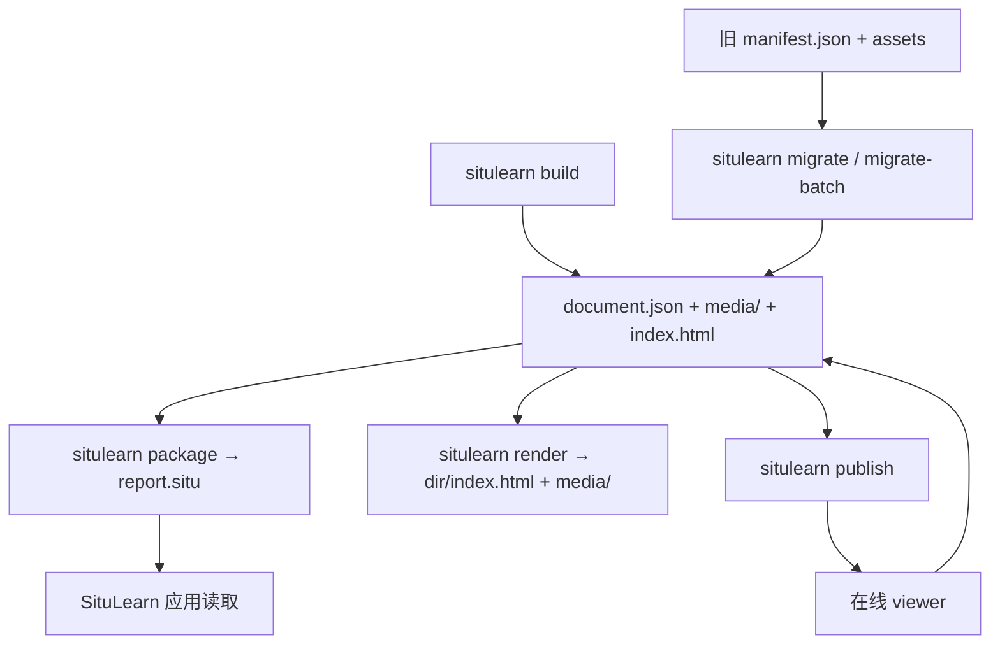

# 情景学习 轻量文档格式（SituLearn Document）技术方案

| 字段 | 内容 |
| --- | --- |
| 标题 | 情景学习 轻量文档格式（SituLearn Document）技术方案 |
| 主笔 | alang |
| 评审人 | 用户 + 多轮独立评审（已批准） |
| 创建日期 | 2026-11-04 |
| 目标版本 | v0.4 |
| 关联资源 | [总体架构](../../architecture/system.md)；[SPEC-001](../SPEC-001-subtitle-learning-report/spec.md)；[SPEC-002](../SPEC-002-report-web-publishing/spec.md)；[SPEC-003](../SPEC-003-content-type-profiles/spec.md)；[附录 A](#附录-a同类格式调研)；[附录 E](#附录-e外部评审处置) |

## 1. 背景与上下文

### 1.1 系统现状

情景学习当前的正式产物是一个报告目录：

```text
reports/<name>/
├── manifest.json     # 生成数据：来源、叙事章节、词条、音频资产、配置、警告
├── report.html       # 离线渲染产物
└── assets/audio/     # 音频文件
```

`manifest.json` 同时承担构建记录、内容模型与展示输入三件事。离线 HTML 与 Web 渲染器各自把 manifest 映射成模板数据；新增元素要同时改 schema、两套模板和发布链路。

### 1.2 核心痛点

1. **没有可移动的文档**：用户拿到的是目录 + HTML，离开目录就无法完整表达内容。
2. **没有在线/离线同构**：离线引用本地文件，Web 重新读 manifest、重新拼 URL。
3. **格式太重**：构建配置、缓存信息、展示结构混在一起；新增图片或单词卡片成本高。
4. **内容类型渗透到展示层**：`content_type` 同时影响提示词、章节数和界面文案。
5. **无法表达元素**：只有“章节”和“词条”两种固定形状，无法表达“文字 + 音频”“图片 + 文字 + 音频”“单词卡片”。

### 1.3 设计目标（用户已确认）

- **彻底替换**：用新的文档格式替换报告格式，而不是给 manifest 加展示层。
- **轻量**：不要很重的“演示文档”模型；只要一个清楚、能表达多种元素的文件格式。
- **双形态**：同一份内容可以是自带图片/音频的压缩包，也可以是 JSON + 网络资源。
- **离线/在线同构**：本地离线观看和在线观看必须由同一份文档驱动。

### 1.4 本次不做

- 视频、动画、时间轴、转场、逐帧导出。
- PPTX、PDF、EPUB 导出。
- 富文本 span/mark、行内批注、词条高亮。
- 交互题、测验、分支剧情。
- `.situ` 包内自带 viewer；包只存数据。
- 图片生成管线（格式支持图片，生成可后置）。
- 多文档打包、加密、DRM、签名。
- 绝对 URL / 外链资源（Deferred）。

## 2. 目标与非目标

### 2.1 目标

- **G1 - 单一文档**：`document.json` 是唯一内容真相；`.situ` 只是把同一份 JSON 和媒体文件打成一个 zip。
- **G2 - 最小元素**：`text`、`image`、`audio`、`word` 四个原语，加一个 `group` 容器；用组合表达多种形态。
- **G3 - 离线/在线同构**：资源只用相对 `href`，且必须位于 `media/` 下；解析器以文档位置为 base。
- **G4 - 彻底替换**：`manifest.json` / `report.html` 不再是正式产物；`build` 产出文档、媒体与派生 `index.html`，`package` 打包，`render` 生成派生视图，`migrate` 迁移旧报告。
- **G5 - 内容类型解耦**：内容类型只影响生成策略、默认元素组合与可选文案；文档格式与渲染器不按内容类型分支。
- **G6 - 轻量且可校验**：无 manifest 嵌套、无绝对坐标、无包内 viewer；strict writer / tolerant reader 分开。
- **G7 - 可迁移且不丢信息**：章节、词条、词→章节关系、分类、标签、来源与音频都进入新文档；迁移幂等、可批量执行。
- **G8 - 可安全发布**：publish token 是信任边界；服务端严格校验文档与媒体；报告按 owner 隔离。

### 2.2 非目标

- **NG1 - 重演示模型**：不引入 slides/layouts/actions/timeline 等演示编排层。
- **NG2 - 包内 viewer**：`.situ` 只含 `document.json` 与媒体。
- **NG3 - 绝对定位**：不存 `x/y/width/height`；布局由 viewer 决定。
- **NG4 - 资源内嵌**：v1 不支持 base64/data URI。
- **NG5 - 自动在线转换**：旧 bundle 不自动改写；需要显式 `migrate` / `migrate-batch`。
- **NG6 - 多文档包**：一个 `.situ` 只对应一个 `document.json`。
- **NG7 - HTML 作为格式一部分**：HTML 只是派生视图，不进入 `.situ`。

## 3. 架构设计与核心方案

### 3.1 总体架构



两层模型：

1. **文档层**：`document.json`，纯 JSON，描述内容与资源引用。
2. **容器层**：`.situ`，一个 zip，根目录固定有 `document.json`，媒体按 `media/...` 存放。

核心原则：**内容与容器分离，资源与位置分离。**

- 文档只知道资源的相对 `href`；不知道自己在 zip 里还是在网络上。
- 解析器以文档位置为基准：包内是 zip 根，在线是文档 URL。
- `.situ` 不是另一种格式，只是同一份文档的容器。

### 3.2 核心模块职责

- **Document Models（新增）**：`Document`、`Meta`、`Resource`、`Section`、`Block`（`TextBlock` / `ImageBlock` / `AudioBlock` / `WordBlock` / `GroupBlock`）的 Pydantic 模型。
- **Strict Writer / Tolerant Reader（新增，分开实现）**：写入严格；读取跳过未知/损坏元素并 warning。
- **Compiler（改造）**：构建管线产出文档；内容类型 profile 只负责提示词、章节范围、TTS 与默认元素组合；LLM 只产出内容投影，Compiler 填 ID/href/资源。
- **Packager（新增）**：只打包 `document.json` 与被引用资源；校验路径安全、去重、确定性；只校验哈希，不改写文档。
- **Resolver（新增）**：以文档位置为 base 解析 `media/...`；包内读 zip entry，在线走 HTTP。
- **Renderer（改造）**：按 block `type` 分派；所有文档字符串转义；输出派生 HTML 目录。
- **Migrator（新增）**：旧 manifest + assets → 新文档；字段级映射、确定性 ID、幂等；支持批量。
- **Publisher（改造）**：上传文档与媒体；服务端以 publish token 为信任边界，按 owner 隔离 `report_key`；服务端严格校验文档与媒体。

### 3.3 核心数据流转

**构建**：

1. `situlearn build` 解析字幕、生成叙事与词条、合成音频。
2. 输出 `document.json`、`media/`，默认同时生成派生 `index.html`；`--no-render` 可关闭。
3. 可选 `--package` 产出 `report.situ`；`.situ` 不包含 `index.html`。

**本地观看**：

1. 读取 `.situ` 根部的 `document.json`。
2. 对每个 `resources[*].href`，以 zip 根为 base，读取对应 entry。
3. Renderer 按 block 类型渲染。

**在线观看**：

1. 从 `https://host/r/<slug>/document.json` 读取文档（public projection）。
2. 对每个 `href`，以文档 URL 为 base，解析成 `https://host/r/<slug>/media/...`。
3. 同一个 Renderer 渲染，资源按需加载。

**迁移**：

1. `situlearn migrate reports/old` 读取旧 `manifest.json` 与 `assets/`。
2. 按字段级映射生成 `document.json` 与 `media/`。
3. 输出到新目录；旧目录保持不动。
4. 已发布 bundle 通过 `migrate-batch` 处理导出的旧 bundle 目录。

### 3.4 关键选型与约束

- **JSON 为主、zip 为容器**：一份文档模型；zip 只是相对路径的物理承载。
- **相对 `href`，且限定 `media/`**：同一份 JSON 在包内和在线都能用；与公开路由 `/r/<slug>/media/...` 一一对应。
- **v1 不允许绝对 URL**：离线优先；外链资源 Deferred。
- **最小原语 + `group`**：多元素旁白单元必须用 `group`，避免同一内容有两种合法编码。
- **`word` 只出现在生词本 section**：叙事 section 只用 `keywords` 引用词卡；词卡数据只有一份。
- **包只存数据**：`.situ` 不含 viewer；观看器是 SituLearn 应用/网页。
- **写入严格、读取宽容**：strict writer / tolerant reader 分开。
- **内容类型不进入格式**：`meta.kind` 只是提示。
- **publish token 是信任边界**：`report_key` 按 owner 隔离；服务端不信任客户端声明的归属。

### 3.5 变与不变

- **新增**：`document.json`、`.situ`、Document 模型、strict/tolerant 解析、`package` / `render` / `migrate` / `migrate-batch` 子命令、Resolver、Packager、旧 bundle 导出流程。
- **改造**：构建输出、Web 发布与渲染、HTML 渲染入口、内容类型 profile 的输出映射。
- **删除/废弃**：`manifest.json` 与 `report.html` 作为正式产物；`NarrativeSection` / `TermEntry` 作为对外 schema；离线与 Web 两套手工字段映射；legacy manifest 读取路径。
- **取代**：SPEC-004 取代 SPEC-002 的报告格式/发布契约，以及 SPEC-003 中“manifest 与 publish 语义不变”的承诺；实施时同步更新 `system.md`、SPEC-002/003 的状态说明与索引。
- **不变**：SRT 解析、切分、LLM 提示词、词典、TTS、缓存；同一 owner 内“同一 key 覆盖”的语义。

## 4. 详细设计

### 4.1 文档顶层

| 字段 | 类型 | 必填 | 说明 |
| --- | --- | --- | --- |
| `format` | string | 是 | 固定为 `situlearn.document` |
| `version` | int | 是 | 格式版本，本次为 `1`；读取端只接受 `1` |
| `meta` | object | 是 | 文档元数据 |
| `resources` | object | 否 | 资源注册表；没有媒体时可省略 |
| `sections` | array | 是 | 有序章节；至少 1 个 |
| `extensions` | object | 否 | 唯一的扩展入口；嵌套对象不再有 `extensions` |

未知顶层字段读取时忽略，写入时不生成。

### 4.2 `meta`

| 字段 | 类型 | 必填 | 说明 |
| --- | --- | --- | --- |
| `id` | string | 否 | 稳定文档 ID；64 位小写 hex。有 `source.sha256` 时等于它；无 source 时作者必须提供 |
| `title` | string | 是 | 文档标题 |
| `language` | string | 是 | 文档/界面语言，BCP-47，例如 `zh-CN` |
| `subtitle` | string | 否 | 副标题 / logline |
| `description` | string | 否 | 背景介绍 |
| `kind` | string | 否 | 开放提示，例如 `documentary` / `movie`；不参与解析 |
| `created_at` | string | 否 | ISO 8601 UTC；迁移时可省略以保持幂等 |
| `generator` | object | 否 | `name`、`version` |
| `source` | object | 否 | `filename`、`sha256`、`language`、`duration_ms`、`cue_count` |
| `labels` | object | 否 | 界面文案覆盖；见 4.2.1 |
| `attribution` | array | 否 | 来源署名，例如词典与 TTS 名称 |
| `extensions` | object | 否 | 扩展字段（顶层唯一） |

`meta.source.sha256`：64 位小写 hex；`meta.source.language` 是**源媒体语言**（例如 `en`），与 `meta.language`（文档/界面语言）分开。

**`meta.id` / `report_key`**：

1. 有 `meta.source.sha256` → `meta.id` 等于它，`report_key` 用它；
2. 没有 source → 作者必须提供 `meta.id`（64-hex），`report_key` 用它；
3. 两者都没有 → 不是可发布文档；
4. **不做随机生成**；构建始终有 source，迁移始终有旧 `source.sha256` 或确定性哈希；
5. **publish token 是信任边界**：服务端按 token 识别 owner，`report_key` 在 owner 内唯一。同一 owner 同 key 覆盖，跨 owner 不可能覆盖；
6. 服务端不重新计算 `source.sha256`（它拿不到源字幕），只校验格式、文档合法性与 owner 归属；
7. 公开文档不包含 `meta.id` / `meta.source.sha256` / `filename`（见 4.9.1），避免 key 与本地路径泄露。

#### 4.2.1 `labels`

`labels` 是自由字符串映射；**写入端必须**填充现有 19 个 `ReportLabels` 键 + `vocabulary_heading` + 5 个分类键；读取端缺失时使用 viewer 默认值。未知键允许，值必须是字符串。

| 现有键 | 用途 |
| --- | --- |
| `report_eyebrow` | 离线报告眉题 |
| `web_eyebrow` | Web 报告眉题 |
| `narrative_heading` | 叙事标题 |
| `narrative_lead` | 叙事导语 |
| `play_all` | 播放全部 |
| `play_section` | 播放本节/本场 |
| `no_audio` | 暂无音频 |
| `expand_script` | 展开播报稿 |
| `section_unit` | 章节/场景 |
| `section_counter_unit` | 章/场 |
| `this_section` | 本节/本场 |
| `key_terms_heading` | 本节关键词 |
| `vocab_lead` | 词表导语 |
| `all_sections` | 全部章节 |
| `back_to_section` | 回到本节 |
| `previous_section` | 上一章 |
| `next_section` | 下一章 |
| `progress_narrative` | 叙事脉络 |
| `progress_section_audio` | 章节音频 |

新增：

| 键 | 默认 |
| --- | --- |
| `vocabulary_heading` | 生词本 |
| `category.domain_term` | 领域术语 |
| `category.proper_noun` | 专名 |
| `category.work_title` | 作品名 |
| `category.school_genre` | 流派/时期 |
| `category.common_advanced` | 低频普通词 |
| `filter_all` | 全部 |
| `filter_category` | 按分类筛选 |
| `filter_section` | 按章节筛选 |
| `search_words` | 搜索单词、释义或语境 |
| `no_words` | 没有匹配的单词 |

### 4.3 `resources`

```json
"resources": {
  "aud-0001": {
    "type": "audio",
    "mime": "audio/mpeg",
    "href": "media/audio/section-01.mp3",
    "duration_ms": 41200,
    "sha256": "...",
    "source": "tts"
  },
  "img-0001": {
    "type": "image",
    "mime": "image/jpeg",
    "href": "media/images/section-01.jpg",
    "width": 1600,
    "height": 900,
    "sha256": "...",
    "alt": "十五世纪佛罗伦萨的城市版画"
  }
}
```

| 字段 | 类型 | 必填 | 说明 |
| --- | --- | --- | --- |
| `type` | enum | 是 | `audio` / `image` |
| `mime` | string | 是 | MIME；必须与 `type` 匹配并在白名单内 |
| `href` | string | 是 | 相对路径，必须匹配 `^media/[A-Za-z0-9._/-]+$` |
| `duration_ms` | int | 否 | 音频时长，≥0 |
| `width` / `height` | int | 否 | 图片尺寸，≥1 |
| `sha256` | string | 是 | **媒体文件字节**的 sha256；build/compile/migrate 必须写入；package/publish 校验 |
| `source` | enum | 否 | `tts` / `dictionary` / `generated` |
| `alt` | string | 否 | 图片默认替代文本 |
| `credit` | string | 否 | 署名 |

规则：

- 资源 ID：`[A-Za-z0-9][A-Za-z0-9._-]{0,63}`；文档内唯一。
- `href` 全文档唯一；两个资源不得指向同一路径（避免服务端 MIME 歧义）。
- `href` 是 RFC 3986 relative reference：无 scheme/netloc/query/fragment；无 `..`、`.`、空段、反斜杠、盘符、NUL；无百分号编码分隔符；NFC 规范化；大小写敏感。
- v1 不允许绝对 URL；外链 Deferred。
- `sha256` 必填；读取端缺失 → warning + 占位；package/publish 缺失或不匹配 → 拒绝。

### 4.4 `sections`

| 字段 | 类型 | 必填 | 说明 |
| --- | --- | --- | --- |
| `id` | string | 是 | 文档内唯一，`[A-Za-z0-9._-]{1,64}` |
| `role` | enum | 是 | `narrative` / `vocabulary` / `cover` / `summary` |
| `title` | string | 是 | 章节标题 |
| `subtitle` | string | 否 | 章节副标题 |
| `time` | object | 否 | `start_ms`、`end_ms`；narrative section 必填，其他 role 可选/不写 |
| `layout` | enum | 否 | `stack` / `row` / `grid`；非规范性提示 |
| `keywords` | array | 否 | 关键词引用；见 4.4.1 |
| `blocks` | array | 是 | 有序元素列表；至少 1 个 |

结构规则：

- `role: "vocabulary"`：只放 `word` 块；`id` 由编译器固定为 `vocabulary`（每文档最多 1 个）。
- `role: "narrative"`：必须包含**恰好一个** `role: "narration"` 的 `group`；不得有第二个 narration group；section 顶层不允许散落 `text/image/audio`。
- `role: "cover"` / `"summary"`：可包含 `text/image/group`，不得包含 `word`；不得包含 `role: "narration"` 的 group。
- `narration` group 只能作为 `narrative` section 的**直接子元素**；嵌套 group 不得有 `role: "narration"`。
- `word` 块只允许出现在 `vocabulary` section。
- 带 `time` 的 section 必须是 `narrative`；按数组顺序 `start_ms` 不递减；**允许重叠但写入端 warning**（兼容旧 manifest），不拒绝。
- `keywords` 只用于 `narrative` section。

#### 4.4.1 `keywords`

```json
"keywords": [{ "word_id": "w-0001" }]
```

| 字段 | 类型 | 必填 | 说明 |
| --- | --- | --- | --- |
| `word_id` | string | 是 | `vocabulary` section 中 `word` 块的 ID |

规则：

- `word_id` 必须解析到一个 `word` 块；展示文本来自词卡，不再单独存 `term`。
- **一致性**：该 `word.section_id` 必须等于当前 narrative section 的 `id`；严格写入拒绝跨 section 引用。读取端遇到不一致时 warning，以 `word.section_id` 为筛选依据。
- 迁移时 `key_terms` 只保留能匹配到词条且 `section_id` 一致的项；匹配不到则丢弃并 warning。

### 4.5 `blocks`

公共字段：

| 字段 | 类型 | 必填 | 说明 |
| --- | --- | --- | --- |
| `type` | string | 是 | 元素类型判别键 |
| `id` | string | 否 | 文档内唯一；`[A-Za-z0-9._-]{1,64}`；`word` 必填 |
| `layout` | enum | 否 | `stack` / `row` / `grid`；非规范性提示 |

#### 4.5.1 `text`

| 字段 | 类型 | 必填 | 说明 |
| --- | --- | --- | --- |
| `text` | string | 是 | 描述性文字 |
| `markup` | enum | 否 | `plain`（默认）/ `markdown`；v1 只要求 `plain` |
| `style` | enum | 否 | `body`（默认）/ `heading` / `caption` / `quote` |
| `lang` | string | 否 | BCP-47；对话/双语内容预留 |
| `speaker` | string | 否 | 说话人；对话内容预留 |

`quote` 只作为 `text.style`，不是独立 block。

#### 4.5.2 `image`

| 字段 | 类型 | 必填 | 说明 |
| --- | --- | --- | --- |
| `resource` | string | 是 | 图片资源 ID |
| `alt` | string | 否 | 覆盖资源默认 `alt` |

图片说明用紧随其后的 `text` 块（`style: "caption"`）。

#### 4.5.3 `audio`

| 字段 | 类型 | 必填 | 说明 |
| --- | --- | --- | --- |
| `resource` | string | 是 | 音频资源 ID |
| `script` | string | 否 | 仅独立 `audio` 块使用；**任何 `group` 内禁止使用** |
| `label` | string | 否 | 播放器显示名 |

#### 4.5.4 `word`

| 字段 | 类型 | 必填 | 说明 |
| --- | --- | --- | --- |
| `id` | string | 是 | `[A-Za-z0-9._-]{1,64}`；唯一；被 `keywords` 引用 |
| `term` | string | 是 | 词/短语/句子 |
| `kind` | enum | 否 | `word`（默认）/ `phrase` / `sentence` |
| `lemma` | string | 否 | 原形 |
| `ipa` | string | 否 | 音标 |
| `pronunciation_note` | string | 否 | 发音提示 |
| `part_of_speech` | string | 否 | 词性 |
| `definitions` | object | 是 | BCP-47 键 → 释义；至少 1 个 |
| `context` | string | 否 | 语境原句 |
| `note` | string | 否 | 为什么值得记 |
| `category` | string | 否 | 词条分类 |
| `section_id` | string | 是 | 该词出现的 narrative section ID；必须解析 |
| `audio` | string | 否 | 发音资源 ID |
| `image` | string | 否 | 词卡配图资源 ID |
| `sources` | array | 否 | `{name, url}`；`url` 只允许 http/https |
| `tags` | array | 否 | 自由标签 |

规则：

- `definitions` 键必须是 BCP-47；渲染回退顺序：`meta.language` 完全匹配 → 主标签（`zh`）→ 插入顺序。空/空白值拒绝。
- `section_id` 必须解析到 `role: "narrative"` 的 section；严格写入拒绝悬空。
- `id` 必填；`keywords[].word_id` 必须能解析到它。
- `word` 只允许在 `vocabulary` section。

#### 4.5.5 `group`

| 字段 | 类型 | 必填 | 说明 |
| --- | --- | --- | --- |
| `blocks` | array | 是 | 子元素；至少 1 个 |
| `layout` | enum | 否 | `stack`（默认）/ `row` / `grid` |
| `role` | enum | 否 | `narration` / `visual` / `mixed` |
| `script` | string | 否 | 仅 `role: "narration"` 的 group 使用；整个旁白单元的完整文稿；多段音频只写一次 |

规则：

- `role: "narration"` 的 group 是 narrative section 的唯一旁白编码；承载 `[image?, text, audio...]`。
- `group.script` 只允许出现在 `role: "narration"` 的 group；任何 group 内禁止 `audio.script`；文稿只放 `group.script`。
- 嵌套 group 不得有 `role: "narration"`；`narration` group 只能是 narrative section 的直接子元素。
- 允许嵌套，但硬上限 3 层；超过拒绝。

### 4.6 结构校验与限额

- ID：`[A-Za-z0-9._-]{1,64}`；section/block 文档内唯一；resource 在 `resources` 内唯一。
- 资源引用：`image.resource` → image；`audio.resource` / `word.audio` → audio；`word.image` → image；全部必须解析。
- `keywords[].word_id` 必须解析；`word.section_id` 必须解析；二者必须同 section。
- 限额（写入拒绝，读取跳过/截断）：

| 项目 | 上限 |
| --- | --- |
| sections | 200 |
| 全文档 blocks | 10,000 |
| group 嵌套深度 | 3 |
| resources | 9,999 |
| `.situ` entries（含 document.json） | 10,000 |
| 单 entry 解压后 | 512 MiB |
| 包总解压后 | 1 GiB |
| 压缩比 | 1000:1 |

### 4.7 离线/在线资源解析

- `resolve(href, base) = resolve_uri(base, href)`。
- 包内：base = `.situ` 根；`media/...` 读取对应 zip entry；不要求解压到磁盘。
- 在线：base = `https://host/r/<slug>/document.json`；`media/...` → `https://host/r/<slug>/media/...`。
- 文档内容不需要按模式改写；只有 base 不同。
- `href` 是 RFC 3986 relative reference；包内查找使用 NFC 字面 UTF-8；在线按注册 href 精确映射；无 query/fragment。
- v1 无绝对 URL；离线 HTML CSP 继续禁止外网。

### 4.8 `.situ` 容器

```text
report.situ
├── document.json          # 必须，固定入口
└── media/
    ├── audio/
    │   └── section-01.mp3
    └── images/
        └── section-01.jpg
```

规则：

- `document.json` 在 zip 根，文件名固定、大小写敏感；
- **只允许** `document.json` 与 `resources[*].href`；其他文件拒绝/跳过并 warning；
- 不含 viewer、HTML、脚本；
- entry 名 `/` 分隔、UTF-8、NFC、大小写敏感；
- 禁止绝对路径、`..`、`.`、空段、反斜杠、盘符、NUL、符号链接、重复 entry、大小写冲突；
- 确定性：entry 排序、固定时间戳（1980-01-01）、固定压缩策略；同一输入 → 相同字节；
- **Packager 只校验哈希，不改写 `document.json`**；哈希由 build/compile 写入；
- `.situ` MIME 建议 `application/vnd.situlearn+zip`；文档 MIME 建议 `application/vnd.situlearn.document+json`。

### 4.9 渲染

Renderer 契约：

1. 只按 block `type` 分派；不读 `content_type`、不因 `kind` 分支。
2. Section 按数组顺序；`layout` 是提示，未知回退 `stack`；未知 `section.role` → 跳过该 section + warning。
3. Narrative section 渲染其 narration group；`group` 递归；未知 `layout` 回退 `stack`；嵌套 >3 拒绝。
4. `text` 默认纯文本转义；`markdown` 仅在显式支持并清洗后启用。
5. `audio` 播放按钮；多音频块按文档顺序组成 section 播放列表；`group.script` 只显示一次；任何 group 内 `audio.script` 被拒绝；独立 audio 块可用 `audio.script`；缺资源显示 `labels.no_audio`。
6. `image` 渲染图片与 `alt`；缺资源占位；说明用后续 caption text。
7. `word` 渲染卡片：term、kind、IPA、词性、释义（4.5.4 回退）、语境、note、发音、配图、分类标签、sources；`resources.credit` 与 `meta.attribution` 在页脚。
8. `keywords` 渲染 chips；按 `word_id` 跳到词卡；无 `word_id` 不出现（strict 文档不允许）。
9. **所有文档字符串**在文本与属性上下文转义；`markdown` 必须清洗；`sources[].url` 只允许 http/https，加 `rel="noopener noreferrer"`。
10. 在线 `href` 解析为公开 URL；离线解析为包内 entry。
11. `meta.labels` 覆盖默认文案；分类标签优先 `labels.category.*`。
12. `meta.attribution` 渲染为页脚署名。
13. **Vocabulary 专用组件**：`vocabulary` section 渲染为“筛选工具栏 + 词卡网格”，而不是平铺长列表。工具栏包含分类筛选（All + 5 个 category）、章节筛选（All + 每个 narrative section）、搜索（term/definitions/context）、当前数量和空状态。筛选默认在客户端完成，离线 HTML 与 Web 页面共用同一套 DOM 契约；词卡带 `data-category`、`data-section-id`、`data-search`。

**4.9.1 公开投影（public projection）**

服务端公开的 `document.json` 是 canonical 文档的投影：

- 移除 `meta.id`、`meta.source.filename` 与 `meta.source.sha256`；
- 保留 `meta.source.language` / `duration_ms` / `cue_count`（可选）；
- 其余字段不变；
- 服务端在存储前用 canonical 文档计算 `report_key`，公开投影不参与 key；
- 离线文档保留完整 `meta.source`，因此“同一内容”不是逐字节相同；格式契约是“同一内容模型 + 公开投影裁剪”。

**派生 HTML**：

- `build` 默认在输出目录生成 `index.html`（`--no-render` 关闭）；与 `document.json`、`media/` 同目录，相对 `href` 正确。
- `render <dir|.situ> --out <output-dir>`：输出目录必须**不存在或为空**；不得位于输入目录内部；输出只含 `index.html` + `media/`，不复制 `document.json`；`.situ` 会解压/复制媒体。
- HTML 不进入 `.situ`，不是内容真相；离线 HTML 不依赖外部网络。

### 4.10 校验、读写模式与错误

**写入/迁移（严格）**：

| 场景 | 处理 |
| --- | --- |
| `format` 错误 / `version != 1` | 拒绝 |
| `sections` 为空 | 拒绝 |
| ID 非法/重复 | 拒绝 |
| `href` 不以 `media/` 开头或不合规 | 拒绝 |
| `href` 重复 | 拒绝 |
| 资源引用不存在 / 类型不匹配 | 拒绝 |
| `word` 不在 vocabulary / `word.id` 缺失 / `word.section_id` 悬空 | 拒绝 |
| `keywords[].word_id` 缺失/悬空/跨 section | 拒绝 |
| narrative 顶层散落 `text/image/audio` | 拒绝 |
| narrative 不是恰好一个 narration group / 多个 narration group | 拒绝 |
| 任何 group 内出现 `audio.script` | 拒绝 |
| `group.script` 出现在非 narration group | 拒绝 |
| `cover`/`summary` 包含 narration group，或嵌套 group 带 narration role | 拒绝 |
| `resources[].sha256` 缺失 | 拒绝 |
| `meta.id` 格式错误 / 与 `source.sha256` 不一致 / 无 source 且缺失 | 拒绝 |
| `group` 嵌套 >3 | 拒绝 |
| 带 `time` 的 narrative 顺序倒置 | 拒绝 |
| `word.definitions` 为空/空白 | 拒绝 |
| `sources[].url` 不是 http/https | 拒绝 |
| MIME 与类型不匹配 / 不在白名单 | 拒绝 |
| 超出限额 | 拒绝 |

重叠时间：写入端 **warning**（兼容旧 manifest），不拒绝。

**读取/渲染（宽容）**：

| 场景 | 处理 |
| --- | --- |
| 未知顶层字段 | 忽略 |
| 未知 block 类型 | 跳过 + warning |
| 已知 block 损坏 | 跳过该 block + warning |
| 未知 `layout` | 回退 `stack` |
| 未知 `section.role` | 跳过该 section + warning |
| 未知 `word.kind` | 回退 `word` + warning |
| 未知 `resource.source` | 省略 + warning |
| 未知 `text.style` | 回退 `body` + warning |
| 未知 `markup` | 回退 `plain` + warning |
| `group.script` 在非 narration group | 忽略 + warning |
| 资源缺失 | 占位/`labels.no_audio` |
| 资源类型不匹配 | 跳过该元素 + warning |
| `resources[].sha256` 缺失 | warning + 占位 |
| group 内 `audio.script` | 忽略该 script + warning |
| `sha256` 不匹配 | warning + 占位（离线/在线一致） |
| labels 缺键 | viewer 默认 |
| `version != 1` | 拒绝 |
| `word.section_id` 悬空/跨 section | warning；筛选按 `word.section_id` |
| `keywords[].word_id` 悬空 | 跳过 chip + warning |

**错误码**（code → 方向 → 触发）：

| 错误码 | 方向 | 触发 |
| --- | --- | --- |
| `document/unknown-format` | write/read | `format` 非 `situlearn.document` |
| `document/unsupported-version` | write/read | `version != 1` |
| `document/empty-sections` | write | `sections` 为空 |
| `document/duplicate-id` | write | section/block/resource ID 重复 |
| `document/invalid-id` | write | ID 不符合正则/长度 |
| `document/invalid-href` | write | href 不合规 |
| `document/duplicate-href` | write | 两个资源同一 href |
| `document/unsupported-mime` | write/read | MIME 不匹配/不在白名单 |
| `document/unresolved-resource` | write/read | 资源引用不存在 |
| `document/resource-type-mismatch` | write/read | image/audio 引用类型错误 |
| `document/invalid-time` | write | start >= end |
| `document/time-out-of-order` | write | 带 time 的 narrative section 顺序倒置 |
| `document/overlapping-time` | write/read | 时间区间重叠（warning） |
| `document/unknown-block-type` | read | 未知 block 类型 |
| `document/malformed-block` | read | 已知 block 结构损坏 |
| `document/unknown-role` | read | 未知 section.role / group.role |
| `document/unknown-layout` | read | 未知 layout，回退 |
| `document/unknown-word-kind` | read | 未知 word.kind，回退 |
| `document/unknown-source` | read | 未知 resource.source，忽略 |
| `document/invalid-block` | read | block/group 子项不是对象 |
| `document/empty-group` | read | group 没有已知子元素，跳过 |
| `document/empty-section` | read | section 没有已知元素，跳过 |
| `document/malformed-document` | read | tolerant 后仍结构性非法 |
| `document/missing-label` | write | 缺少 25 个 labels 键 |
| `document/invalid-word-section` | write | word 不在 vocabulary / section_id 悬空 |
| `document/missing-narration-group` | write | narrative 不是恰好一个 narration group |
| `document/duplicate-narration-group` | write | narrative 有多个 narration group |
| `document/scattered-narration` | write | narrative 顶层散落 text/image/audio |
| `document/audio-script-in-group` | write (reject); read (warning) | 任何 group 内出现 audio.script |
| `document/script-on-non-narration-group` | write/read | `group.script` 出现在非 narration group |
| `document/narration-in-cover` | write | cover/summary 含 narration group |
| `document/nested-narration-group` | write | 嵌套 group 带 narration role |
| `document/missing-hash` | write (reject); read (warning); package/publish (reject) | `resources[].sha256` 缺失 |
| `document/invalid-id-source` | publish | 无 source 且无 `meta.id` |
| `document/invalid-definitions` | write/read | `word.definitions` 为空/空白 |
| `document/invalid-source-url` | write/read | `sources[].url` 非 http/https |
| `document/invalid-meta-id` | write | `meta.id` 非 64-hex 或与 source 不一致 |
| `document/invalid-vocabulary-content` | write | vocabulary section 含非 word 块 |
| `document/keywords-on-non-narrative` | write | 非 narrative section 带 keywords |
| `document/missing-word-id` | write | `word.id` 缺失 |
| `publish/invalid-slug` | publish | `requested_slug` 格式非法（422） |
| `publish/slug-conflict` | publish | slug 被其他 report 占用（409） |
| `migrate/missing-source-sha256` | migrate-batch | 导出 bundle 缺 `source.sha256` |
| `document/unknown-style` | read | 未知 text.style / markup，回退 |
| `authoring/unknown-term` | compile | `sections[].terms` 在 `words[]` 中找不到 |
| `authoring/duplicate-term` | compile | `words[]` 中 term 重复 |
| `authoring/unreferenced-word` | compile warning | `words[]` 中词未被任何 section 引用 |
| `authoring/empty-vocabulary` | compile | 所有词都未被引用，无法生成 vocabulary |
| `authoring/duplicate-term-reference` | compile warning | 同一 `sections[].terms` 内重复 |
| `authoring/term-cross-section` | compile warning | 后续 section 重复列出已分配词 |
| `document/dangling-keyword` | write/read | keywords.word_id 悬空 |
| `document/cross-section-keyword` | write/read | keyword 与 word.section_id 不一致 |
| `document/limit-exceeded` | write/read/package | 超出 4.6/4.8 限额 |
| `document/hash-mismatch` | read (warning); package/publish (reject) | `sha256` 不匹配 |
| `document/unsafe-package-path` | package/read | 非法 entry |
| `document/duplicate-package-entry` | package/read | 重复 entry |
| `document/unreferenced-package-entry` | package | 未引用文件（warning） |
| `document/missing-resource` | package/read | 资源文件缺失 |

### 4.11 版本与兼容

- `version` 整数主版本；本次 `1`；读取端只接受 `1`，其他版本拒绝。
- 新增可选字段不递增；新增枚举值必须定义读取回退（见 4.10），否则递增主版本。
- 破坏性变更递增主版本；写入端永远输出当前版本。

### 4.12 内容类型映射

| 维度 | documentary | movie |
| --- | --- | --- |
| `meta.kind` | `documentary` | `movie` |
| `meta.language` / `source.language` | `zh-CN` / `en` | 同左 |
| 章节数 | 4–8 | 6–12 |
| `section.role` | `narrative` + `vocabulary` | 同左 |
| 默认 narration | 一个 `group(role=narration)`，含 `text + audio` | 同左 |
| 生词本 | `role: vocabulary`，`id: vocabulary`，`layout: grid` | 同左 |
| 关键词 | narrative 的 `keywords` 引用同 section 的 `word_id` | 同左 |
| `meta.labels` | 19 键 + `vocabulary_heading` + 分类键 | 电影 19 键 + `vocabulary_heading` + 分类键 |
| `meta.attribution` | 词典/TTS 署名 | 同左 |
| TTS 语气 | provider 默认 | 剧情解说语气 |

新增内容类型只新增 profile 与默认元素组合；格式、Resolver、Renderer 不改。

### 4.13 旧报告迁移

`situlearn migrate <old-report-dir> --out <new-dir>`；`situlearn migrate-batch <export-root> --out <out-root>`。

**字段级映射**（以现有 `TermEntry` / `NarrativeSection` / `ReportManifest` 为准）：

| 旧字段 | 新位置 |
| --- | --- |
| `narrative.title` | `meta.title` |
| `narrative.logline` | `meta.subtitle` |
| `narrative.background` | `meta.description` |
| `source.filename` | `meta.source.filename`（公开投影裁剪） |
| `source.sha256` | `meta.source.sha256` 且 `meta.id` = 它 |
| `source.duration_ms` / `cue_count` | `meta.source.duration_ms` / `cue_count` |
| `source.language`（旧无） | 默认 `en`；`--source-language` 可覆盖 |
| `meta.language`（旧无） | 默认 `zh-CN` |
| `config.content_type` | `meta.kind`；缺失按 `documentary` |
| `profile.labels`（代码常量，19 键）+ `vocabulary_heading` | `meta.labels` 逐键复制；`vocabulary_heading` 默认“生词本” |
| `CATEGORY_LABELS`（代码常量） | `meta.labels.category.*` |
| 词典/TTS 署名（代码常量） | `meta.attribution` |
| `section.section_id` | `section.id`；重复则迁移失败 `document/duplicate-id` |
| `section.heading` | `section.title` |
| `section.start_ms/end_ms` | `section.time` |
| `section.summary` | narration group 的 `text` 块 |
| `section.spoken_text` | narration group 的 `script`（只写一次） |
| `section.audio_refs` | narration group 内 `audio` 块（每 ref 一个；路径 join 到资源 ID；找不到/`unavailable` 跳过 + warning） |
| `section.key_terms` | `section.keywords`；按 `terms[].term` 大小写不敏感精确匹配，且 `word.section_id` 必须等于本节；匹配不到丢弃 + warning |
| `terms[].term` | `word.term` |
| `terms[].ipa` / `pronunciation_note` / `part_of_speech` | `word.*` |
| `terms[].lemma` | **旧 `TermEntry` 没有该字段；不映射** |
| `definition_zh` / `definition_en` | `definitions.zh` / `definitions.en` |
| `context_sentence` | `word.context` |
| `why_it_matters` | `word.note` |
| `terms[].category` | `word.category` |
| `terms[].section_id` | `word.section_id`；无效则赋第一个 narrative section + warning |
| `terms[].audio_ref` | 归一化 `assets/audio/...` → `media/audio/...`，按 `resources[].href` 查找资源 ID；`"unavailable"` 或找不到则跳过 + warning |
| `terms[].sources` | `word.sources` |
| `assets[].path` | `resources[].href`（`assets/audio/...` → `media/audio/...`） |
| `assets[].duration_ms` | `resources[].duration_ms` |
| `assets[].source` | `resources[].source`；`unavailable` 省略 |
| `assets[].text_sha256` | **不映射**（TTS 输入文本哈希，不是媒体哈希） |
| `audio_status` | 不写入；由 `audio_refs` 推导 |
| `warnings` | 只进迁移日志 |
| `config.llm_model` / `tts_voice` / `prompt_version` / `no_audio` | 丢弃；迁移日志列出 |

**迁移规则**：

- **必须创建且只创建一个** `role: "vocabulary"` section：`id: "vocabulary"`，`title` 取 `labels.vocabulary_heading`（默认“生词本”），`layout: "grid"`，追加在所有 narrative section 之后；`blocks` 按旧 `terms[]` 顺序放 `word` 块。
- 每个旧 `NarrativeSection` 生成 `role: "narrative"` 的 section，内部**恰好一个** narration group：`text`（summary）+ 每个 `audio_refs` 一个 `audio` 块 + `group.script`（spoken_text）。
- 迁移时对每个复制的媒体文件计算 `sha256`，写入 `resources[].sha256`；`assets[].text_sha256` 不映射。
- 默认 `meta.attribution = ["Oxford Learner's Dictionaries", "Youdao Dictionary", "小米 MiMo TTS"]`；离线模板中的额外说明属于展示文案，不进入文档。
- 固定 `vocabulary` ID 与旧 `section_id` 冲突时，旧 section 重命名为 `vocabulary-legacy-{index}` + warning；新 vocabulary section 保持 `vocabulary`。
- 旧目录只读，输出到新目录；显式命令，不自动改写旧 bundle。
- ID：`section.id` = 旧 `section_id`；`word.id = w-{index:04d}` 按旧 `terms` 顺序；`resource.id = r-{index:04d}` 按排序后的唯一路径。
- `meta.id` = 旧 `source.sha256`；没有则对 `filename + section IDs` 做 sha256。
- `created_at` 省略（旧 manifest 无可靠时间戳），保证幂等。
- `generator.version` 固定为 migrator 版本。
- 同一旧目录多次迁移 → 相同 `document.json` 字节。
- 重叠时间：保留并 warning（不拒绝）。
- `migrate-batch` 布局：
  ```text
  <export-root>/<report_key>/manifest.json
  <export-root>/<report_key>/assets/...
  <export-root>/<report_key>/bundle.json          # 含旧 slug / published_at
  → <out-root>/<report_key>/document.json + media/ + publish.json
  ```
  每个 bundle 独立失败隔离；重复 `report_key` 报错；有失败则退出码非 0。
- `migrate-batch` 校验目录名等于 `manifest.source.sha256`；不匹配或缺失报错 `migrate/missing-source-sha256`。`<out-root>` 已存在时默认拒绝，`--force` 才覆盖；同一输入重复运行结果一致。

### 4.14 构建、打包、渲染、迁移、发布

**build**：

```bash
situlearn build input.srt --out reports/demo
# reports/demo/document.json
# reports/demo/media/audio/...
# reports/demo/media/images/...
# reports/demo/index.html        # 默认派生视图
```

`--no-render` 关闭 `index.html`；`--package` 额外输出 `reports/demo.situ`（不含 HTML）。

**package**：

```bash
situlearn package reports/demo --out reports/demo.situ
```

只打包 `document.json` 与 `resources[*].href`；其他文件跳过并 warning；只校验哈希，不改文档。

**render**：

```bash
situlearn render reports/demo --out reports/demo-html
situlearn render reports/demo.situ --out reports/demo-html
# reports/demo-html/index.html + media/
```

`--out` 必须不存在或为空，且不得位于输入目录内部；输出只含 `index.html` + `media/`。

**migrate / migrate-batch**：见 4.13。

**publish**：

```bash
situlearn publish reports/demo --server https://learn.example.com
situlearn publish reports/demo.situ --server https://learn.example.com --slug old-slug
# 目录输入若含 publish.json，会自动带 requested_slug
```

发布契约：

- **publish token = 信任边界**；服务端由 token 确定 owner。
- `report_key` = `meta.source.sha256` → `meta.id`；owner 内唯一；同 owner 同 key 覆盖；跨 owner 不可能覆盖。
- 服务端**不重算** `source.sha256`；只校验格式、文档合法性、owner 归属与媒体 MIME。
- 服务端安装前跑 **strict document validation**：schema、`version=1`、ID/引用、`href` 正则、资源类型/MIME 白名单、限额；不合法返回 4xx。
- 服务端存储 canonical 文档与媒体；公开 `document.json` 用 4.9.1 的 public projection。
- 媒体路由只服务已注册 `href`；`Content-Type` 取自 `resources.mime`；只允许 audio/image + JSON；加 `X-Content-Type-Options: nosniff`。
- 旧 manifest 上传/读取端点移除；发布 API 主版本升级。
- 旧 `/r/<slug>/assets/...` 在迁移窗口内 **308** 到 `/r/<slug>/media/...`；窗口结束后移除。

**LLM authoring input（契约，`authoring_version: 1`）**：

`document.json` 是构建产物，不是 LLM 的直接输出。LLM 只产出：

```json
{
  "authoring_version": 1,
  "meta": {
    "title": "...",
    "subtitle": "...",
    "description": "...",
    "language": "zh-CN",
    "kind": "documentary"
  },
  "sections": [
    {
      "role": "narrative",
      "title": "...",
      "time": { "start_ms": 0, "end_ms": 240000 },
      "terms": ["epistemology"],
      "narration": { "text": "...", "script": "..." }
    }
  ],
  "words": [
    {
      "term": "epistemology",
      "kind": "word",
      "ipa": "...",
      "part_of_speech": "noun",
      "definitions": { "zh": "...", "en": "..." },
      "context": "...",
      "note": "...",
      "category": "domain_term",
      "sources": [{ "name": "...", "url": "https://..." }]
    }
  ]
}
```

Authoring 字段：

| 字段 | 类型 | 必填 | 说明 |
| --- | --- | --- | --- |
| `authoring_version` | int | 是 | 固定 `1`；进入缓存键 |
| `meta.title` | string | 是 | 文档标题 |
| `meta.language` | string | 否 | 默认 `zh-CN` |
| `meta.subtitle` / `description` / `kind` | string | 否 | 可选元数据 |
| `sections[]` | array | 是 | 至少 1 个 |
| `sections[].role` | enum | 是 | v1 只允许 `narrative` |
| `sections[].title` | string | 是 | 章节标题 |
| `sections[].time` | object | 否 | `start_ms` / `end_ms` |
| `sections[].terms` | array[string] | 否 | 本节出现的词条；用于生成 `word.section_id` 与 `keywords` |
| `sections[].narration.text` | string | 是 | 展示文字 |
| `sections[].narration.script` | string | 是 | TTS 文稿 |
| `words[]` | array | 是 | 至少 1 个 |
| `words[].term` | string | 是 | 词/短语/句子；`words[]` 内唯一 |
| `words[].kind` / `ipa` / `part_of_speech` / `context` / `note` / `category` / `sources` | 各自类型 | 否 | 词卡可选字段 |
| `words[].definitions` | object | 是 | 至少 1 个 BCP-47 键 |
| `attribution` | array[string] | 否 | 默认取 profile |

Compiler 规则：

- `sections[].terms` 的匹配使用 `casefold()` 精确匹配；找不到 → 编译失败 `authoring/unknown-term`。
- `words[]` 中 `term` 的 `casefold()` 值重复 → 编译失败 `authoring/duplicate-term`。
- `words[]` 中没有任何 section 引用的词 → 丢弃 + warning `authoring/unreferenced-word`（因为输出 `word.section_id` 必填）。
- 如果 `words[]` 非空但所有词都被丢弃（没有任何 section 引用）→ 编译失败 `authoring/empty-vocabulary`，避免生成空 vocabulary section。
- `sections[].terms` 内重复词 → 去重 + warning `authoring/duplicate-term-reference`。
- `word.section_id` = 文档顺序中**第一个**在 `sections[].terms` 包含该词的 narrative section；后续 section 再列出同一词时丢弃并 warning `authoring/term-cross-section`。
- `keywords` 由 `sections[].terms` 生成，只引用同 section 的 `word_id`。
- 生成 section ID：`s-{index:03d}`；word ID：`w-{index:04d}`；resource ID 与 `media/...` 路径由 Compiler 分配。
- `narration.text` → text block；`narration.script` → TTS → 一个或多个 audio block + `group.script`（只写一次）；音频块顺序按 TTS 分块顺序。
- 生成唯一 `vocabulary` section：`id: vocabulary`、`role: vocabulary`、`title: labels.vocabulary_heading`、`layout: grid`，顺序放在 narrative 之后。
- `meta.id = source.sha256`；`source.*` 来自 SRT；`generator` 来自构建器。
- `meta.labels`、`meta.attribution`、`meta.kind`、`meta.language`、`source.language` 由 profile 填充。
- `authoring_version` 进入缓存键；变更需 bump。

### 4.15 Owner 与发布标识

**实体**：

| 实体 | 字段 | 约束 |
| --- | --- | --- |
| `Owner` | `owner_id`（稳定不可变，例如 16-hex）、`name`、`token_hash` | token 明文只在签发时出现；服务端只存 `sha256(token)` |
| `Report` | `report_id`、`owner_id`、`report_key`（64-hex）、`slug`、`current_version` | `UNIQUE(owner_id, report_key)`；`UNIQUE(slug)`；`report_id` 全局唯一 |

`object_prefix` 只存在 `report_versions`，不在 `Report` 实体上重复。

**token → owner**：

- 服务端维护 token 注册表；初始部署可以只有一个 token 和一个 owner。
- 客户端请求不得携带 `owner_id`；服务端从 `Authorization: Bearer <token>` 解析 owner。
- token 轮换只换 token；`owner_id` 不变，历史报告归属不变。

**生命周期 API 的 owner 隔离**：

- 公开阅读路由 `/r/<slug>/...` 是公开的；**owner API** 必须按 owner 隔离。
- `GET /api/v1/reports`、`GET /api/v1/reports/{slug}`、`DELETE /api/v1/reports/{slug}` 必须校验 `report.owner_id == token.owner_id`；跨 owner 返回 **404**（不暴露存在性）。
- 发布路径也按 owner 隔离：`get_by_key(owner_id, report_key)`、owner-scoped upsert；禁止全局 `report_key` 查询。
- repository 接口使用 `get_by_slug(owner_id, slug)`、`unpublish(owner_id, slug)`、`get_by_key(owner_id, report_key)`；禁止 slug-only/key-only 的 owner 操作。
- 公开 viewer 的 `/r/<slug>`、`/chapters/<id>`、`/vocabulary` 仍按 slug 公开，不需要 token。

**`report_key` 派生**：

- `report_key = meta.source.sha256` 如果存在，否则 `meta.id`；两者都无 → 拒绝发布。
- “有 source”指 `meta.source.sha256` 存在；只有 `meta.source` 对象但没有 `sha256` 时，按无 source 处理，必须提供 `meta.id`。
- 服务端**不重算** `source.sha256`（拿不到源字幕）；只校验：
  - 64 位小写 hex；
  - 两者都有时 `meta.id == meta.source.sha256`；
  - `(owner_id, report_key)` 归属。
- `report_key` 不进入公开文档；public projection 移除 `meta.id` 与 `meta.source.sha256`。

**`report_id`**：

- `report_id = uuid5(NAMESPACE_URL, f"situlearn:{owner_id}:{report_key}")`；确定性，同一 owner/key 重试得到同一 ID；不同 owner 同 key 得到不同 ID。
- 新报告在写对象**之前**生成/复用 `report_id`，用于构造对象前缀。

**slug**：

- 新建报告：`slugify(title)` 截断到 55 字符 + `-` + `sha256(owner_id:report_key)[:8]`，总长 ≤ 64。
- 同一 owner 同一 `report_key` 再次发布：复用现有 `report_id` 与 `slug`，覆盖 `current_version`。
- `requested_slug`（multipart form，`[a-z0-9][a-z0-9-]{0,63}`）：
  - 空闲 → 使用；
  - 同 owner 同 report → 复用；
  - 被任何其他 report（包括同 owner 的其他 report）占用 → **409**；
  - 格式非法 → **422** `publish/invalid-slug`。
- 目录输入：`publish` 读取同目录 `publish.json` 的 `slug` 作为 `requested_slug`；`migrate-batch` 在 `<out-root>/<report_key>/publish.json` 写入旧 slug。
- sidecar schema：`{"slug": "<old-slug>", "published_at": "<iso8601>"}`；键固定为 `slug` / `published_at`。
- `.situ` 输入无法携带 sidecar；保留 slug 必须用 `publish --slug`。
- 旧 `/r/<slug>/assets/...` → `/r/<slug>/media/...` 用 **308**。308 保留方法，客户端会重新发送 Range；迁移窗口内服务端同时把旧路径作为 alias 服务，确保 Range 请求不中断。

**存储**：

- 版本前缀：`owners/<owner_id>/reports/<report_id>/<version>/`。
- 版本内文件：
  - `canonical.json`（私有，完整文档，含 `meta.id` / `meta.source`）；
  - `document.json`（公开投影，不含 `meta.id` / `meta.source.filename` / `meta.source.sha256`）；
  - `media/...`。
- 公开路由只服务 `document.json` 与 `media/`；`canonical.json` 永不公开。
- 上传 zip 根部的 `document.json` 视为 canonical 输入；服务端存为 `canonical.json`，并按 4.9.1 生成公开 `document.json`。
- `owners(owner_id PK, name, token_hash UNIQUE, created_at)`。
- `reports(report_id PK, owner_id, report_key, slug, title, status, current_version, UNIQUE(owner_id, report_key), UNIQUE(slug))`。
- `report_versions(report_id, version, status, object_prefix, schema_version, created_at)`；`status` 为 `pending` / `ready` / `superseded` / `deleted`。`superseded` 超过 `PREVIOUS_VERSION_TTL_H` 后清理。
- 回滚：把 `current_version` re-pin 到旧版本；旧对象不删除。

**DB 迁移/引导**：

1. 创建 `owners`；`token_hash = sha256(PUBLISH_TOKEN)`；建立 bootstrap owner。
2. 给 `reports` 加 `owner_id`，回填 bootstrap owner。
3. 重建 `reports` 为 `UNIQUE(owner_id, report_key)`；为旧行生成 `report_id`；保留旧 slug。
4. 建 `report_versions`；旧版本保留原 `object_prefix`。
5. 迁移在服务启动前执行；失败则拒绝启动。

**发布校验顺序（原子）**：

1. token → `owner_id`；
2. 解包上传信封（zip：根 `document.json` + `media/`）；
3. strict document validation（4.10）；
4. `report_key` 一致性与 64-hex；`meta.id`/source 一致性；
5. 解析 `report_id`（`get_by_key(owner_id, report_key)` 或 `uuid5`）；校验/保留 `requested_slug`；
6. 每个资源的媒体 `sha256` 校验；
7. 计算 `new_version`；在 `report_versions` 插入 `status: "pending"` 行；
8. 把 `canonical.json`、`document.json`（投影）、媒体写入新前缀；
9. 单个 DB 事务：`report_versions.status = "ready"`、upsert `reports`（owner-scoped，使用 `report_id`/`requested_slug`）、`current_version = new_version`；
10. commit 后旧版本保留；任一步失败 → 删除新前缀 + 删除 pending 行，`current_version` 不变；
11. 崩溃恢复：启动时清理 24 小时前仍为 `pending` 的版本行与其前缀；`superseded` 版本按 `PREVIOUS_VERSION_TTL_H` 清理；`ready` 行缺对象则告警，不改 `current_version`。

**上传信封/请求**：

- `POST /api/v1/reports` multipart：
  - `archive`：zip，根 `document.json` + `media/`；
  - `requested_slug`：可选；
  - `report_key` 不由客户端传；服务端从 canonical 文档派生。
- `publish <dir>`：客户端用 Packager 只打包 `document.json` + 已注册 `href`；排除 `publish.json`、`index.html`、`preview.html`。
- `publish <.situ>`：直接发送；`--slug` 可选。
- 旧的 tar.gz + manifest 端点移除。

## 5. 非功能性需求

### 5.1 兼容性

- `manifest.json` / `report.html` 不再是正式产物；旧报告通过 `migrate` 进入新格式。
- 旧 bundle 不自动转换，Web 也不保留 legacy manifest 读取路径；必须在切换前导出、迁移、重新发布。
- 切换顺序：导出旧 bundle → `migrate-batch` → 部署只读新文档的服务端 → 切换 CLI/发布。
- SPEC-004 取代 SPEC-002 的报告格式/发布契约，以及 SPEC-003 中“manifest 与 publish 语义不变”的承诺；实施时更新 `system.md`、SPEC-002/003 状态说明与索引。
- 旧 `/assets/...` URL 在迁移窗口内 308 到 `/media/...`（保留方法与 Range）。

### 5.2 性能与资源

- 文档解析 O(n)，不新增 LLM/TTS 调用。
- 媒体按需加载；音频 Range；图片用 `width/height` 预留布局。
- `.situ` 随机访问，不要求整包解压。
- 文档不内嵌 base64。
- `render` 对 `.situ` 的媒体解压一次。

### 5.3 可靠性与可复现性

- 相同内容 + 相同生成器版本 → 相同 `document.json`（`created_at` 若存在除外）。
- 构建始终有 source，`meta.id = source.sha256`；不做随机生成。
- 哈希由 build/compile 写入；package/publish 只校验，不改写文档。
- 迁移幂等：固定 ID/排序，省略 `created_at`。
- `.situ` 打包确定性：排序、固定时间戳、固定压缩策略。

### 5.4 安全与隐私

- 包内路径禁止 `..`、绝对路径、反斜杠、盘符、NUL、符号链接、重复 entry、大小写冲突。
- `href` 限定 `media/`；禁止 scheme/query/fragment/百分号编码分隔符。
- MIME 白名单：audio（`audio/mpeg`、`audio/mp4`、`audio/aac`、`audio/ogg`、`audio/wav`、`audio/webm`）；image（`image/jpeg`、`image/png`、`image/webp`、`image/gif`、`image/avif`）；v1 不接受 SVG。
- 服务端安装前 strict validation；媒体只服务白名单 MIME + `nosniff`。
- 所有文档字符串在文本/属性上下文转义；`markdown` 清洗。
- `sources[].url` 只允许 http/https；`rel="noopener noreferrer"`。
- 公开文档移除 `meta.id` / `meta.source.filename` / `meta.source.sha256`；离线文档保留。
- publish token 是信任边界；`report_key` 按 owner 隔离。
- 文档不包含密钥、缓存路径、API 配置。

### 5.5 可观测性

- `build` / `migrate`：sections、blocks、resources 数量，文档版本，warnings。
- `render`：缺失资源、未知/损坏 block、哈希校验结果。
- `package`：entry 数量、媒体大小、未引用文件、非法路径。
- `publish`：owner、report_key、validation 结果、public projection 裁剪项。

## 6. 上线与迁移计划

### 6.1 发布与灰度

- 本地 CLI 与 Web 服务一起升级；`document.json` / `.situ` 是新的正式产物。
- 灰度：纪录片与电影样本各构建一次，`render` 与 Web viewer 对照旧报告；再迁移一份旧报告对照。
- Web 不保留 legacy manifest 读取；上线前完成全部已发布 bundle 的导出、迁移与重新发布。
- 协调发布：导出 → 迁移 → 部署新服务 → 切换 CLI；不设新旧服务并存的长期窗口。

### 6.2 数据迁移

- 本地报告：`situlearn migrate`；旧目录保留。
- 已发布 bundle：对象存储导出为 `<export-root>/<report_key>/manifest.json + assets/... + bundle.json`（含旧 slug），再用 `migrate-batch`；最后重新发布。
- 缓存：沿用现有 LLM/TTS 缓存。
- 不重写旧 bundle 的对象存储内容；新发布写新格式。

### 6.3 上线验证与冒烟

- 纪录片：`build` 产出 `document.json` + `media/` + `index.html`；章节数、文案、音频与旧报告一致；`package` 后 `.situ` 能读。
- 电影：6–12 个 narrative；`meta.kind=movie`；25 个电影 label 键（19 + `vocabulary_heading` + 5 分类）。
- 元素：`group(image, text, audio)` + vocabulary `word`；离线/在线都能渲染；缺图/缺音频降级。
- 迁移：旧纪录片与电影各迁移一份；`word.section_id`、`keywords[].word_id`、分类、attribution 都在；严格校验通过；8 个 section、77 个词、84 个资源。
- 在线：public projection 不含 `meta.id` / filename / sha256；媒体 `Content-Type` 正确；`/assets/` 308 到 `/media/`。
- 回滚演练：恢复旧服务 + DB 快照/re-pin `current_version`。
- 自动化：`uv run pytest`、`uv run ruff check src tests`；新增模型、strict/tolerant、Resolver、Packager、Migrator、Renderer 契约测试。

### 6.4 回滚与熔断

- 触发条件：渲染回归失败；`.situ` 路径安全失败；迁移丢字段；媒体 404/5xx 异常；服务端 validation 误拒。
- 回滚：
  1. 恢复旧版 Web 与 CLI。
  2. 恢复 DB 快照，或将 `current_version` re-pin 到迁移前对象前缀。
  3. 旧报告目录保留；旧 bundle 仍在对象存储。
  4. 新文档不删除；旧服务不读取。
- 回滚窗口内保留旧镜像、DB 快照与旧 bundle。

### 6.5 文档交付

- `README.md`：命令、产物、“发哪个文件”。
- `docs/architecture/system.md`：Document/Container/Resolver/strict-toleration；产品产物改为 `document.json`。
- `docs/runbooks/publish-report.md`：导出、迁移、切换、回滚、`/assets` 重定向。
- `docs/specs/README.md`：SPEC-004 状态与任务链接。
- SPEC-002/003：加“部分被 SPEC-004 取代”的状态说明。
- `changelog.md`：记录修订。

## 7. 替代方案与权衡

### 7.1 方案 A：继续使用 manifest + 展示 JSON

- **淘汰**：两份真相；离线/在线仍各自解析。

### 7.2 方案 B：直接采用 EPUB 3.3

- **优点**：成熟、标准化、media overlays 支持文字-音频同步。
- **淘汰**：XHTML/OPF/SMIL 与阅读系统过重。

### 7.3 方案 C：直接采用 RWPM / IIIF

- **优点**：JSON-first、hosted/packaged 同一模型。
- **淘汰**：缺少 section 级内容元素与 word 卡片；IIIF Canvas/Annotation 过重。

### 7.4 方案 D：H5P 式包 + 内容 JSON

- **淘汰**：库/player 体系重；包内带代码。

### 7.5 方案 E：轻量文档 + zip 容器（当前选型）

- **理由**：最小 schema；同一 JSON 两用；包只是容器；迁移路径明确；strict reader/writer；owner 隔离发布。
- **代价**：需要维护模型、Resolver、Packager、Migrator；旧格式一次性迁移；v1 无绝对 URL。

| 维度 | A | B EPUB | C RWPM/IIIF | D H5P | E 轻量文档 |
| --- | --- | --- | --- | --- | --- |
| 轻量 | 中 | 低 | 中 | 低 | **高** |
| 离线包 | 差 | 好 | 中 | 好 | 好 |
| 在线同构 | 差 | 中 | 好 | 中 | **好** |
| 元素表达 | 中 | 中 | 中 | 好 | 好 |
| 包内无代码 | 是 | 是 | 是 | 否 | **是** |
| 迁移成本 | 低 | 高 | 高 | 高 | 中 |
| 契合当前阶段 | 否 | 否 | 否 | 否 | **是** |

## 附录 A：同类格式调研

| 格式 | 许可证 | 可借鉴 | 不采用 |
| --- | --- | --- | --- |
| **EPUB 3.3** | W3C 规范 | OCF zip、固定入口、相对资源、media overlays 思路 | XHTML/OPF/SMIL、阅读系统、DRM |
| **Readium Web Publication Manifest** | BSD-3-Clause | JSON-first、hosted/packaged 同一模型、相对 href、资源 MIME/duration | 出版物 readingOrder；无 word 卡片 |
| **IIIF Presentation 3.0** | CC BY 4.0 | 资源描述、duration、图片/音频内容资源 | Canvas/Annotation 过重；JSON-LD |
| **H5P** | 核心多为 MIT；部分 GPL | 包清单/内容/资产分离、包 + 播放器分发 | 库依赖、包内代码、player 体系 |
| **OPF** | MIT | 有序 blocks、资源注册表、布局提示 | slide/PPTX 导向；无音频 |
| **deck-spec** | MIT | Pydantic → JSON Schema、narration 与 notes 分离 | 静态幻灯片模型；无字幕时间码 |
| **MulmoScript** | AGPL-3.0（只借思路） | beat = 文字 + 图片 + 语音；多形态输出 | AGPL 代码、provider 配置 |
| **OpenMAIC** | MIT | 静态元素 + 语音动作分层；版本迁移 | 白板/课堂编排、坐标模型 |
| **Portable Text** | MIT | 自定义 block 类型；未来行内标注 | 富文本 span 模型 |
| **Editor.js** | Apache-2.0 | 极简 block 信封 | 编辑器工具依赖 |
| **Podcasting 2.0 Chapters** | CC0-1.0 | 章节索引、时间/图片/跳转 | 仅章节 |
| **WebVTT** | W3C | cue 时间、章节区间 | 字幕专用 |
| **CBZ、openZIM** | 各自开源 | “包即可移动”的分发形态 | 内容模型过于简单/偏归档 |
| **SCORM / Common Cartridge** | 各自规范 | 学习内容打包、资源清单 | 过重、绑定 LMS |

关键结论：

1. RWPM 最接近“JSON 为主、打包/托管同构”；借鉴“文档位置决定 base”。
2. EPUB 最接近“可移动包”；只借容器与 media overlays 思路。
3. IIIF 说明图片/音频可统一成内容资源 + duration，但 Canvas/Annotation 不适合轻量。
4. H5P 说明“包 + 播放器”可行，但包内代码不符合“包只存数据”。
5. OPF/deck-spec/MulmoScript/OpenMAIC 提供 block/旁白/文本+图片+语音范式；本方案收敛为 `text/image/audio/word/group`。

许可证提示：MIT/Apache/CC0/BSD 可参考 schema 思路；MulmoCast（AGPL）、Anki（AGPL）、H5P 部分 GPL 组件、SMILE（UNLICENSED）只借设计。

## 附录 B：示例文档

> 示例只展示部分 `labels` 键；严格写入时由 profile 填充全部 25 键（19 + `vocabulary_heading` + 5 分类）。

```json
{
  "format": "situlearn.document",
  "version": 1,
  "meta": {
    "id": "0000000000000000000000000000000000000000000000000000000000000000",
    "title": "文艺复兴的解放",
    "subtitle": "一场关于人、知识与权力的重新分配",
    "description": "本片从城市、印刷术与赞助制度三个线索，解释文艺复兴如何改变欧洲人的自我理解。",
    "language": "zh-CN",
    "kind": "documentary",
    "created_at": "2026-11-04T08:00:00Z",
    "generator": { "name": "situlearn", "version": "0.4.0" },
    "source": {
      "filename": "renaissance.en.srt",
      "sha256": "0000000000000000000000000000000000000000000000000000000000000000",
      "language": "en",
      "duration_ms": 3600000,
      "cue_count": 1180
    },
    "labels": {
      "section_unit": "章节",
      "section_counter_unit": "章",
      "play_section": "播放本节",
      "vocabulary_heading": "生词本",
      "category.domain_term": "领域术语"
    },
    "attribution": ["Oxford Learner's Dictionaries", "Youdao Dictionary", "小米 MiMo TTS"]
  },
  "resources": {
    "aud-0001": {
      "type": "audio",
      "mime": "audio/mpeg",
      "href": "media/audio/section-01.mp3",
      "duration_ms": 41200,
      "sha256": "1111111111111111111111111111111111111111111111111111111111111111",
      "source": "tts"
    },
    "img-0001": {
      "type": "image",
      "mime": "image/jpeg",
      "href": "media/images/section-01.jpg",
      "width": 1600,
      "height": 900,
      "sha256": "2222222222222222222222222222222222222222222222222222222222222222",
      "alt": "十五世纪佛罗伦萨的城市版画"
    },
    "aud-term-0001": {
      "type": "audio",
      "mime": "audio/mpeg",
      "href": "media/audio/term-0001.mp3",
      "duration_ms": 1200,
      "sha256": "3333333333333333333333333333333333333333333333333333333333333333",
      "source": "dictionary"
    }
  },
  "sections": [
    {
      "id": "s1",
      "role": "narrative",
      "title": "从城市开始",
      "time": { "start_ms": 0, "end_ms": 240000 },
      "layout": "stack",
      "keywords": [{ "word_id": "w-0001" }],
      "blocks": [
        {
          "type": "group",
          "role": "narration",
          "layout": "stack",
          "script": "文艺复兴不是突然发生的。它先发生在意大利的城市里……",
          "blocks": [
            { "type": "image", "resource": "img-0001" },
            {
              "type": "text",
              "text": "文艺复兴不是突然发生的。它先发生在意大利的城市里：贸易带来财富，财富带来闲暇，闲暇让人重新讨论人应该怎样生活。"
            },
            { "type": "audio", "resource": "aud-0001" }
          ]
        }
      ]
    },
    {
      "id": "vocabulary",
      "role": "vocabulary",
      "title": "生词本",
      "layout": "grid",
      "blocks": [
        {
          "id": "w-0001",
          "type": "word",
          "term": "epistemology",
          "kind": "word",
          "ipa": "/ɪˌpɪstəˈmɒlədʒi/",
          "part_of_speech": "noun",
          "definitions": {
            "zh": "认识论；研究知识本质与范围的哲学分支",
            "en": "the branch of philosophy concerned with knowledge"
          },
          "context": "The Renaissance changed epistemology before it changed politics.",
          "note": "漏掉这个词会听不出本段把知识与权力并列的论证。",
          "category": "domain_term",
          "section_id": "s1",
          "audio": "aud-term-0001",
          "sources": [
            { "name": "Oxford Learner's Dictionaries", "url": "https://www.oxfordlearnersdictionaries.com/" }
          ]
        }
      ]
    }
  ]
}
```

包内布局：

```text
report.situ
├── document.json
└── media/
    ├── audio/
    │   ├── section-01.mp3
    │   └── term-0001.mp3
    └── images/
        └── section-01.jpg
```

在线布局（public projection，去掉 `meta.id`、`meta.source.filename/sha256`）：

```text
https://host/r/<slug>/document.json
https://host/r/<slug>/media/audio/section-01.mp3
https://host/r/<slug>/media/images/section-01.jpg
```

## 附录 C：已关闭的决定

| 决定 | 取值 |
| --- | --- |
| `version` | 整数 `1`；读取端只接受 `1` |
| `media/` | 必需前缀；v1 只能 `media/...` |
| 绝对 URL | v1 不允许；Deferred |
| `meta.id` | 64-hex；有 source 时等于 `source.sha256`；无 source 必须显式提供；不随机生成 |
| `report_key` | `meta.source.sha256` → `meta.id`；owner 内唯一 |
| publish 信任 | publish token = 信任边界；服务端不重算 source sha，只校验格式/合法性/owner |
| `meta.labels` | 自由映射；写入端填充 19 键 + `vocabulary_heading` + 5 分类键；读取端回退默认 |
| `word.definitions` | BCP-47 键；`meta.language` → 主标签 → 插入顺序 |
| `group.role` | 可选；narration 用 `role: "narration"` |
| `word` 位置 | 只在 `vocabulary` section；`id` 与 `section_id` 必填 |
| 关键词 | `keywords: [{word_id}]`；必须同 section；展示文本来自词卡 |
| `group` | 多元素旁白必须用 `group`；section 顶层禁止散落旁白原语 |
| `group.script` | narration group 唯一文稿位置；禁止 `audio.script` |
| 迁移生词本 | 必须创建固定 `vocabulary` section |
| 迁移音频 | `audio_ref == "unavailable"` 跳过；`text_sha256` 不映射 |
| 时间重叠 | 写入 warning、不拒绝（兼容旧 manifest） |
| legacy Web 读取 | 不保留；旧 bundle 必须导出、迁移、重新发布 |
| `resources[].source` | 可选 `tts` / `dictionary` / `generated` |
| `audio_status` / `warnings` | 不进入文档；推导/日志 |
| `.situ` `mimetype` | 可选；入口固定根 `document.json` |
| Web 发布 API | 只接受新文档；旧端点移除；主版本升级 |
| 构建派生 HTML | 默认 `index.html`；`--no-render` 关闭；`.situ` 不含 HTML |
| `render` 输出 | 目录（`index.html` + `media/`）；不支持单文件 |
| `text.format` | 改名 `markup` |
| `image.caption` | 移除；用 caption text |
| `extensions` | 只在顶层 |
| 保留 block | 移除 `list/quote/callout/divider`；`quote` 只做 text style |
| `word.kind` | `word` / `phrase` / `sentence` |
| 公开投影 | 去掉 `meta.id` / `meta.source.filename` / `sha256`；离线保留 |
| 旧 `/assets/` | 迁移窗口 308 到 `/media/` |
| 取代关系 | SPEC-004 取代 SPEC-002 的格式/发布契约与 SPEC-003 的相关承诺 |

Deferred：

- 富文本 `markdown` 完整实现与行内标注。
- 图片生成管线。
- 多文档包、加密、DRM、签名。
- 绝对 URL / 外链资源。
- 字幕与音频逐句同步（media overlays）。

## 附录 D：真实样本验证（2026-11-04）

输入：`The Renaissance Unchained p04`，913 条 cue，58.7 分钟。旧构建：7 个叙事章节、77 个词条、84 个音频资产、0 warnings。

一次性原型转换结果：

| 指标 | 结果 |
| --- | --- |
| 新文档 section | 8（7 叙事 + 1 生词本） |
| `word` 块 | 77 |
| 资源 | 84 个音频 |
| `document.json` | 122,666 bytes |
| `.situ` | 5,607,474 bytes |
| 包内 `document.json` | 与源文件逐字节一致 |
| 包内资源 | 84/84 存在 |
| 在线解析 | 84/84 HTTP 200 |
| 重复 `word` 块 | 0 |
| 派生预览 | 8 个 section、77 张词卡、84 个播放器 |

本次修订关闭的缺口：`resources[].source`；叙事只放 `keywords`、词卡集中生词本；`audio_status`/`warnings` 不进入文档；`word.section_id`；`group.script`；`meta.labels` 全量；`keywords.term` 移除；`word.id` 必填。

原型脚本是一次性验证，未进入仓库；按 `CLAUDE.md` 军规，spec 重新批准前不写实现代码。

## 附录 E：外部评审处置

### E.1 第一轮（工程/架构 + 产品/格式）

| 发现 | 处置 |
| --- | --- |
| `meta.id` / `report_key` 未定义 | 4.2 定义；owner 隔离；附录 C |
| 迁移丢 `TermEntry.section_id` | `word.section_id` + `keywords.word_id`；4.13 |
| build 无可打开产物 | `build` 默认 `index.html`；`--no-render` |
| `render --out x.html` 相对 href 失效 | `render --out` 必须目录 |
| 迁移/回滚不可执行 | `migrate-batch` + 导出布局；6.4 re-pin |
| 生词本靠标题/布局推断 | `section.role` |
| keywords 与内联 word 两套 | word 只在 vocabulary；keywords 用 `word_id` |
| group 二义性 | 多元素旁白强制 group；顶层禁止散落原语 |
| 演示残留/`hero`/reserved | 移除；`quote` 只做 style |
| labels 13 vs 19 | 4.2.1 全量 |
| `meta.language` 模糊 | 拆 `source.language` |
| LLM 直接生成不安全 | 4.14 authoring 契约 |
| `.situ` 离开 SituLearn 打不开 | 包 data-only；build 给 `index.html` |
| 绝对 https 与 CSP 冲突 | v1 移除绝对 URL |
| 任意 href 与 `/media/` 不匹配 | href 必须 `media/` |
| malformed block 整篇失败 | strict/tolerant 分开 |
| 资源类型不匹配 | 4.6 校验 |
| href 编码 | RFC 3986 + NFC |
| 包内混入 `.env`/preview | 4.8 allowlist |
| zip 硬化/限额 | 4.6 + 4.8 |
| 迁移表不是字段级/`text_sha256` | 4.13 修正；不映射 `text_sha256` |
| 迁移不幂等 | 固定 ID/排序；省略 `created_at` |
| 渲染丢分类/筛选/署名 | `word.category`、`labels.category.*`、`meta.attribution` |
| 只转义 text | 4.9 所有字符串 |
| `sources[].url` 未校验 | 4.5.4 http/https + noopener |
| 公开 filename | public projection |
| 任务拆分 | tasks.md 重排 |
| 错误码 | 4.10 表 |
| Appendix D 不可复现 | T3 要求 fixture + 期望计数/哈希 |

### E.2 第二轮（验证修订）

| 发现 | 处置 |
| --- | --- |
| B1 `report_key` 客户端可控/服务端无法重算 | publish token + owner 隔离；服务端不重算；公开投影去掉 `meta.id` / `source.sha256`；4.2/4.9.1/4.15 |
| B2 迁移没有 vocabulary section | 4.13 强制创建固定 `vocabulary` section |
| B3 authoring 丢 word→section | 4.14 `sections[].terms` + Compiler 规则；首个 section 优先 |
| M1 keyword 两套真相 | `word.id` 必填；`keywords` 只含 `word_id`；迁移匹配不到丢弃 |
| M2 section_id 悬空/不一致 | 严格校验 `section_id` 解析；同 section 引用 |
| M3 packager 改写 sha256 | build/compile 写入；package 只校验 |
| M4 服务端未严格校验 / stored XSS | 4.14 安装前 strict validation；MIME 白名单 + nosniff |
| M5 迁移表不准确 | 修正：无 `lemma`；`unavailable` 跳过；labels/attribution 来自 profile/常量；重叠 warning |
| M6 batch 布局未定义 | 4.13 定义 `<export-root>/<report_key>/...` |
| M7 group.script vs audio.script | narration group 只允许 `group.script` |
| M8 authoring 只是示意 | 4.14 完整契约与 Compiler 规则 |
| M9 SPEC-002/003/system.md 冲突 | 3.5/5.1 取代说明；`/assets` 308；T7 更新 |
| m1 错误码方向不清 | 4.10 code → 方向 → 触发表 |
| m2 labels 契约不一致 | 写入端必填集合 + reader 默认 |
| m3 entry 限额差 1 | resources 9,999；entries 10,000 |
| m4 enum 兼容未定义 | 4.10 回退规则 |
| m5 公开投影不一致 | 4.9.1 明确投影；离线保留 source |
| m6 render 输出未定义 | 非空/不嵌套/只含 index+media |
| m7 ID/href 唯一性 | ID ≤64；href 唯一 |
| m8 无 source 随机 ID | 移除随机；无 source 必须显式 `meta.id` |
